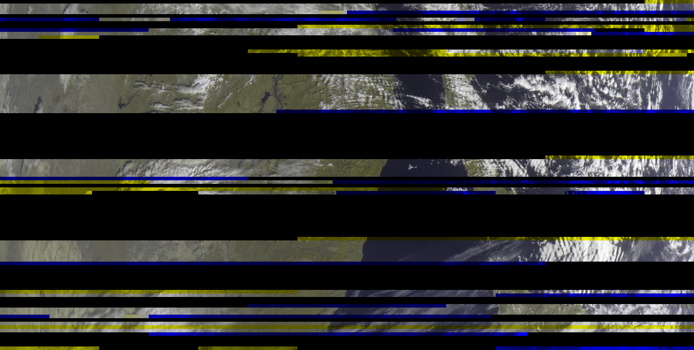
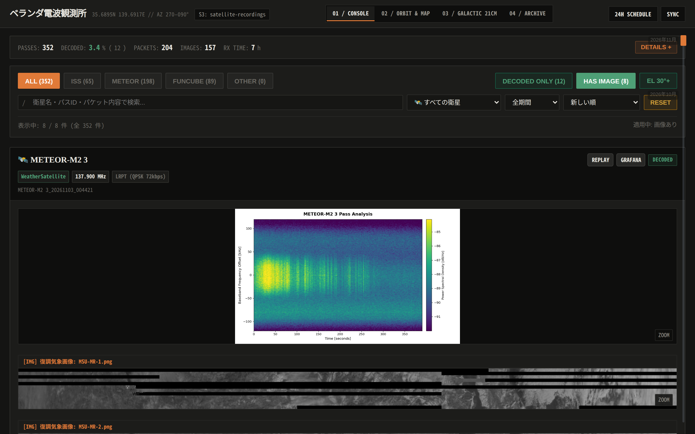
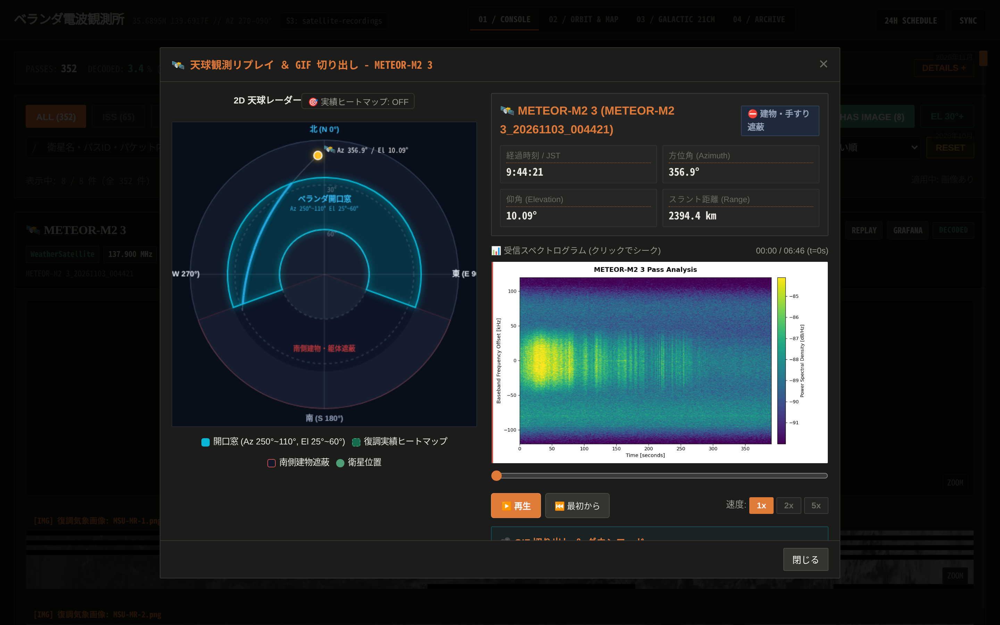
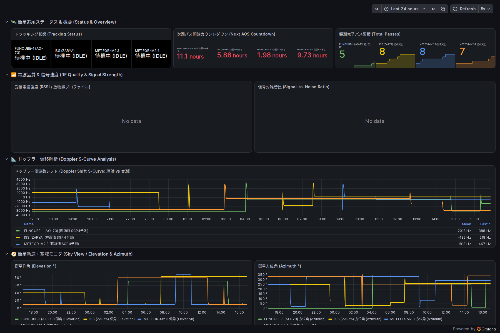
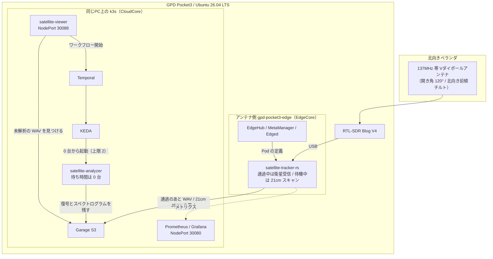

# ベランダ電波観測所

[](https://www.rust-lang.org/)
[](https://www.python.org/)
[](https://kubeedge.io/)
[](https://k3s.io/)
[](https://www.rtl-sdr.com/rtl-sdr-blog-v4-users-guide/)
[](https://temporal.io/)

> 東京都の北向きベランダから、RTL-SDR Blog V4 と小型 PC（GPD Pocket3）で電波を受信し、衛星画像やテレメトリの計測値、復号した文字列まで確認するためのリポジトリです。
> Antigravity でまず動くものを作り、無線工学やデジタル信号処理（DSP）の理論は後から追いかけながら進めています。

マンションのベランダに個人用の地上局を組む、通称「ベランダ天文学」のプロジェクトです。受信できたかどうかの判断は、S メーターの振れではなく「画像、テレメトリ、復号文字列といった中身が見えること」に置いています（判定基準は [docs/qa/10_observation_metrics_and_heuristic_evaluation.md](docs/qa/10_observation_metrics_and_heuristic_evaluation.md)）。

---

## 観測成果（気象衛星 METEOR-M2 高解像度 LRPT 画像）

北向きベランダの Vダイポールアンテナ（開き角 120°、エレメント長約 53cm）と RTL-SDR Blog V4 で受信し、自動解析パイプラインで復調したロシアの極軌道気象衛星 METEOR-M2 の気象画像です。AVHRR の自然色風マルチスペクトル合成で、解像度は 1568 × 792 ピクセルあります。



3 分以上 OQPSK シンボル同期が切れずに保てたおかげで、中央を南北に走る間宮海峡と樺太がはっきり写りました。西側には初雪を被ったロシア極東や中国東北部の山脈とアムール川水系、東側には北海道東方沖から千島列島へ渦を巻く低気圧の雲海が広がっています。復調の仕組みや DSP パイプラインを直した経緯は [docs/qa/21_meteor_lrpt_reception_diagnosis_and_dsp_remediation.md](docs/qa/21_meteor_lrpt_reception_diagnosis_and_dsp_remediation.md) にまとめました。

---

## 観測ビューア & 監視ダッシュボード

### 観測結果ビューア（`satellite-viewer` / NodePort 30088）

[DESIGN.md](DESIGN.md) に沿った黒鉛色の計器盤 UI と 4 つのワークスペースで構成したビューアです。パスごとの音声やスペクトログラム、復調画像、軌道予測、銀河 21cm 分光データをブラウザから確認できます。

| 観測結果ダッシュボード | 天球観測リプレイと実績ヒートマップ |
| :---: | :---: |
|  |  |

ワークスペースは用途ごとに 4 つに分かれています。

- `01 / CONSOLE` では、上部の統計バーやカテゴリと状態のフィルタ、次のベストパス表示に加えて、選んだパスの復号画像や宇宙機テレメトリ HUD、スペクトログラム同期リプレイ、GIF 書き出しをその場で展開します。最接近時刻 TCA や最大仰角、ベランダ開口角、ドップラー実測による TCA 補正値の横にある ⓘ をタップすると、物理の解説が読めます（[docs/qa/29_viewer_geek_telemetry_and_physics_tooltips.md](docs/qa/29_viewer_geek_telemetry_and_physics_tooltips.md)）。
- `02 / ORBIT & MAP` は軌道予測と電波伝搬の画面で、過去の実績をもとにベイズ確率モデルで精度を更新する通過予測カレンダーと、世界地図上のフットプリントや電波伝搬のアニメーションを出します。
- `03 / GALACTIC 21CM` では、衛星を待っている間に実行した 21cm 水素線ドリフトスキャン（1420.406 MHz ON と 1423.000 MHz OFF の周波数スイッチング）の視線速度スペクトルと銀河俯瞰図を見られます（[docs/qa/33_milky_way_scale_and_21cm_spectroscopy_interpretation.md](docs/qa/33_milky_way_scale_and_21cm_spectroscopy_interpretation.md)）。
- `04 / ARCHIVE` は Garage S3 バケットの統計確認と、フルバックアップやリストアの操作用です。

### リアルタイム監視ダッシュボード（Grafana / NodePort 30080）

Prometheus と連携して、衛星通過中の受信状態や GPD Pocket3 本体のリソースを監視しています。



軌道計算から出したドップラー偏移の理論カーブと受信信号の電力重心（実測値）の突き合わせや、パス中の受信電波強度（RSSI）の変化、さらに KubeEdge 経由で集めたアンテナ側ノード `gpd-pocket3-edge` の CPU とメモリ使用量をひとつの画面で追えます。

---

## システムアーキテクチャ & 観測環境

### 観測地と見通し

北極上空から日本へ近づく極軌道の衛星は、このベランダの正面（北向き）に入ります。

| 項目 | 条件・諸元 |
| :--- | :--- |
| **観測地** | 東京都（広域代表値: 北緯 35.6895、東経 139.6917、標高 30 m） |
| **アンテナ** | 北向きベランダ。137MHz 帯 Vダイポールアンテナ（エレメント長約 53cm、開き角 120°、北向き前傾チルト設置） |
| **見通せる範囲** | 方位およそ \(270^\circ\)（西）から北を経て \(90^\circ\)（東） |
| **遮られる範囲** | 南から南西。建物の鉄筋コンクリートで覆われ、地平線近くの衛星は大きく減衰 |

> [!NOTE]
> 観測対象の選定と背景
> - 気象衛星は、かつて米国の NOAA が送信していたアナログの APT 放送が停波したため、ロシアの極軌道気象衛星 Meteor-M のデジタル画像放送（LRPT）を狙っています。
> - 太陽は東から南を通って西へ沈むため、南側を建物に遮られる北向きベランダは太陽電波の直接受信に向きません。以前試した `solar-station` のコードだけ残してあります。
> - 21cm 中性水素線については、`satellite-tracker-rs` が次の好条件パスまで 30 秒以上空いている間に 1420.406 MHz ON と 1423.000 MHz OFF を切り替えるドリフトスキャンを回し、結果を Garage S3 の `galactic/` に保存しています。低仰角パスを足切りして銀河観測を優先する Pass Gating も入っており、理論式と背景は [docs/02_radio_astronomy_guide.md](docs/02_radio_astronomy_guide.md) に整理しました。

### 動いている場所（1台にまとめた KubeEdge）

受信機を繋いだ GPD Pocket3 に Ubuntu 26.04 LTS を直接入れ、CloudCore 側の軽量な Kubernetes（[k3s](https://docs.k3s.io/)）と、[KubeEdge](https://kubeedge.io/docs/architecture/) のアンテナ側ノードである EdgeCore を 1 台の PC に同居させています（1 クラスタ、2 論理ノード）。



| コンポーネント | 役割・状態 | 稼働場所 |
| :--- | :--- | :--- |
| `satellite-tracker-rs` | 衛星通過中は受信・Garage へ転送、待機中は銀河 21cm ドリフトスキャンを実行 | アンテナ側 Pod (`gpd-pocket3-edge`) |
| Garage / Temporal / KEDA / `satellite-analyzer` | オブジェクトストレージ、イベント駆動ワークフロー、オンデマンド解析 | 同じ PC 上の Kubernetes |
| `satellite-viewer` | 統合ダッシュボード（`CONSOLE` / `ORBIT & MAP` / `GALACTIC 21CM` / `ARCHIVE`）とワークフロー自動起動（NodePort 30088） | 同じ PC 上の Kubernetes |
| `kubeedge-metrics-proxy` | アンテナ側コンテナの CPU・メモリ使用量を Prometheus へ中継 | アンテナ側 |
| Prometheus / Grafana | 監視ダッシュボード（NodePort 30080） | 同じ PC 上の Kubernetes |

アーキテクチャの詳細は [docs/03_system_architecture.md](docs/03_system_architecture.md)、エッジ・クラウド間の通信メカニズムは [docs/qa/13_kubeedge_architecture_and_edge_cloud_communication.md](docs/qa/13_kubeedge_architecture_and_edge_cloud_communication.md) を参照してください。

---

## ハードウェア要件

受信機には RTL-SDR Blog V4 を使っています。仕様の一次情報は [RTL-SDR Blog V4 Users Guide](https://www.rtl-sdr.com/rtl-sdr-blog-v4-users-guide/) と [rtlsdrblog/rtl-sdr-blog GitHub](https://github.com/rtlsdrblog/rtl-sdr-blog) にあります。

| 項目 | 仕様 |
| :--- | :--- |
| ADC | Realtek RTL2832U（8-bit） |
| チューナー | Rafael Micro R828D |
| 受信周波数範囲 | 500 kHz 〜 1.76 GHz（HF 帯は内蔵アップコンバータ使用） |
| 推奨サンプリングレート | 2.4 MSPS まで安定動作 |
| 周波数安定度 (TCXO) | 1 ppm |
| Bias-T | 4.5 V（ソフトウェア制御で ON / OFF 可能） |
| アンテナ端子 | SMA メス（50 Ω） |

> [!IMPORTANT]
> 衛星受信アンテナ（Vダイポール）のセッティング
> 137MHz 帯（気象衛星 Meteor-M 等）に共振させた Vダイポールアンテナ（片側エレメント長約 53cm、開き角 120°）を置いています。開き角を 120° にするとインピーダンスが約 50 Ω に近づき、真上の利得ヌル（死角）も消えます。北向きベランダでは、北側の空（仰角約 60°）を見上げる向きに前傾チルトさせて固定しています（[docs/qa/22_v_dipole_antenna_electromagnetics_and_orientation_tuning.md](docs/qa/22_v_dipole_antenna_electromagnetics_and_orientation_tuning.md)）。初期確認で室外機の天板に垂直ホイップアンテナを載せたときの手順は [docs/05_getting_started.md](docs/05_getting_started.md) に残っています。

---

## リポジトリ構成要素

| パス | 役割 |
| :--- | :--- |
| `apps/satellite-tracker-rs` | アンテナ側の追尾（Rust）。北向き見通し角と Pass Gating を判定し、衛星受信・21cm スキャン結果を Garage へアップロード |
| `apps/satellite-analyzer` | Temporal の解析ワーカー（Python）。パケット・画像・生 IQ の復号およびスペクトログラム生成 |
| `apps/satellite-viewer` | 観測結果ビューア（Python/Flask）。4 ワークスペース統合 UI と未解析録音のワークフロー起動（NodePort 30088） |
| `apps/kubeedge-metrics-proxy` | アンテナ側コンテナのリソースメトリクスを Prometheus へ中継 |
| `apps/satellite-tracker` | アンテナ側追尾のプロトタイプ実装（Python 版） |
| `apps/ground-station` | Rust の地上局クレート（通過予測、SGP4 軌道計算、ドップラー計算、復調、`solar-station`） |
| `apps/seestar-plan` | スマート望遠鏡 Seestar 向けの天体観測計画・気象/空況ダッシュボード |
| `infrastructure/kubeedge` | k3s および KubeEdge（CloudCore / EdgeCore）のマニフェスト |
| `infrastructure/monitoring` | kube-prometheus-stack（Prometheus / Grafana） |
| `infrastructure/storage/garage` | Garage S3 ストレージのマニフェスト |
| `infrastructure/apps` | Temporal, Tracker, Analyzer, Seestar Plan のデプロイ定義 |
| `infrastructure/viewer` / `keda` / `registry` | Viewer、KEDA オートスケーリング、ローカルコンテナレジストリの定義 |
| `DESIGN.md` | `satellite-viewer` 統合ダッシュボードのデザインシステム・UI 実装規約 |
| `docs/qa/` | 軌道力学、DSP、復調、KubeEdge 等の技術解説アーカイブ |
| `docs/articles/` | 連載「ベランダ電波観測所」の執筆原稿 |

### 追尾対象衛星
- `satellite-tracker-rs` 標準設定（`DEFAULT_TARGETS`）は、ISS (ZARYA)（145.825 MHz APRS）、METEOR-M2 3（137.900 MHz LRPT）、METEOR-M2 4（137.900 MHz LRPT）、FUNCUBE-1 (AO-73)（145.935 MHz BPSK）の 4 機です。
- `ground-station` 側には、XW-2A、CAS-4A、UmKA-1、SONATE-2、SO-50 なども定義してあります。

---

## クイックスタート

### 1. V4 対応ドライバのセットアップ（Ubuntu）

Ubuntu 標準の `rtl-sdr` パッケージは旧型の V3（R820T）向けです。V4（R828D チューナー）で受信するには、公式ドライバをソースからビルドします（未導入の場合は `[R82XX] PLL not locked!` が発生し同調できません）。

```bash
sudo apt update
sudo apt install -y build-essential cmake libusb-1.0-0-dev git pkg-config

git clone https://github.com/rtlsdrblog/rtl-sdr-blog.git
cd rtl-sdr-blog
mkdir build && cd build
cmake ../ -DINSTALL_UDEV_RULES=ON
make
sudo make install
sudo ldconfig

# カーネル標準の DVB ドライバと競合しないようブラックリスト登録
echo 'blacklist dvb_usb_rtl28xxu' | sudo tee /etc/modprobe.d/blacklist-dvb_usb_rtl28xxu.conf
sudo udevadm control --reload-rules
sudo udevadm trigger

# 認識確認
rtl_test -t
```

`Found Rafael Micro R828D tuner` と表示されれば正常に認識されています（末尾の `No E4000 tuner found, aborting.` は E4000 チューナー向けのテスト結果であり正常です）。

KubeEdge コンテナから受信機にアクセスするための udev 設定およびデバイスパススルーの詳細は [docs/setup/03_kubeedge_deployment_guide.md](docs/setup/03_kubeedge_deployment_guide.md) を参照してください。

### 2. KubeEdge 観測パイプラインの確認

クラスタの構築手順は [infrastructure/kubeedge/README.md](infrastructure/kubeedge/README.md) にあります。

```bash
kubectl get nodes
kubectl get pods -A
```

ブラウザから各 NodePort サービスを開けます。
- 観測結果ビューア（`satellite-viewer`）：`http://<Pocket3-IP>:30088`
- リアルタイム監視ダッシュボード（Grafana）：`http://<Pocket3-IP>:30080`

アンテナ側の追尾ロジックは `apps/satellite-tracker-rs` に、解析パイプラインの設計仕様は [docs/superpowers/specs/2026-10-10-event-driven-satellite-analysis-pipeline-design.md](docs/superpowers/specs/2026-10-10-event-driven-satellite-analysis-pipeline-design.md) に置いてあります。

---

## ドキュメント案内

運用しながら調べた無線工学や軌道力学、DSP、分散インフラのメモを `docs/` 以下にためています。

### 運用とインフラ
- [DESIGN.md](DESIGN.md)：統合ダッシュボード（黒鉛系計器盤 UI）のデザインシステムと実装規約
- [docs/03_system_architecture.md](docs/03_system_architecture.md)：1 台に集約した KubeEdge とイベント駆動パイプラインの全体像
- [docs/setup/03_kubeedge_deployment_guide.md](docs/setup/03_kubeedge_deployment_guide.md)：Ubuntu 26.04 への k3s と EdgeCore セットアップ手順
- [infrastructure/kubeedge/README.md](infrastructure/kubeedge/README.md)：クラスタ構成とインフラ運用の目次
- [docs/04_qa.md](docs/04_qa.md)：技術質疑応答・トピック別インデックス（全アーカイブへの入口）
- [docs/qa/32_satellite_viewer_performance_optimization_and_latency.md](docs/qa/32_satellite_viewer_performance_optimization_and_latency.md)：`satellite-viewer` の並列 I/O や暖機、レスポンス最適化

### 電波天文学・DSP・軌道力学の理論
- [docs/00_glossary.md](docs/00_glossary.md)：SDR、無線工学、電波天文学の基本用語集
- [docs/01_math_and_dsp_cheatsheet.md](docs/01_math_and_dsp_cheatsheet.md)：IQ 信号、FFT、窓関数、雑音解析の数式集
- [docs/02_radio_astronomy_guide.md](docs/02_radio_astronomy_guide.md)：21cm 水素線放射機構、天球座標変換、銀河回転曲線の導出
- [docs/qa/10_observation_metrics_and_heuristic_evaluation.md](docs/qa/10_observation_metrics_and_heuristic_evaluation.md)：観測成否の判定基準とヒューリスティック評価
- [docs/qa/21_meteor_lrpt_reception_diagnosis_and_dsp_remediation.md](docs/qa/21_meteor_lrpt_reception_diagnosis_and_dsp_remediation.md)：METEOR-M2 LRPT 受信診断と DSP 最適化
- [docs/qa/29_viewer_geek_telemetry_and_physics_tooltips.md](docs/qa/29_viewer_geek_telemetry_and_physics_tooltips.md)：地上局テレメトリと物理解説ツールチップ
- [docs/qa/30_iss_raw_iq_and_doppler_cancellation_dsp.md](docs/qa/30_iss_raw_iq_and_doppler_cancellation_dsp.md)：ISS 生 IQ 録音とドップラーキャンセル DSP
- [docs/qa/33_milky_way_scale_and_21cm_spectroscopy_interpretation.md](docs/qa/33_milky_way_scale_and_21cm_spectroscopy_interpretation.md)：天の川銀河のスケールと 21cm 分光スペクトルの読み解き
- [docs/qa/34_dsp_demodulation_optimization_and_threshold_theory.md](docs/qa/34_dsp_demodulation_optimization_and_threshold_theory.md)：復調 DSP 最適化としきい値理論

### 連載記事（Qiita）と初期記録
- [docs/articles/qiita_rtl_sdr_v4_getting_started.md](docs/articles/qiita_rtl_sdr_v4_getting_started.md)：#1 WSL2 と RTL-SDR Blog V4 で始める電波受信
- [docs/articles/qiita_kubeedge_satellite_tracker.md](docs/articles/qiita_kubeedge_satellite_tracker.md)：#2 ベランダ地上局を KubeEdge でエッジ化する
- [docs/articles/qiita_kubeedge_pipeline.md](docs/articles/qiita_kubeedge_pipeline.md)：#3 イベント駆動型衛星解析パイプラインの構築
- [docs/05_getting_started.md](docs/05_getting_started.md)：初日に WSL2 で FM ラジオを復調した記録

---

## ディレクトリ構成

```text
.
├── README.md
├── DESIGN.md                          # 統合ダッシュボード UI/UX 設計指針
├── GEMINI.md
├── Cargo.toml                         # Cargo ワークスペース定義
├── docker-compose.yaml                # ローカル検証用構成
├── apps/
│   ├── satellite-tracker-rs/          # アンテナ側の衛星追尾 & 21cm スキャン（Rust）
│   ├── satellite-analyzer/            # Temporal 解析ワーカー（Python）
│   ├── satellite-viewer/              # 観測結果ビューア Web アプリケーション
│   ├── kubeedge-metrics-proxy/        # エッジメトリクス Prometheus 中継エージェント
│   ├── satellite-tracker/             # アンテナ側追尾（Python 初期実装）
│   ├── ground-station/                # Rust 地上局クレート & solar-station
│   └── seestar-plan/                  # Seestar 天体観測計画アプリ
├── infrastructure/                    # k3s, KubeEdge, Garage, Temporal, KEDA, Viewer, 監視
├── docs/
│   ├── 00_glossary.md                 # 用語集
│   ├── 01_math_and_dsp_cheatsheet.md  # 数学・DSP チートシート
│   ├── 02_radio_astronomy_guide.md    # 電波天文学ガイド（21cm線）
│   ├── 03_system_architecture.md      # システムアーキテクチャ詳細
│   ├── 04_qa.md                       # Q&A インデックス
│   ├── 05_getting_started.md          # 初期導入手順（WSL2）
│   ├── qa/                            # 技術トピック別 Q&A 詳細
│   ├── articles/                      # 連載記事原稿
│   └── setup/                         # セットアップガイド
└── scripts/                           # 各種ユーティリティスクリプト
```
