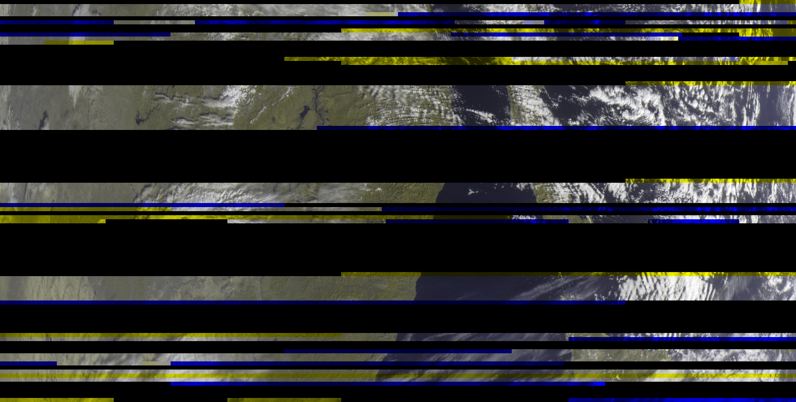
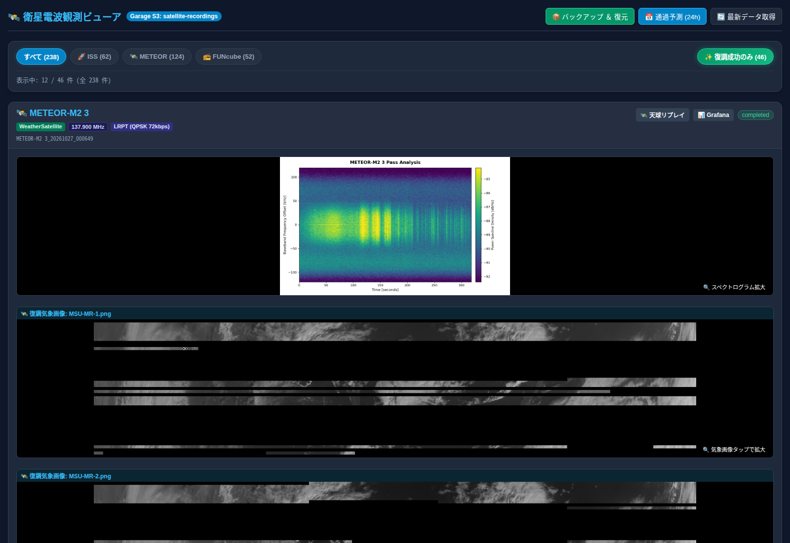
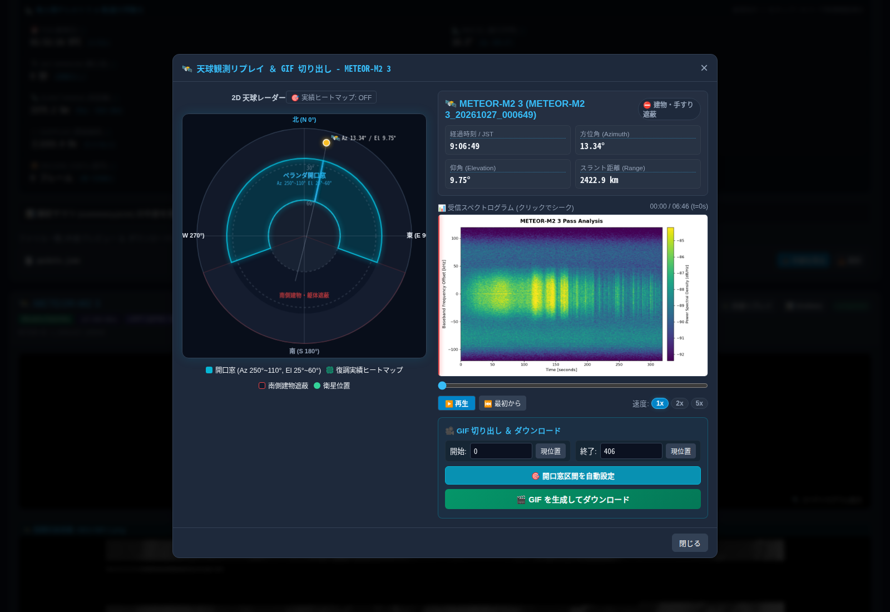
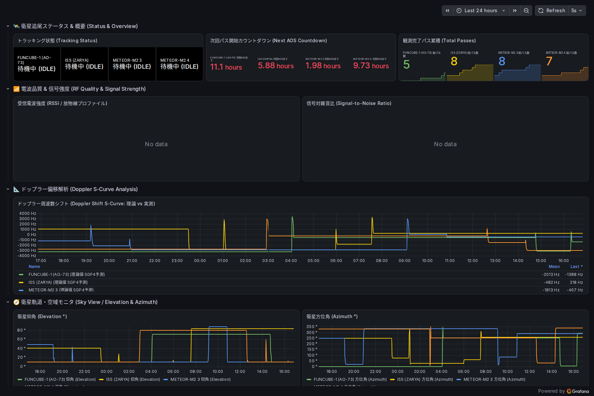

# ベランダ電波観測所

[](https://www.rust-lang.org/)
[](https://www.python.org/)
[](https://kubeedge.io/)
[](https://k3s.io/)
[](https://www.rtl-sdr.com/rtl-sdr-blog-v4-users-guide/)
[](https://temporal.io/)

> 東京都の北向きベランダから、RTL-SDR Blog V4 と小型 PC（GPD Pocket3）で電波を受信し、**衛星画像、テレメトリ（計測値）、復号した文字列**まで確認するためのリポジトリです。
> **Antigravity** を使ってまずは動くものを作り、無線工学やデジタル信号処理（DSP）の理論を後追いで勉強しながら進めています。

マンションのベランダから、個人の地上局を動かすプロジェクト（通称: ベランダ天文学）です。受信できたかどうかは「結果の中身が見えること（画像、テレメトリ、復号文字列）」で判定します（判定基準: [docs/qa/10_observation_metrics_and_heuristic_evaluation.md](docs/qa/10_observation_metrics_and_heuristic_evaluation.md)）。

---

## 観測成果（気象衛星 METEOR-M2 高解像度 LRPT 画像）

東京都の北向きベランダに設置した Vダイポールアンテナ（開き角 120°、エレメント長約 53cm）と RTL-SDR Blog V4 で受信し、自動解析パイプラインによって復調したロシアの極軌道気象衛星 **METEOR-M2** の高解像度気象写真（AVHRR 自然色風マルチスペクトル合成、1568 × 792 ピクセル）です。



3 分間以上の安定した OQPSK シンボル同期を維持し、画面中央を南北に貫く**間宮海峡**と**樺太（サハリン）**、西側に広がる**ロシア極東・中国東北部の大陸（初雪で冠雪した山脈やアムール川水系）**、そして東側の**北海道東方沖・千島列島に渦巻く低気圧の雲海**が鮮明に記録されました。復調メカニズムや DSP パイプラインの改善経緯は [docs/qa/21_meteor_lrpt_reception_diagnosis_and_dsp_remediation.md](docs/qa/21_meteor_lrpt_reception_diagnosis_and_dsp_remediation.md) にあります。

---

## 観測ビューア & 監視ダッシュボード

### 観測結果ビューア（`satellite-viewer` / NodePort 30088）

録音されたパスごとの音声・スペクトログラム、復調された気象画像、地上局テレメトリ（最接近時刻 TCA、最大仰角、開口角）をブラウザから確認できます。

| 観測結果ダッシュボード | 天球観測リプレイ ＆ 実績ヒートマップ |
| :---: | :---: |
|  |  |

- **地上局テレメトリ & 軌道力学諸元**: 通過ごとの最接近時刻 TCA、最大仰角、ベランダ開口角、ドップラー実測 TCA 補正値を即座に算出。各項目の ⓘ をタップすると無線工学・軌道力学の物理解説が表示されます（詳細は [docs/qa/29_viewer_geek_telemetry_and_physics_tooltips.md](docs/qa/29_viewer_geek_telemetry_and_physics_tooltips.md)）。
- **天球観測リプレイ & GIF 切り出し**: 北向きベランダの見通し範囲（\(270^\circ \sim 90^\circ\)）と観測実績ヒートマップを天球上に重畳し、衛星の通過軌跡をシミュレーション再生および GIF エクスポートできます。

### リアルタイム監視ダッシュボード（`Grafana` / NodePort 30080）

Prometheus と連携し、衛星通過中の物理量や小型 PC（GPD Pocket3）のリソースを常時監視します。



- **ドップラー偏移 S 字カーブ**: 軌道計算による理論値周波数シフトと、受信信号の電力重心（実測値）をリアルタイムに比較。
- **受信電波強度（RSSI）**: パス中の信号強度プロファイルを可視化。
- **エッジノード監視**: GPD Pocket3（アンテナ側 `gpd-pocket3-edge`）の CPU・メモリ消費量や Pod 別リソースを KubeEdge 経由で常時メトリクス収集。

---

## システムアーキテクチャ & 観測環境

### 観測地と見通し

北極上空から日本へ近づく極軌道の衛星は、このベランダの正面（北向き）に入ります。

| 項目 | 条件・諸元 |
| :--- | :--- |
| **観測地** | 東京都（広域代表値: 北緯 35.6895、東経 139.6917、標高 30 m） |
| **アンテナ** | 北向きベランダ。137MHz 帯 Vダイポールアンテナ（エレメント長約 53cm、開き角 120°、北向き前傾チルト設置） |
| **見通せる範囲** | 方位およそ \(270^\circ\)（西）から北を経て \(90^\circ\)（東） |
| **遮られる範囲** | 南から南西。建物の鉄筋コンクリートで覆われ、地平線近くの衛星は大きく減衰 |

> [!NOTE]
> **観測対象の選定と背景**
> - **気象衛星**: かつて米国の NOAA が送信していた APT（アナログ放送）は停波しているため、本観測所ではロシアの極軌道気象衛星 Meteor-M の LRPT（デジタル画像放送）を受信しています。
> - **太陽電波**: 太陽は東から南を通って西へ沈むため、南側を建物が遮る北向きベランダでは直接受信に向きません（コード `solar-station` は残しています）。
> - **21cm 中性水素線**: 常時分光して貯める処理（生 IQ 1 秒積算）は本リポジトリでは稼働していませんが、理論式と背景は [docs/02_radio_astronomy_guide.md](docs/02_radio_astronomy_guide.md) に参照用として整理しています。

### 動いている場所（1台にまとめた KubeEdge）

受信機を接続した **GPD Pocket3** 上に **Ubuntu 26.04 LTS を直接インストール**し、軽量な Kubernetes（[k3s](https://docs.k3s.io/)。CloudCore 側）と、[KubeEdge](https://kubeedge.io/docs/architecture/) の EdgeCore（アンテナ側ノード）を 1 台の PC でまとめて稼働させています（1 クラスタ / 2 論理ノード）。


| コンポーネント | 役割・状態 | 稼働場所 |
| :--- | :--- | :--- |
| `satellite-tracker-rs` | 衛星通過中のみ受信機を開き、48 kHz WAV を録音・Garage へ転送 | アンテナ側 Pod (`gpd-pocket3-edge`) |
| Garage / Temporal / KEDA / `satellite-analyzer` | オブジェクトストレージ、イベント駆動ワークフロー、オンデマンド解析 | 同じ PC 上の Kubernetes |
| `satellite-viewer` | 観測結果の閲覧、TCA/仰角/GIF 切り出し、ワークフロー自動起動（NodePort 30088） | 同じ PC 上の Kubernetes |
| `kubeedge-metrics-proxy` | アンテナ側コンテナの CPU・メモリ使用量を Prometheus へ中継 | アンテナ側 |
| Prometheus / Grafana | 監視ダッシュボード（NodePort 30080） | 同じ PC 上の Kubernetes |

アーキテクチャの詳細は [docs/03_system_architecture.md](docs/03_system_architecture.md)、エッジ・クラウド間の通信メカニズムは [docs/qa/13_kubeedge_architecture_and_edge_cloud_communication.md](docs/qa/13_kubeedge_architecture_and_edge_cloud_communication.md) を参照してください。

---

## ハードウェア要件

受信機には **RTL-SDR Blog V4** を使用します。
一次情報は [RTL-SDR Blog V4 Users Guide](https://www.rtl-sdr.com/rtl-sdr-blog-v4-users-guide/) および [rtlsdrblog/rtl-sdr-blog GitHub](https://github.com/rtlsdrblog/rtl-sdr-blog) を参照してください。

| 項目 | 仕様 |
| :--- | :--- |
| **ADC** | Realtek RTL2832U（8-bit） |
| **チューナー** | Rafael Micro R828D |
| **受信周波数範囲** | 500 kHz 〜 1.76 GHz（HF 帯は内蔵アップコンバータ使用） |
| **推奨サンプリングレート** | 2.4 MSPS まで安定動作 |
| **周波数安定度 (TCXO)** | 1 ppm |
| **Bias-T** | 4.5 V（ソフトウェア制御で ON/OFF 可能） |
| **アンテナ端子** | SMA メス（50 Ω） |

> [!IMPORTANT]
> **衛星受信アンテナ（Vダイポール）のセッティング**
> 観測アンテナには、137MHz 帯（気象衛星 Meteor-M 等）に共振させた **Vダイポールアンテナ（片側エレメント長約 53cm、開き角 120°）** を使用しています。開き角を 120° にすることでインピーダンスが約 50 Ω に整合し、天頂付近の利得ヌル（死角）を解消します。北向きベランダでは、北側の空（仰角約 60°）を見上げるように前傾チルトさせて設置しています（詳細は [docs/qa/22_v_dipole_antenna_electromagnetics_and_orientation_tuning.md](docs/qa/22_v_dipole_antenna_electromagnetics_and_orientation_tuning.md)）。初期確認用の垂直ホイップアンテナ（室外機天板吸着）の手順は [docs/05_getting_started.md](docs/05_getting_started.md) を参照してください。

---

## リポジトリ構成要素

| パス | 役割 |
| :--- | :--- |
| `apps/satellite-tracker-rs` | アンテナ側の追尾（Rust）。北向き見通し角を判定し、通過中のみ 48 kHz WAV を録音して Garage へアップロード |
| `apps/satellite-analyzer` | Temporal の解析ワーカー（Python）。パケットの復号およびスペクトログラム生成 |
| `apps/satellite-viewer` | 観測結果ビューア（Python/Flask）。未解析の録音を見つけてワークフローを開始（NodePort 30088） |
| `apps/kubeedge-metrics-proxy` | アンテナ側コンテナのリソースメトリクスを Prometheus へ中継 |
| `apps/satellite-tracker` | アンテナ側追尾のプロトタイプ実装（Python 版） |
| `apps/ground-station` | Rust の地上局クレート（通過予測、SGP4 軌道計算、ドップラー計算、復調、`solar-station`） |
| `infrastructure/kubeedge` | k3s および KubeEdge（CloudCore / EdgeCore）のマニフェスト |
| `infrastructure/monitoring` | kube-prometheus-stack（Prometheus / Grafana） |
| `infrastructure/storage/garage` | Garage S3 ストレージのマニフェスト |
| `infrastructure/apps` | Temporal, Tracker, Analyzer のデプロイ定義 |
| `docs/qa/` | 軌道力学、DSP、復調、KubeEdge 等の技術解説アーカイブ |
| `docs/articles/` | 連載「ベランダ電波観測所」の執筆原稿 |

### 追尾対象衛星
- `satellite-tracker-rs` 標準設定: **ISS**（145.825 MHz APRS）、**METEOR-M2 4**（137.100 MHz LRPT）、**FUNcube-1**
- `ground-station` 定義済み衛星: XW-2A、CAS-4A、UmKA-1、SONATE-2、SO-50 ほか

---

## クイックスタート

### 1. V4 対応ドライバのセットアップ（Ubuntu）

Ubuntu 標準の `rtl-sdr` パッケージは旧型の V3（R820T）向けです。V4（R828D チューナー）で受信するには、公式ドライバをソースからビルドします（未導入の場合は `[R82XX] PLL not locked!` が発生し同調できません）。

```bash
sudo apt update
sudo apt install -y build-essential cmake libusb-1.0-0-dev git pkg-config

git clone https://github.com/rtlsdrblog/rtl-sdr-blog.git
cd rtl-sdr-blog
mkdir build && cd build
cmake ../ -DINSTALL_UDEV_RULES=ON
make
sudo make install
sudo ldconfig

# カーネル標準の DVB ドライバと競合しないようブラックリスト登録
echo 'blacklist dvb_usb_rtl28xxu' | sudo tee /etc/modprobe.d/blacklist-dvb_usb_rtl28xxu.conf
sudo udevadm control --reload-rules
sudo udevadm trigger

# 認識確認
rtl_test -t
```

`Found Rafael Micro R828D tuner` と表示されれば正常に認識されています（末尾の `No E4000 tuner found, aborting.` は E4000 チューナー向けのテスト結果であり正常です）。

KubeEdge コンテナから受信機にアクセスするための udev 設定およびデバイスパススルーの詳細は [docs/setup/03_kubeedge_deployment_guide.md](docs/setup/03_kubeedge_deployment_guide.md) を参照してください。

### 2. KubeEdge 観測パイプラインの確認

クラスタの構築手順は [infrastructure/kubeedge/README.md](infrastructure/kubeedge/README.md) にあります。

```bash
kubectl get nodes
kubectl get pods -A
```

ブラウザから各 NodePort サービスへアクセスします：
- **観測結果ビューア (`satellite-viewer`)**: `http://<Pocket3-IP>:30088`
- **リアルタイム監視ダッシュボード (`Grafana`)**: `http://<Pocket3-IP>:30080`

アンテナ側の追尾ロジックは `apps/satellite-tracker-rs`、解析パイプラインの設計仕様は [docs/superpowers/specs/2026-10-10-event-driven-satellite-analysis-pipeline-design.md](docs/superpowers/specs/2026-10-10-event-driven-satellite-analysis-pipeline-design.md) に記載されています。

---

## ドキュメント案内（Documentation Map）

本リポジトリでは、無線工学・軌道力学・DSP・分散インフラの知見を体系的にドキュメント化しています。

### 運用とインフラ
- [docs/03_system_architecture.md](docs/03_system_architecture.md) — 1 台に集約した KubeEdge とイベント駆動パイプラインの全体像
- [docs/setup/03_kubeedge_deployment_guide.md](docs/setup/03_kubeedge_deployment_guide.md) — Ubuntu 26.04 への k3s & EdgeCore セットアップ手順
- [infrastructure/kubeedge/README.md](infrastructure/kubeedge/README.md) — クラスタ構成とインフラ運用の目次
- [docs/04_qa.md](docs/04_qa.md) — 技術質疑応答・トピック別インデックス（全アーカイブへの入口）

### 電波天文学・DSP・軌道力学の理論
- [docs/00_glossary.md](docs/00_glossary.md) — SDR、無線工学、電波天文学の基本用語集
- [docs/01_math_and_dsp_cheatsheet.md](docs/01_math_and_dsp_cheatsheet.md) — IQ 信号、FFT、窓関数、雑音解析の数式集
- [docs/02_radio_astronomy_guide.md](docs/02_radio_astronomy_guide.md) — 21cm 水素線放射機構、天球座標変換、銀河回転曲線の導出
- [docs/qa/10_observation_metrics_and_heuristic_evaluation.md](docs/qa/10_observation_metrics_and_heuristic_evaluation.md) — 観測成否の判定基準とヒューリスティック評価
- [docs/qa/21_meteor_lrpt_reception_diagnosis_and_dsp_remediation.md](docs/qa/21_meteor_lrpt_reception_diagnosis_and_dsp_remediation.md) — METEOR-M2 LRPT 受信診断と DSP 最適化
- [docs/qa/29_viewer_geek_telemetry_and_physics_tooltips.md](docs/qa/29_viewer_geek_telemetry_and_physics_tooltips.md) — 地上局テレメトリと物理解説ツールチップ

### 連載記事（Qiita）と初期記録
- [docs/articles/qiita_rtl_sdr_v4_getting_started.md](docs/articles/qiita_rtl_sdr_v4_getting_started.md) — #1 WSL2 と RTL-SDR Blog V4 で始める電波受信
- [docs/articles/qiita_kubeedge_satellite_tracker.md](docs/articles/qiita_kubeedge_satellite_tracker.md) — #2 ベランダ地上局を KubeEdge でエッジ化する
- [docs/articles/qiita_kubeedge_pipeline.md](docs/articles/qiita_kubeedge_pipeline.md) — #3 イベント駆動型衛星解析パイプラインの構築
- [docs/05_getting_started.md](docs/05_getting_started.md) — 初日に WSL2 で FM ラジオを復調した記録

---

## ディレクトリ構成

```text
.
├── README.md
├── GEMINI.md
├── Cargo.toml                         # Cargo ワークスペース定義
├── apps/
│   ├── satellite-tracker-rs/          # アンテナ側の衛星追尾（Rust）
│   ├── satellite-analyzer/            # Temporal 解析ワーカー（Python）
│   ├── satellite-viewer/              # 観測結果ビューア Web アプリケーション
│   ├── kubeedge-metrics-proxy/        # エッジメトリクス Prometheus 中継エージェント
│   ├── satellite-tracker/             # アンテナ側追尾（Python 初期実装）
│   └── ground-station/                # Rust 地上局クレート & solar-station
├── infrastructure/                    # k3s, KubeEdge, Garage, Temporal, KEDA, 監視
├── docs/
│   ├── 00_glossary.md                 # 用語集
│   ├── 01_math_and_dsp_cheatsheet.md  # 数学・DSP チートシート
│   ├── 02_radio_astronomy_guide.md    # 電波天文学ガイド（21cm線）
│   ├── 03_system_architecture.md      # システムアーキテクチャ詳細
│   ├── 04_qa.md                       # Q&A インデックス
│   ├── 05_getting_started.md          # 初期導入手順（WSL2）
│   ├── qa/                            # 技術トピック別 Q&A 詳細
│   ├── articles/                      # 連載記事原稿
│   └── setup/                         # セットアップガイド
└── scripts/                           # 各種ユーティリティスクリプト
```
