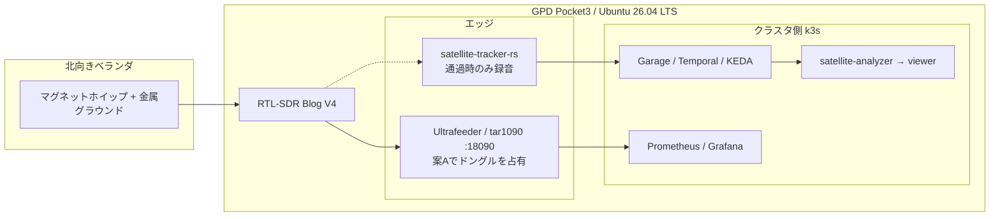

# ベランダ電波観測所

> 東京都の北向きベランダから、RTL-SDR Blog V4 と GPD Pocket3 で電波を受信し、**機影・画像・テレメトリ・復号テキスト**として中身を確認するためのリポジトリです。

マンションのベランダという限られた見通しのなかで、個人の地上局を動かすプロジェクトです。通称はベランダ天文学です。成功の定義は、受信結果の中身が見えることです。基準は [docs/qa/10_observation_metrics_and_heuristic_evaluation.md](docs/qa/10_observation_metrics_and_heuristic_evaluation.md) にあります。

---

## 観測地と見通し

| 項目 | 値 |
| :--- | :--- |
| 観測地 | 東京都（広域代表値: 北緯 35.6895、東経 139.6917、標高 30 m） |
| アンテナ | 北向きベランダ（2026-09-15 移設）。マグネットホイップを室外機などの金属面に吸着 |
| 見通し | 方位およそ \(270^\circ\)（西）から北を経て \(90^\circ\)（東） |
| 遮蔽 | 南〜南西は建物の鉄筋コンクリート。この方向の低仰角パスは減衰が大きい |

北極側から降りてくる極軌道衛星と、北半球側の航空路は、この開口の正面に入ります。太陽は南天（東→南→西）を通るため、このベランダから太陽電波を直視する観測は成立しません。`solar-station` の実装は残していますが、現行の観測対象には入れていません。

NOAA の APT 画像放送は退役しています。気象画像を狙うときは Meteor-M の LRPT を優先します。

---

## 現行フェーズ（案A）

RTL-SDR は 1 本です。衛星受信と ADS-B を同時に同じドングルへ載せると取り合いになります。いまはドングルを ADS-B（1090 MHz）に明け渡し、**機影が見える**ところを先に取ります。

`apps/ground-station/config.toml` の状態:

- `satellites.meteor` / `cubesats` / `iss` は `enabled = false`
- `scheduler.daily_schedule_enabled = false`（朝の衛星スケジュール通知も停止）
- `adsb.enabled = true`
- tar1090 のホスト公開ポートは **18090**（8080 / 8081 は他アプリ、8090 は PocketBase）

衛星の追尾・録音・解析パイプライン（`satellite-tracker-rs`、Garage、Temporal、KEDA、`satellite-analyzer`、`satellite-viewer`）はリポジトリにあります。案Aのあいだは、ドングルを Ultrafeeder が占有します。北寄りの高仰角パスから、対象を 1 つずつ戻す想定です。

---

## 動いているシステムの置き場所

エッジ観測機は **GPD Pocket3（Ubuntu 26.04 LTS、ネイティブ Linux）** です。同じ端末の上で k3s（CloudCore）と KubeEdge EdgeCore を同居させています。論理的には次の 2 層です。

- **エッジ**: アンテナ直下。RTL-SDR v4。通過時だけ狭帯域を録音する `satellite-tracker-rs`。案Aでは Ultrafeeder（readsb + tar1090）が 1090 MHz を常時受信する。
- **クラスタ側**: Garage S3、Temporal、KEDA、`satellite-analyzer`（普段は 0 レプリカ）、`satellite-viewer`、Prometheus / Grafana。

物理的な分析用 PC への分離は、同じマニフェストのまま広げられるようにしてある拡張先です。現行の稼働形態は、この 1 台の上の同居です。

Windows 11 + WSL2 で FM 放送を鳴らした手順は、初日の記録として [docs/05_getting_started.md](docs/05_getting_started.md) に残しています。現行ホストの OS はネイティブの Ubuntu 26.04 LTS です。

全体図は [docs/03_system_architecture.md](docs/03_system_architecture.md)。Edge と Cloud の通信は [docs/qa/13_kubeedge_architecture_and_edge_cloud_communication.md](docs/qa/13_kubeedge_architecture_and_edge_cloud_communication.md)。



---

## リポジトリにあるもの

| パス | 役割 |
| :--- | :--- |
| `apps/ground-station` | Rust の地上局。パス予測、復調、ADS-B 近接通知、メトリクス、VOICEVOX / Discord。`solar-station` バイナリも含む |
| `apps/satellite-tracker` | エッジ追尾の Python 版（先行実装） |
| `apps/satellite-tracker-rs` | エッジ追尾の Rust 版。北向き視界判定、通過時のみ SDR を開き、48 kHz WAV を Garage へ置く |
| `apps/satellite-analyzer` | Temporal ワーカー。パケット復号とスペクトログラム |
| `apps/satellite-viewer` | 録音と解析結果を見る Web ビューア |
| `apps/kubeedge-metrics-proxy` | Edge の cAdvisor メトリクスを Prometheus へ中継 |
| `infrastructure/kubeedge` | k3s と CloudCore / EdgeCore |
| `infrastructure/monitoring` | kube-prometheus-stack |
| `infrastructure/storage/garage` | Garage S3 |
| `infrastructure/apps` | Temporal、tracker、analyzer のマニフェスト |
| `docker-compose.yaml` | 案Aの Ultrafeeder と VOICEVOX |
| `docs/qa/` | 受信幾何、復調、ADS-B、KubeEdge の個別解説 |
| `docs/articles/` | 「ベランダ電波観測所」連載の原稿 |

観測対象の初期値は `apps/satellite-tracker-rs` では ISS（145.825 MHz APRS）、METEOR-M2 4、FUNcube-1 です。`ground-station` の衛星リストはこれに加え XW-2A、CAS-4A、UmKA-1、SONATE-2、SO-50 を持っています。案Aではどちらもドングルを使わない側に回しています。

---

## ハードウェア

RTL-SDR Blog V4 を使います。仕様の一次情報は [RTL-SDR Blog V4 Users Guide](https://www.rtl-sdr.com/rtl-sdr-blog-v4-users-guide/) と [rtlsdrblog/rtl-sdr-blog](https://github.com/rtlsdrblog/rtl-sdr-blog) です。

- ADC: Realtek RTL2832U（8-bit）
- チューナー: Rafael Micro R828D
- 受信範囲: 500 kHz 〜 1.76 GHz（HF は内蔵アップコンバータ）
- 安定して使うサンプリング: 2.4 MSPS まで
- TCXO: 1 ppm
- Bias-T: 4.5 V（ソフトウェアで ON/OFF）
- アンテナ端子: SMA メス（50 Ω）

Ubuntu の標準パッケージ `rtl-sdr` は V3 / R820T 向けです。V4 では公式ドライバを自前ビルドしないと、`[R82XX] PLL not locked!` で周波数にロックできません。

ベランダ側のアンテナは、付属のマグネットホイップを金属面（室外機天板など）に吸着させたモノポールです。金属面がグラウンドプレーンになります。吸着しないと給電点のインピーダンスが合わず、感度が落ちます。

---

## クイックスタート

### 1. V4 対応ドライバ（Ubuntu）

```bash
sudo apt update
sudo apt install -y build-essential cmake libusb-1.0-0-dev git pkg-config

git clone https://github.com/rtlsdrblog/rtl-sdr-blog.git
cd rtl-sdr-blog
mkdir build && cd build
cmake ../ -DINSTALL_UDEV_RULES=ON
make
sudo make install
sudo ldconfig

echo 'blacklist dvb_usb_rtl28xxu' | sudo tee /etc/modprobe.d/blacklist-dvb_usb_rtl28xxu.conf
sudo udevadm control --reload-rules
sudo udevadm trigger

rtl_test -t
```

`Found Rafael Micro R828D tuner` が出れば認識できています。末尾の `No E4000 tuner found, aborting.` は、このコマンドが E4000 用の試験で終わっているだけで、故障ではありません。

KubeEdge 上で Pod からドングルを使うときの udev と blacklist は [docs/setup/03_kubeedge_deployment_guide.md](docs/setup/03_kubeedge_deployment_guide.md) にまとめてあります。

### 2. 案A: ADS-B レーダー

リポジトリ直下で実行します。Ultrafeeder のイメージと環境変数の意味は [sdr-enthusiasts/docker-adsb-ultrafeeder](https://github.com/sdr-enthusiasts/docker-adsb-ultrafeeder) を参照します。地図 UI は [wiedehopf/tar1090](https://github.com/wiedehopf/tar1090) です。

```bash
docker compose up -d ultrafeeder
```

- 地図: `http://localhost:18090`
- 機体 JSON: `http://localhost:18090/data/aircraft.json`

地上局から近接通知の疎通を見るときは、`apps/ground-station` で次を実行します。

```bash
cargo run -- test-adsb -c config.toml
```

受信の物理と tar1090 の構成は [docs/qa/08_adsb_flight_tracking_and_tar1090.md](docs/qa/08_adsb_flight_tracking_and_tar1090.md) です。

### 3. 衛星パイプラインを戻すとき

ドングルを Ultrafeeder から外したうえで、`config.toml` の対象衛星を有効にします。エッジの追尾実装は `apps/satellite-tracker-rs`、解析側の設計は [docs/superpowers/specs/2026-10-10-event-driven-satellite-analysis-pipeline-design.md](docs/superpowers/specs/2026-10-10-event-driven-satellite-analysis-pipeline-design.md) です。北向きベランダで UHF CubeSat を優先する理由は [docs/qa/15_uhf_cubesat_doppler_tracking_and_containerd_pipeline.md](docs/qa/15_uhf_cubesat_doppler_tracking_and_containerd_pipeline.md) にあります。

---

## 資料の読み分け

現行の運用と実装を知るときの入口です。

- [docs/03_system_architecture.md](docs/03_system_architecture.md) — 1 台同居の KubeEdge と、いま載っているワークロード
- [docs/04_qa.md](docs/04_qa.md) — 質疑の索引。個別解説は `docs/qa/`
- [docs/setup/03_kubeedge_deployment_guide.md](docs/setup/03_kubeedge_deployment_guide.md) — k3s と EdgeCore の導入
- [infrastructure/kubeedge/README.md](infrastructure/kubeedge/README.md) — Cloud / Edge の手順への目次

背景として残している理論資料です。21cm 中性水素線や銀河回転曲線は、このベランダの現行プログラムには入っていません。式と用語の参照用です。

- [docs/00_glossary.md](docs/00_glossary.md) — SDR と電波天文学の用語
- [docs/01_math_and_dsp_cheatsheet.md](docs/01_math_and_dsp_cheatsheet.md) — IQ、FFT、窓関数、雑音
- [docs/02_radio_astronomy_guide.md](docs/02_radio_astronomy_guide.md) — 21cm 線、座標系、ドップラー、銀河回転

連載原稿と初日の手順は、その時点の記録です。

- [docs/articles/qiita_rtl_sdr_v4_getting_started.md](docs/articles/qiita_rtl_sdr_v4_getting_started.md) — #1 WSL2 で受信するまで
- [docs/articles/qiita_kubeedge_satellite_tracker.md](docs/articles/qiita_kubeedge_satellite_tracker.md) — #2 ネイティブ Ubuntu と衛星追尾
- [docs/articles/qiita_kubeedge_pipeline.md](docs/articles/qiita_kubeedge_pipeline.md) — #3 Rust エッジとゼロスケール解析

---

## ディレクトリ構成

```text
.
├── README.md
├── GEMINI.md
├── Cargo.toml                         # workspace: ground-station, satellite-tracker-rs
├── docker-compose.yaml                # ultrafeeder (:18090) と VOICEVOX
├── apps/
│   ├── ground-station/                # Rust 地上局と solar-station
│   ├── satellite-tracker/             # Python エッジ追尾（先行実装）
│   ├── satellite-tracker-rs/          # Rust エッジ追尾
│   ├── satellite-analyzer/            # Temporal 解析ワーカー
│   ├── satellite-viewer/              # 観測結果ビューア
│   └── kubeedge-metrics-proxy/
├── infrastructure/                    # kubeedge, monitoring, garage, temporal, keda
├── docs/
│   ├── 00_glossary.md
│   ├── 01_math_and_dsp_cheatsheet.md
│   ├── 02_radio_astronomy_guide.md    # 21cm 線の背景資料
│   ├── 03_system_architecture.md
│   ├── 04_qa.md
│   ├── 05_getting_started.md          # 初日の WSL2 手順（記録）
│   ├── qa/
│   ├── articles/
│   └── setup/
└── scripts/
```
