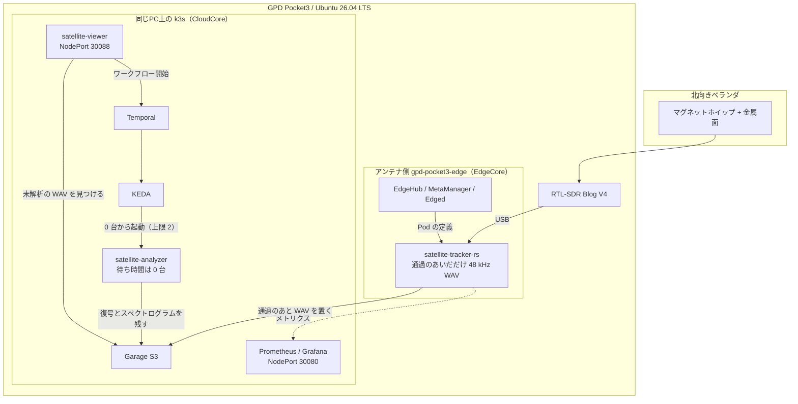

# ベランダ電波観測所

> 東京都の北向きベランダから、RTL-SDR Blog V4 と小型PC（GPD Pocket3）で電波を受信し、**衛星画像、テレメトリ（計測値）、復号した文字列**まで確認するためのリポジトリです。

マンションのベランダから、個人の地上局を動かすプロジェクトです。通称はベランダ天文学です。受信できたかどうかは、結果の中身が見えることで判断します。判断基準は [docs/qa/10_observation_metrics_and_heuristic_evaluation.md](docs/qa/10_observation_metrics_and_heuristic_evaluation.md) に書いてあります。

いま動いているのは、GPD Pocket3 の 1 台にまとめた KubeEdge です。アンテナ側の `satellite-tracker-rs` が衛星の通過を録音し、同じ PC 上の Kubernetes が解析します。

---

## 観測地と見通し

| 項目 | 値 |
| :--- | :--- |
| 観測地 | 東京都（広域代表値: 北緯 35.6895、東経 139.6917、標高 30 m） |
| アンテナ | 北向きベランダ（2026-09-15 移設）。マグネットホイップを室外機などの金属面に吸着 |
| 見通せる範囲 | 方位およそ \(270^\circ\)（西）から北を経て \(90^\circ\)（東） |
| 遮られる範囲 | 南から南西。建物の鉄筋コンクリートがあり、地平線近くの衛星は大きく減衰する |

北極上空から日本へ近づく極軌道の衛星は、このベランダの正面に入ります。太陽は東から南を通って西へ沈みます。ベランダは北向きで南側を建物が遮るため、太陽の電波を直接受ける観測には向きません。太陽観測用の `solar-station` はコードとして残しています。

米国の気象衛星 NOAA が送っていた APT（画像のアナログ放送）は停波しています。気象画像を受けるときは、ロシアの気象衛星 Meteor-M の LRPT（デジタル画像放送）を使います。

---

## 動いている場所

受信機を挿している PC は **GPD Pocket3** で、OS は **Ubuntu 26.04 LTS を直接インストール**したものです。この 1 台の上で、軽量な Kubernetes（[k3s](https://docs.k3s.io/)。制御側の名前は CloudCore）と、[KubeEdge](https://kubeedge.io/docs/architecture/) の EdgeCore（アンテナ側でコンテナを動かす部分）をまとめて動かしています。論理ノードは 2 つで、Kubernetes クラスタは 1 つです。

- **アンテナ側（エッジ、`gpd-pocket3-edge`）**: `satellite-tracker-rs` が、衛星が上空を通る時間だけ受信機を開き、音声帯域（48 kHz）の WAV を書きます。通過が終わると [Garage](https://garagehq.deuxfleurs.fr/) へ置き、PC 上のファイルは消します。通過していないときは受信機を閉じます。
- **同じ PC 上の Kubernetes**: Garage、[Temporal](https://temporal.io/)、[KEDA](https://keda.sh/)、`satellite-analyzer`（待ち時間はコンテナを止めておく）、`satellite-viewer`、監視の Prometheus と Grafana。

`satellite-viewer` が未解析の録音を見つけると Temporal のワークフローを開始し、KEDA が解析ワーカーを 0 台から起動します。復号した文字列とスペクトログラム（周波数、時間、強さの図）は Garage の `results/` に残ります。

制御側（CloudCore）を別の PC へ移す構成は、同じ定義ファイルのまま移せるようにしてあります。いまはすべてこの 1 台です。

Windows の WSL2 で FM ラジオを鳴らした手順は、初日の記録として [docs/05_getting_started.md](docs/05_getting_started.md) に残しています。

全体の図の詳細は [docs/03_system_architecture.md](docs/03_system_architecture.md)、アンテナ側と制御側の通信は [docs/qa/13_kubeedge_architecture_and_edge_cloud_communication.md](docs/qa/13_kubeedge_architecture_and_edge_cloud_communication.md) にあります。



| 処理 | 状態 | 置き場所 |
| :--- | :--- | :--- |
| `satellite-tracker-rs` | 通過のあいだだけ受信機を開く | アンテナ側の Pod |
| Garage / Temporal / KEDA / `satellite-analyzer` / `satellite-viewer` | 録音の保存、解析、表示 | 同じ PC 上の Kubernetes |
| `kubeedge-metrics-proxy` | アンテナ側の CPU とメモリを Prometheus へ中継 | アンテナ側 |
| Prometheus / Grafana | 監視。Grafana は NodePort 30080 | 同じ PC 上の Kubernetes |
| `solar-station` | コードは残している。北向きベランダから太陽は直接見えない | `apps/ground-station` |

21cm 水素線を常時分光して貯める処理（生の IQ を 1 秒積算し、約 8 KB/s で保存する構成）は、このリポジトリでは動いていません。水素線の式は [docs/02_radio_astronomy_guide.md](docs/02_radio_astronomy_guide.md) に参照として残しています。

---

## リポジトリにあるもの

| パス | 役割 |
| :--- | :--- |
| `apps/satellite-tracker-rs` | アンテナ側の追尾。北向きから見える方位かを判定し、通過中だけ受信機を開いて 48 kHz の WAV を Garage へ置く |
| `apps/satellite-analyzer` | Temporal のワーカー。パケットの復号とスペクトログラムを作る |
| `apps/satellite-viewer` | 録音と解析結果をブラウザで見る。未解析の WAV を見つけるとワークフローを開始する。NodePort 30088 |
| `apps/kubeedge-metrics-proxy` | アンテナ側コンテナの CPU とメモリを Prometheus へ中継する |
| `apps/satellite-tracker` | 同じ追尾の、先に書いた Python 版 |
| `apps/ground-station` | Rust の地上局クレート。通過予測、復調、成否の記録、`solar-station` を含む |
| `infrastructure/kubeedge` | k3s と CloudCore / EdgeCore |
| `infrastructure/monitoring` | kube-prometheus-stack |
| `infrastructure/storage/garage` | Garage S3 |
| `infrastructure/apps` | Temporal、tracker、analyzer のマニフェスト |
| `docs/qa/` | 見通し、復調、KubeEdge の個別解説 |
| `docs/articles/` | 「ベランダ電波観測所」連載の原稿 |

`satellite-tracker-rs` が最初から知っている衛星は、ISS（145.825 MHz の APRS パケット）、METEOR-M2 4、FUNcube-1 です。`ground-station` のリストには、これに加えて XW-2A、CAS-4A、UmKA-1、SONATE-2、SO-50 があります。

---

## ハードウェア

RTL-SDR Blog V4 を使います。仕様の一次情報は [RTL-SDR Blog V4 Users Guide](https://www.rtl-sdr.com/rtl-sdr-blog-v4-users-guide/) と [rtlsdrblog/rtl-sdr-blog](https://github.com/rtlsdrblog/rtl-sdr-blog) です。

- ADC: Realtek RTL2832U（8-bit）
- チューナー: Rafael Micro R828D
- 受信範囲: 500 kHz 〜 1.76 GHz（HF は内蔵アップコンバータ）
- 安定して使うサンプリング: 2.4 MSPS まで
- TCXO: 1 ppm
- Bias-T: 4.5 V（ソフトウェアで ON/OFF）
- アンテナ端子: SMA メス（50 Ω）

Ubuntu のパッケージ `rtl-sdr` は、1 世代前の V3（チューナー R820T）向けです。いま使っている V4（チューナー R828D）では、公式ドライバを自分でビルドします。入れていないと `[R82XX] PLL not locked!` が出て、指定した周波数に同調できません。

ベランダのアンテナは、付属のマグネット式ホイップ（棒状のアンテナ）を、室外機の天板などの金属面に付けたものです。アンテナとしてはモノポールで、金属面が地面側の導体（グラウンドプレーン）になります。金属面に付けないと、給電点のインピーダンスが合わず、感度が落ちます。

---

## クイックスタート

### 1. V4 対応ドライバ（Ubuntu）

```bash
sudo apt update
sudo apt install -y build-essential cmake libusb-1.0-0-dev git pkg-config

git clone https://github.com/rtlsdrblog/rtl-sdr-blog.git
cd rtl-sdr-blog
mkdir build && cd build
cmake ../ -DINSTALL_UDEV_RULES=ON
make
sudo make install
sudo ldconfig

echo 'blacklist dvb_usb_rtl28xxu' | sudo tee /etc/modprobe.d/blacklist-dvb_usb_rtl28xxu.conf
sudo udevadm control --reload-rules
sudo udevadm trigger

rtl_test -t
```

`Found Rafael Micro R828D tuner` が出れば認識できています。末尾の `No E4000 tuner found, aborting.` は、このコマンドが E4000 用の試験で終わっているだけで、故障ではありません。

KubeEdge のコンテナから受信機を開くときの udev ルールと、カーネル標準ドライバの無効化は [docs/setup/03_kubeedge_deployment_guide.md](docs/setup/03_kubeedge_deployment_guide.md) にまとめてあります。

### 2. KubeEdge の観測パイプライン

クラスタの定義は `infrastructure/` にあります。手順の入口は [infrastructure/kubeedge/README.md](infrastructure/kubeedge/README.md) です。

```bash
kubectl get nodes
kubectl get pods -A
```

ブラウザからは次の NodePort に接続します。

- 観測ビューア（`satellite-viewer`）: `30088`（[infrastructure/viewer/viewer.yaml](infrastructure/viewer/viewer.yaml)）
- Grafana: `30080`（[infrastructure/monitoring/kube-prometheus-stack/values-minimal.yaml](infrastructure/monitoring/kube-prometheus-stack/values-minimal.yaml)）

アンテナ側の追尾は `apps/satellite-tracker-rs`、解析の設計は [docs/superpowers/specs/2026-10-10-event-driven-satellite-analysis-pipeline-design.md](docs/superpowers/specs/2026-10-10-event-driven-satellite-analysis-pipeline-design.md) にあります。北向きベランダで UHF 帯の CubeSat（超小型衛星）を優先する理由は [docs/qa/15_uhf_cubesat_doppler_tracking_and_containerd_pipeline.md](docs/qa/15_uhf_cubesat_doppler_tracking_and_containerd_pipeline.md) にあります。

---

## 資料の読み分け

いまの運用と実装を知るときは、ここから読みます。

- [docs/03_system_architecture.md](docs/03_system_architecture.md) — 1 台にまとめた KubeEdge と、いま動かしている処理
- [docs/04_qa.md](docs/04_qa.md) — 質疑の索引。長い解説は `docs/qa/`
- [docs/setup/03_kubeedge_deployment_guide.md](docs/setup/03_kubeedge_deployment_guide.md) — k3s と EdgeCore の導入
- [infrastructure/kubeedge/README.md](infrastructure/kubeedge/README.md) — 制御側とアンテナ側の手順への目次

式と用語の参照用です。21cm 中性水素線と銀河の回転曲線は、いまのベランダ観測（KubeEdge 上の衛星受信）の手順とは別に残している資料です。

- [docs/00_glossary.md](docs/00_glossary.md) — SDR と電波天文学の用語
- [docs/01_math_and_dsp_cheatsheet.md](docs/01_math_and_dsp_cheatsheet.md) — IQ、FFT、窓関数、雑音
- [docs/02_radio_astronomy_guide.md](docs/02_radio_astronomy_guide.md) — 21cm 線、座標系、ドップラー、銀河回転

連載原稿と初日の手順は、その時点の記録です。

- [docs/articles/qiita_rtl_sdr_v4_getting_started.md](docs/articles/qiita_rtl_sdr_v4_getting_started.md) — #1 WSL2 で受信するまで
- [docs/articles/qiita_kubeedge_satellite_tracker.md](docs/articles/qiita_kubeedge_satellite_tracker.md) — #2 Ubuntu を直接インストールして衛星を追う
- [docs/articles/qiita_kubeedge_pipeline.md](docs/articles/qiita_kubeedge_pipeline.md) — #3 Rust 版の受信と、必要なときだけ起動する解析

---

## ディレクトリ構成

```text
.
├── README.md
├── GEMINI.md
├── Cargo.toml                         # workspace: ground-station, satellite-tracker-rs
├── apps/
│   ├── satellite-tracker-rs/          # アンテナ側の追尾（Rust）
│   ├── satellite-analyzer/            # Temporal 解析ワーカー
│   ├── satellite-viewer/              # 観測結果ビューア
│   ├── kubeedge-metrics-proxy/
│   ├── satellite-tracker/             # アンテナ側の追尾（Python、先に書いた版）
│   └── ground-station/                # Rust 地上局と solar-station
├── infrastructure/                    # kubeedge, monitoring, garage, temporal, keda
├── docs/
│   ├── 00_glossary.md
│   ├── 01_math_and_dsp_cheatsheet.md
│   ├── 02_radio_astronomy_guide.md    # 21cm 線の背景資料
│   ├── 03_system_architecture.md
│   ├── 04_qa.md
│   ├── 05_getting_started.md          # 初日の WSL2 手順（記録）
│   ├── qa/
│   ├── articles/
│   └── setup/
└── scripts/
```
