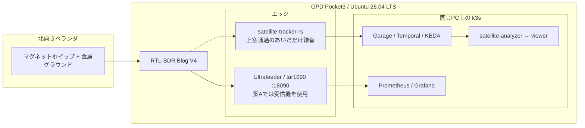

# ベランダ電波観測所

> 東京都の北向きベランダから、RTL-SDR Blog V4 と小型PC（GPD Pocket3）で電波を受信し、**航空機の航跡、衛星画像、テレメトリ（計測値）、復号した文字列**まで確認するためのリポジトリです。

マンションのベランダから、個人の地上局を動かすプロジェクトです。通称はベランダ天文学です。受信できたかどうかは、結果の中身が見えることで判断します。判断基準は [docs/qa/10_observation_metrics_and_heuristic_evaluation.md](docs/qa/10_observation_metrics_and_heuristic_evaluation.md) に書いてあります。

---

## 観測地と見通し

| 項目 | 値 |
| :--- | :--- |
| 観測地 | 東京都（広域代表値: 北緯 35.6895、東経 139.6917、標高 30 m） |
| アンテナ | 北向きベランダ（2026-09-15 移設）。マグネットホイップを室外機などの金属面に吸着 |
| 見通せる範囲 | 方位およそ \(270^\circ\)（西）から北を経て \(90^\circ\)（東） |
| 遮られる範囲 | 南から南西。建物の鉄筋コンクリートがあり、地平線近くの衛星は大きく減衰する |

北極上空から日本へ近づく極軌道の衛星と、北側の航空路は、このベランダの正面に入ります。太陽は東から南を通って西へ沈みます。ベランダは北向きで南側を建物が遮るため、太陽の電波を直接受ける観測には向きません。太陽観測用の `solar-station` はコードとして残しています。

米国の気象衛星 NOAA が送っていた APT（画像のアナログ放送）は停波しています。気象画像を受けるときは、ロシアの気象衛星 Meteor-M の LRPT（デジタル画像放送）を使います。

---

## いまの運用（設定名は案A）

USB の受信機は 1 台です。衛星の受信と ADS-B（航空機が 1090 MHz で送る位置情報）は、同時には使えません。いまは ADS-B を優先し、地図上に航空機の航跡が出るところを先に確認します。このリポジトリでは、その航跡を機影と呼びます。

`apps/ground-station/config.toml` の状態は次のとおりです。

- 衛星（Meteor、CubeSat、ISS）は `enabled = false`
- 朝の衛星スケジュール通知（`daily_schedule_enabled`）も `false`
- ADS-B（`adsb.enabled`）は `true`
- 地図画面 tar1090 のポートは **18090** です。8080 と 8081 は他のアプリ、8090 は PocketBase が使っています

衛星を追って録音し、解析する一式（`satellite-tracker-rs`、オブジェクトストレージの Garage、ワークフローの Temporal、必要なときだけ起動する KEDA、解析の `satellite-analyzer`、結果を見る `satellite-viewer`）はリポジトリにあります。案Aのあいだは、受信ソフト Ultrafeeder が RTL-SDR を専有します。衛星観測へ戻すときは、北寄りの高い通過から 1 機ずつ有効にします。

---

## 動いている場所

受信機を挿しているPCは **GPD Pocket3** で、OS は **Ubuntu 26.04 LTS を直接インストール**したものです。この 1 台の上で、軽量な Kubernetes（k3s。制御側の名前は CloudCore）と、KubeEdge の EdgeCore（アンテナ側でコンテナを動かす部分）をまとめて動かしています。役割は次の 2 つです。

- **アンテナ側（エッジ）**: ベランダのすぐ内側。案Aでは Ultrafeeder（受信エンジン readsb と地図画面 tar1090）が 1090 MHz を受信し続けます。衛星用の `satellite-tracker-rs` は、衛星が上空を通る時間だけ、音声帯域（48 kHz）まで絞って録音します。
- **同じPC上の Kubernetes**: Garage、Temporal、KEDA、`satellite-analyzer`（待ち時間はコンテナを止めておく）、`satellite-viewer`、監視の Prometheus と Grafana。

制御側（CloudCore）を別のPCへ移す構成は、同じ定義ファイルのまま移せるようにしてあります。いまはすべてこの 1 台です。

Windows の WSL2 で FM ラジオを鳴らした手順は、初日の記録として [docs/05_getting_started.md](docs/05_getting_started.md) に残しています。

全体の図は [docs/03_system_architecture.md](docs/03_system_architecture.md)、アンテナ側と制御側の通信は [docs/qa/13_kubeedge_architecture_and_edge_cloud_communication.md](docs/qa/13_kubeedge_architecture_and_edge_cloud_communication.md) にあります。



---

## リポジトリにあるもの

| パス | 役割 |
| :--- | :--- |
| `apps/ground-station` | Rust の地上局。衛星の通過予測、復調、近くを飛ぶ航空機の通知、成否の記録、音声合成（VOICEVOX）と Discord。`solar-station` も含む |
| `apps/satellite-tracker` | アンテナ側の追尾プログラム。先に書いた Python 版 |
| `apps/satellite-tracker-rs` | 同じ追尾の Rust 版。北向きから見える方位かを判定し、通過中だけ受信機を開いて 48 kHz の WAV を Garage へ置く |
| `apps/satellite-analyzer` | Temporal のワーカー。パケットの復号とスペクトログラム（周波数、時間、強さの図）を作る |
| `apps/satellite-viewer` | 録音と解析結果をブラウザで見る |
| `apps/kubeedge-metrics-proxy` | アンテナ側コンテナの CPU とメモリを Prometheus へ中継する |
| `infrastructure/kubeedge` | k3s と CloudCore / EdgeCore |
| `infrastructure/monitoring` | kube-prometheus-stack |
| `infrastructure/storage/garage` | Garage S3 |
| `infrastructure/apps` | Temporal、tracker、analyzer のマニフェスト |
| `docker-compose.yaml` | 案Aの Ultrafeeder と VOICEVOX |
| `docs/qa/` | 見通し、復調、ADS-B、KubeEdge の個別解説 |
| `docs/articles/` | 「ベランダ電波観測所」連載の原稿 |

`satellite-tracker-rs` が最初から知っている衛星は、ISS（145.825 MHz の APRS パケット）、METEOR-M2 4、FUNcube-1 です。`ground-station` のリストには、これに加えて XW-2A、CAS-4A、UmKA-1、SONATE-2、SO-50 があります。案Aでは、どちらのリストも受信には使いません。受信機は ADS-B が使います。

---

## ハードウェア

RTL-SDR Blog V4 を使います。仕様の一次情報は [RTL-SDR Blog V4 Users Guide](https://www.rtl-sdr.com/rtl-sdr-blog-v4-users-guide/) と [rtlsdrblog/rtl-sdr-blog](https://github.com/rtlsdrblog/rtl-sdr-blog) です。

- ADC: Realtek RTL2832U（8-bit）
- チューナー: Rafael Micro R828D
- 受信範囲: 500 kHz 〜 1.76 GHz（HF は内蔵アップコンバータ）
- 安定して使うサンプリング: 2.4 MSPS まで
- TCXO: 1 ppm
- Bias-T: 4.5 V（ソフトウェアで ON/OFF）
- アンテナ端子: SMA メス（50 Ω）

Ubuntu のパッケージ `rtl-sdr` は、1 世代前の V3（チューナー R820T）向けです。いま使っている V4（チューナー R828D）では、公式ドライバを自分でビルドします。入れていないと `[R82XX] PLL not locked!` が出て、指定した周波数に同調できません。

ベランダのアンテナは、付属のマグネット式ホイップ（棒状のアンテナ）を、室外機の天板などの金属面に付けたものです。アンテナとしてはモノポールで、金属面が地面側の導体（グラウンドプレーン）になります。金属面に付けないと、給電点のインピーダンスが合わず、感度が落ちます。

---

## クイックスタート

### 1. V4 対応ドライバ（Ubuntu）

```bash
sudo apt update
sudo apt install -y build-essential cmake libusb-1.0-0-dev git pkg-config

git clone https://github.com/rtlsdrblog/rtl-sdr-blog.git
cd rtl-sdr-blog
mkdir build && cd build
cmake ../ -DINSTALL_UDEV_RULES=ON
make
sudo make install
sudo ldconfig

echo 'blacklist dvb_usb_rtl28xxu' | sudo tee /etc/modprobe.d/blacklist-dvb_usb_rtl28xxu.conf
sudo udevadm control --reload-rules
sudo udevadm trigger

rtl_test -t
```

`Found Rafael Micro R828D tuner` が出れば認識できています。末尾の `No E4000 tuner found, aborting.` は、このコマンドが E4000 用の試験で終わっているだけで、故障ではありません。

KubeEdge のコンテナから受信機を開くときの udev ルールと、カーネル標準ドライバの無効化は [docs/setup/03_kubeedge_deployment_guide.md](docs/setup/03_kubeedge_deployment_guide.md) にまとめてあります。

### 2. 案A: ADS-B レーダー

リポジトリ直下で実行します。Ultrafeeder のイメージと環境変数の意味は [sdr-enthusiasts/docker-adsb-ultrafeeder](https://github.com/sdr-enthusiasts/docker-adsb-ultrafeeder) を参照します。地図 UI は [wiedehopf/tar1090](https://github.com/wiedehopf/tar1090) です。

```bash
docker compose up -d ultrafeeder
```

- 地図: `http://localhost:18090`
- 機体 JSON: `http://localhost:18090/data/aircraft.json`

近くを飛ぶ航空機の通知が届くかを試すときは、`apps/ground-station` で次を実行します。

```bash
cargo run -- test-adsb -c config.toml
```

電波の届く距離と、tar1090 の構成は [docs/qa/08_adsb_flight_tracking_and_tar1090.md](docs/qa/08_adsb_flight_tracking_and_tar1090.md) にあります。

### 3. 衛星の受信に戻すとき

Ultrafeeder を止めて受信機を空けてから、`config.toml` で見る衛星を有効にします。アンテナ側の追尾は `apps/satellite-tracker-rs`、解析の設計は [docs/superpowers/specs/2026-10-10-event-driven-satellite-analysis-pipeline-design.md](docs/superpowers/specs/2026-10-10-event-driven-satellite-analysis-pipeline-design.md) にあります。北向きベランダで UHF 帯の CubeSat（超小型衛星）を優先する理由は [docs/qa/15_uhf_cubesat_doppler_tracking_and_containerd_pipeline.md](docs/qa/15_uhf_cubesat_doppler_tracking_and_containerd_pipeline.md) にあります。

---

## 資料の読み分け

いまの運用と実装を知るときは、ここから読みます。

- [docs/03_system_architecture.md](docs/03_system_architecture.md) — 1 台にまとめた KubeEdge と、いま動かしている処理
- [docs/04_qa.md](docs/04_qa.md) — 質疑の索引。長い解説は `docs/qa/`
- [docs/setup/03_kubeedge_deployment_guide.md](docs/setup/03_kubeedge_deployment_guide.md) — k3s と EdgeCore の導入
- [infrastructure/kubeedge/README.md](infrastructure/kubeedge/README.md) — 制御側とアンテナ側の手順への目次

式と用語の参照用です。21cm 中性水素線と銀河の回転曲線は、いまのベランダ観測（ADS-B と衛星）の手順とは別の資料です。

- [docs/00_glossary.md](docs/00_glossary.md) — SDR と電波天文学の用語
- [docs/01_math_and_dsp_cheatsheet.md](docs/01_math_and_dsp_cheatsheet.md) — IQ、FFT、窓関数、雑音
- [docs/02_radio_astronomy_guide.md](docs/02_radio_astronomy_guide.md) — 21cm 線、座標系、ドップラー、銀河回転

連載原稿と初日の手順は、その時点の記録です。

- [docs/articles/qiita_rtl_sdr_v4_getting_started.md](docs/articles/qiita_rtl_sdr_v4_getting_started.md) — #1 WSL2 で受信するまで
- [docs/articles/qiita_kubeedge_satellite_tracker.md](docs/articles/qiita_kubeedge_satellite_tracker.md) — #2 Ubuntu を直接インストールして衛星を追う
- [docs/articles/qiita_kubeedge_pipeline.md](docs/articles/qiita_kubeedge_pipeline.md) — #3 Rust 版の受信と、必要なときだけ起動する解析

---

## ディレクトリ構成

```text
.
├── README.md
├── GEMINI.md
├── Cargo.toml                         # workspace: ground-station, satellite-tracker-rs
├── docker-compose.yaml                # ultrafeeder (:18090) と VOICEVOX
├── apps/
│   ├── ground-station/                # Rust 地上局と solar-station
│   ├── satellite-tracker/             # アンテナ側の追尾（Python、先に書いた版）
│   ├── satellite-tracker-rs/          # アンテナ側の追尾（Rust）
│   ├── satellite-analyzer/            # Temporal 解析ワーカー
│   ├── satellite-viewer/              # 観測結果ビューア
│   └── kubeedge-metrics-proxy/
├── infrastructure/                    # kubeedge, monitoring, garage, temporal, keda
├── docs/
│   ├── 00_glossary.md
│   ├── 01_math_and_dsp_cheatsheet.md
│   ├── 02_radio_astronomy_guide.md    # 21cm 線の背景資料
│   ├── 03_system_architecture.md
│   ├── 04_qa.md
│   ├── 05_getting_started.md          # 初日の WSL2 手順（記録）
│   ├── qa/
│   ├── articles/
│   └── setup/
└── scripts/
```
