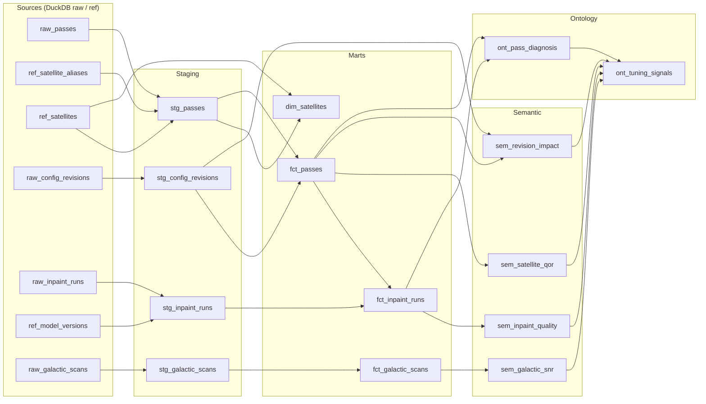

# analytics（オントロジー・セマンティック診断基盤）

ベランダ電波観測所（`radio-astronomy`）の観測ログ・AI 欠損補完メトリクス・21cm 分光スキャン・設定変更履歴を DuckDB と `dbt-duckdb` で統合・診断し、毎日のチューニングレビューや `satellite-viewer` の `05 / ANALYTICS` タブへ供給する軽量分析基盤です。

## 全体パイプライン

1. **増分同期（`scripts/sync_s3_to_duckdb.py`）**: Garage S3（`results/`・`ml_inpainted/`・`galactic/`）、Git 履歴（`raw_config_revisions`）、オントロジー YAML（`ontology/*.yaml`）を `analytics/state/observatory.duckdb` へ取り込みます。
2. **変換・診断（`dbt_observatory/`）**: `dbt build`（`rules.yaml` の閾値を `--vars` で注入）により `staging` → `marts` → `semantic` → `ontology` の順にモデルとデータ品質テストを実行します。
3. **レポート生成・公開（`scripts/generate_review_context.py`）**: 診断サマリと `dbt_observatory/target/manifest.json` ベースの `dbt_lineage` を構築し、`--publish-s3` で Garage S3 の `analytics/latest_report.json` へ公開します。
4. **可視化（`satellite-viewer`）**: `05 / ANALYTICS` タブが `/api/analytics/report` 経由で `analytics/latest_report.json` を取得し、グラフ・シグナル一覧・インタラクティブ dbt リネージュ図を描画します。

## dbt データリネージュ



## 層別モデル一覧

| 層 | モデル / テーブル | 役割 |
| :--- | :--- | :--- |
| **Sources** | `raw_passes`, `raw_inpaint_runs`, `raw_galactic_scans`, `raw_config_revisions`, `ref_*` | S3・Git・YAML マスタから同期した生データおよび参照テーブル |
| **Staging** | `stg_passes`, `stg_inpaint_runs`, `stg_galactic_scans`, `stg_config_revisions` | 衛星 ID 正規化（エイリアス解決）、`config_hash` 結合、型・タイムスタンプ整備 |
| **Marts** | `dim_satellites`, `fct_passes`, `fct_inpaint_runs`, `fct_galactic_scans` | `GOLDEN` 判定、直近デプロイ済みリビジョンの紐付け、パス単位の結合ファクト |
| **Semantic** | `sem_satellite_qor`, `sem_revision_impact`, `sem_inpaint_quality`, `sem_galactic_snr` | 衛星別 QoR（`7d`/`30d`/`all`）、PR 前後比較、ML 補完品質、21cm SNR 集計 |
| **Ontology** | `ont_pass_diagnosis`, `ont_tuning_signals` | 失敗原因の自動分類（`LowSNRWeakSignal` 分離等）とチューニングシグナル発火 |

## 実行コマンド

```bash
# 1. S3 / Git / YAML から DuckDB へ増分同期
analytics/.venv/bin/python analytics/scripts/sync_s3_to_duckdb.py --galactic-days 30

# 2. dbt build 実行 + S3 へレポート公開
analytics/.venv/bin/python analytics/scripts/generate_review_context.py --run-dbt --publish-s3

# 3. テスト実行（ローカル）
mise exec uv@0.9.11 -- uv run --python 3.12 --with dbt-duckdb --with pyyaml --with pytest python -m pytest analytics/tests/ -v
```
