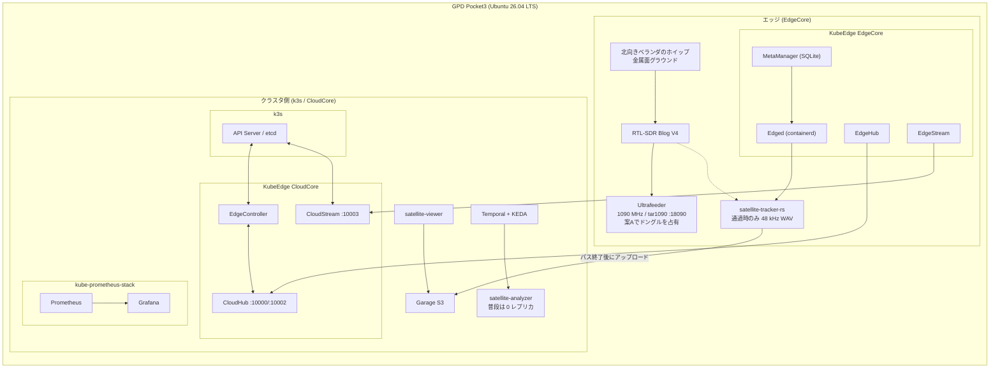

# ベランダ電波観測所のシステム構成

本ドキュメントは、北向きベランダの直下に置いた **GPD Pocket3（Ubuntu 26.04 LTS）** の上で、CNCF **KubeEdge** を使って電波観測を動かす現行構成を定義します。

同じ端末に CloudCore（k3s）と EdgeCore を同居させています。論理的には、アンテナ直下の受信と、クラスタ側の保存・解析・監視に分かれます。分析用 PC へ CloudCore を切り離す場合も、エッジ側の参加手順はそのまま使えます。現行の稼働形態は 1 台同居です。

用語は [00_glossary.md](00_glossary.md)、Edge と Cloud の通信は [qa/13_kubeedge_architecture_and_edge_cloud_communication.md](qa/13_kubeedge_architecture_and_edge_cloud_communication.md) を参照します。

---

## 1. 現行の観測ワークロード

RTL-SDR は 1 本です。`apps/ground-station/config.toml` の案Aでは、ドングルを ADS-B に明け渡しています。

| ワークロード | 状態 | 置き場所 |
| :--- | :--- | :--- |
| Ultrafeeder（readsb + tar1090） | 稼働対象。1090 MHz を占有。ホストポート 18090 | `docker-compose.yaml` |
| `ground-station` の ADS-B 近接通知 | 稼働対象。Ultrafeeder の JSON を HTTP で読む | `apps/ground-station` |
| `satellite-tracker-rs` | 実装済み。案Aのあいだはドングルを使わない | エッジ Pod |
| Garage / Temporal / KEDA / `satellite-analyzer` / `satellite-viewer` | 実装済み。衛星パスの録音を解析して中身を見る経路 | クラスタ側 |
| `solar-station` | コードは残置。北向きベランダから太陽を直視できないため、現行対象外 | `apps/ground-station` |

21cm 水素線用の常時分光コレクタ（生 IQ を 1 秒積算して 8 KB/s で貯める構成）は、このリポジトリの稼働ワークロードにはありません。水素線の式は [02_radio_astronomy_guide.md](02_radio_astronomy_guide.md) に背景資料として残しています。

---

## 2. 全体図（GPD Pocket3 単一ホスト）



衛星パスの解析シーケンス（S3 アップロード、Temporal、KEDA の 0→1）は [qa/16_edge_computing_power_consumption_and_footprint.md](qa/16_edge_computing_power_consumption_and_footprint.md) と [superpowers/specs/2026-10-10-event-driven-satellite-analysis-pipeline-design.md](superpowers/specs/2026-10-10-event-driven-satellite-analysis-pipeline-design.md) にあります。

---

## 3. この観測に KubeEdge を使う理由

1. **コントロールプレーンが止まっても受信を続ける**
   - `edgecore` は Pod 定義を MetaManager の SQLite（`/var/lib/kubeedge/edgecore.db`）に持っています。k3s や CloudCore が止まっても、エッジ側は前回の Pod を維持します。
2. **復帰時に状態を戻す**
   - CloudCore が戻ると EdgeHub が再接続し、ノード状態と ConfigMap / Secret を同期します。
3. **生 IQ を貯めない**
   - 2.4 MSPS の複素 IQ（8 bit）は約 4.8 MB/s です。常時保存するとエッジの SSD が先に尽きます。
   - 衛星側は通過中だけ狭帯域 48 kHz WAV を書き、Garage へ置いたあとローカルを消します。非通過時は SDR を閉じます。
   - 案Aの ADS-B は、Ultrafeeder が復調した結果を JSON で配信します。IQ ファイルは残りません。
4. **エッジからのアウトバウンドだけで操作する**
   - CloudStream / EdgeStream により、エッジ側で待ち受けポートを開けなくても `kubectl logs` と `kubectl exec` が通ります。CloudCore を別 PC へ移すときも、この向きは同じです。

一次情報: [KubeEdge](https://kubeedge.io/)、[keadm](https://kubeedge.io/docs/setup/install-with-keadm/)、[k3s](https://docs.k3s.io/)。

---

## 4. レイヤー別の役割

| レイヤー | 実行場所 | コンポーネント | 役割 |
| :--- | :--- | :--- | :--- |
| エッジ受信 | GPD Pocket3 | EdgeCore、Ultrafeeder、`satellite-tracker-rs` | 案Aでは 1090 MHz を常時受信する。衛星を戻すときは通過窓だけ SDR を開く |
| 地上局デーモン | GPD Pocket3 | `ground-station` | ADS-B JSON の近接判定、Discord / VOICEVOX。衛星スケジュールは案Aでは停止 |
| クラスタ制御 | 同一ホストの k3s | CloudCore、API Server | ノードと Pod の定義。将来の物理分離でも制御面はここ |
| 解析 | 同一ホストの k3s | Garage、Temporal、KEDA、`satellite-analyzer`、`satellite-viewer` | パス終了後だけワーカーを 1 にし、復号テキストとスペクトログラムを残す |
| 監視 | 同一ホストの k3s | kube-prometheus-stack | SDR を載せたノードの負荷と、tracker のメトリクス |

導入手順は [setup/03_kubeedge_deployment_guide.md](setup/03_kubeedge_deployment_guide.md) と [../infrastructure/kubeedge/README.md](../infrastructure/kubeedge/README.md) です。

---

## 5. インフラのディレクトリ

```text
infrastructure/
├── kubeedge/
│   ├── cloud/                          # k3s と CloudCore
│   └── edge/                           # EdgeCore
├── monitoring/
│   └── kube-prometheus-stack/
├── storage/garage/                     # 録音と解析結果の S3
├── apps/
│   ├── temporal/
│   ├── satellite-tracker/
│   └── satellite-analyzer/             # KEDA ScaledObject を含む
├── keda/
└── viewer/
```
