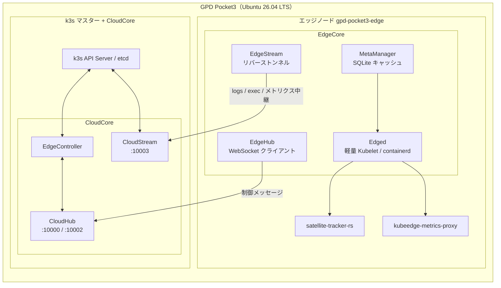
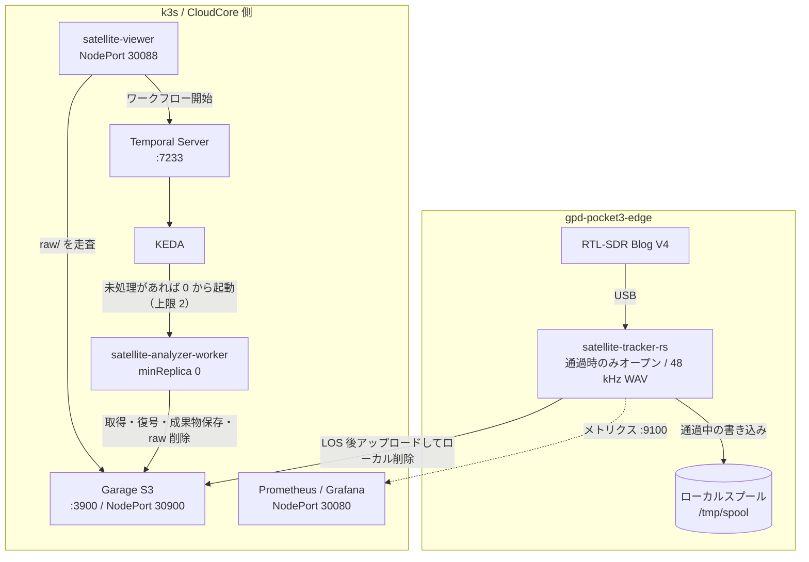

# 自宅KubeEdge電波天文学システム構成図

本ドキュメントは、**GPD Pocket3（Ubuntu 26.04 LTS）1台**で動いている現行構成を定義します。CNCF [KubeEdge](https://kubeedge.io/docs/architecture/) の CloudCore と EdgeCore を同一ホストに同居させ、その上で衛星電波の受信から解析までを回します。コントロールプレーンの Kubernetes は [k3s](https://docs.k3s.io/) です。

論理ノードは k3s マスターとエッジノード `gpd-pocket3-edge` の2つで、Kubernetes クラスタは1つです。将来、分析用 PC へ CloudCore を移す場合も、エッジは同じ EdgeCore のまま接続先を変えて分離できます。

用語は [00_glossary.md](00_glossary.md)、Edge と Cloud の通信コンポーネントは [qa/13_kubeedge_architecture_and_edge_cloud_communication.md](qa/13_kubeedge_architecture_and_edge_cloud_communication.md) を参照してください。

---

## 1. 制御プレーン（1台同居）

エッジからクラウドへアウトバウンドの WebSocket を1本張り、Pod の希望状態と `kubectl logs` / `kubectl exec` 用のリバーストンネルを分けています。回線が切れても `MetaManager` の SQLite に残った希望状態で Pod は動き続けます。



一次情報: [CloudHub](https://kubeedge.io/docs/architecture/cloud/cloudhub/)、[EdgeHub](https://kubeedge.io/docs/architecture/edge/edgehub/)、[MetaManager](https://kubeedge.io/docs/architecture/edge/metamanager/)。

---

## 2. データプレーン（現行の衛星観測パイプライン）

`satellite-tracker-rs` は非通過時に RTL-SDR を閉じ、可視通過の間だけ 2.4 MSPS の IQ を 48 kHz の PCM WAV に落とします。LOS のあとローカルスプールを Garage の `raw/{衛星}/{pass_id}.wav` へアップロードし、ローカルファイルは削除します。

`satellite-viewer` が `raw/` に未解析の WAV を見つけると、[Temporal](https://temporal.io/) の `AnalyzeSatellitePassWorkflow` を開始します。[KEDA](https://keda.sh/) は viewer の `/api/pending-tasks` をポーリングし、`satellite-analyzer-worker` を 0 から起動します。ワーカーは WAV を復号してスペクトログラムと JSON を `results/` に書き、元の WAV を削除します。



オブジェクトの置き場（バケット `satellite-recordings`）:

```text
satellite-recordings/
├── raw/                              # 解析前の 48 kHz WAV（解析後に削除）
│   └── ISS/
│       └── ISS_20261010_090048.wav
└── results/                          # 残す成果物
    └── ISS/
        └── 20261010_090048/
            ├── summary.json
            ├── packets.json
            └── spectrogram.png
```

Garage の仕様は [公式ドキュメント](https://garagehq.deuxfleurs.fr/) と [deuxfleurs-org/garage](https://github.com/deuxfleurs-org/garage) を参照してください。

---

## 3. なぜ電波観測に KubeEdge を置くか

1. **コントロールプレーンが止まっても受信は続く**  
   EdgeCore は直前の Pod 定義を `MetaManager`（SQLite）に持っています。k3s や CloudCore がメンテナンスで落ちても、観測 Pod はエッジ上で動き続けます。
2. **復帰時に状態が戻る**  
   CloudCore が再起動すると EdgeHub が WebSocket を張り直し、ノード状態と ConfigMap / Secret を再同期します。
3. **重い解析をエッジに常駐させない**  
   復調とスペクトログラム生成は `satellite-analyzer-worker` に寄せ、KEDA で必要なときだけ 1 レプリカにします。エッジは追尾と狭帯域録音に寄せます。
4. **NAT の内側から logs と exec が届く**  
   エッジ発のアウトバウンド接続（CloudStream / EdgeStream、ポート 10003）の中で、API Server からの `kubectl logs` と `kubectl exec` を中継します。物理分離したあとも、エッジ側のポート開放は不要です。

---

## 4. レイヤー別の役割

| レイヤー | 実行場所 | コンポーネント | 役割 |
| :--- | :--- | :--- | :--- |
| エッジ観測 | `gpd-pocket3-edge` | EdgeCore（EdgeHub, EdgeStream, MetaManager, Edged）、`satellite-tracker-rs`、`kubeedge-metrics-proxy` | RTL-SDR v4 の追尾と 48 kHz WAV のアップロード。cAdvisor の中継。オフライン時は SQLite キャッシュで Pod を継続。 |
| ストレージ | k3s | Garage S3（StatefulSet、`local-path`） | `raw/` の一時録音と `results/` の JSON / PNG。S3 API は 3900、ホストからは NodePort 30900。 |
| 解析 | k3s | `satellite-viewer`、Temporal、KEDA、`satellite-analyzer-worker` | 未解析 WAV の検知、ワークフロー、0 スケールの復号とスペクトログラム生成。ビューアは NodePort 30088。 |
| 監視 | k3s | kube-prometheus-stack | Grafana は NodePort 30080。エッジのコンテナメトリクスは metrics-proxy 経由。 |

---

## 5. インフラのディレクトリ

```text
infrastructure/
├── kubeedge/
│   ├── cloud/                          # k3s と CloudCore
│   └── edge/                           # EdgeCore
├── apps/
│   ├── satellite-tracker/              # satellite-tracker-rs の Deployment
│   ├── satellite-analyzer/             # worker と KEDA ScaledObject
│   └── temporal/                       # Temporal Server
├── storage/garage/                     # Garage S3
├── keda/                               # KEDA
├── viewer/                             # satellite-viewer（NodePort 30088）
├── monitoring/kube-prometheus-stack/   # Prometheus / Grafana（NodePort 30080）
└── registry/                           # ローカルイメージレジストリ
```

対応するコンテナイメージのソースは `apps/satellite-tracker-rs/`、`apps/satellite-analyzer/`、`apps/satellite-viewer/`、`apps/kubeedge-metrics-proxy/` です。
