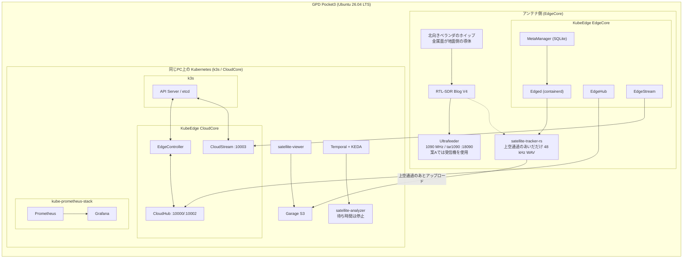

# ベランダ電波観測所のシステム構成

この文書は、北向きベランダのすぐ内側に置いた **GPD Pocket3（Ubuntu 26.04 LTS）** で、KubeEdge を使って電波を受信するいまの構成です。

受信と、保存・解析・監視は、同じ PC の中で役割を分けています。制御側（CloudCore）を別の PC へ移すときも、アンテナ側（EdgeCore）の参加手順はそのまま使えます。いまは 1 台にまとめています。

用語は [00_glossary.md](00_glossary.md)、アンテナ側と制御側の通信は [qa/13_kubeedge_architecture_and_edge_cloud_communication.md](qa/13_kubeedge_architecture_and_edge_cloud_communication.md) にあります。

---

## 1. いま動かしている処理

USB の受信機は 1 台です。`apps/ground-station/config.toml` の案A（いまの運用）では、受信機を ADS-B が専有します。ADS-B は、航空機が 1090 MHz で送る位置情報です。

| 処理 | 状態 | 置き場所 |
| :--- | :--- | :--- |
| Ultrafeeder（受信エンジン readsb と地図画面 tar1090） | いま動かす。1090 MHz を専有。ポート 18090 | `docker-compose.yaml` |
| `ground-station` の航空機通知 | いま動かす。Ultrafeeder の JSON を HTTP で読む | `apps/ground-station` |
| `satellite-tracker-rs` | 実装済み。案Aのあいだは受信機を使わない | アンテナ側の Pod |
| Garage / Temporal / KEDA / `satellite-analyzer` / `satellite-viewer` | 実装済み。衛星の通過録音を解析し、中身を見る経路 | 同じ PC 上の Kubernetes |
| `solar-station` | コードは残している。北向きベランダから太陽は直接見えないので、いまの観測には入れていない | `apps/ground-station` |

21cm 水素線を常時分光して貯める処理（生の IQ を 1 秒積算し、約 8 KB/s で保存する構成）は、このリポジトリでは動いていません。水素線の式は [02_radio_astronomy_guide.md](02_radio_astronomy_guide.md) に参照として残しています。

---

## 2. 全体図（GPD Pocket3 の 1 台）



衛星が通り終わったあとの解析（Garage へのアップロード、Temporal、KEDA がワーカーを 0 台から 1 台にする流れ）は [qa/16_edge_computing_power_consumption_and_footprint.md](qa/16_edge_computing_power_consumption_and_footprint.md) と [superpowers/specs/2026-10-10-event-driven-satellite-analysis-pipeline-design.md](superpowers/specs/2026-10-10-event-driven-satellite-analysis-pipeline-design.md) にあります。

---

## 3. この観測に KubeEdge を使う理由

1. **制御側が止まっても受信を続ける**
   - EdgeCore は、コンテナの定義を MetaManager の SQLite（`/var/lib/kubeedge/edgecore.db`）に持っています。k3s や CloudCore が止まっても、アンテナ側は前回のコンテナを動かしたままにします。
2. **制御側が戻ったら状態を合わせる**
   - CloudCore が戻ると EdgeHub が再接続し、ノードの状態と ConfigMap、Secret を同期します。
3. **生の IQ をディスクに貯めない**
   - 2.4 MSPS の複素 IQ（8 bit）は、およそ 4.8 MB/s です。常時保存すると、アンテナ側の SSD が先にいっぱいになります。
   - 衛星側は、上空通過のあいだだけ音声帯域（48 kHz）の WAV を書き、Garage へ置いたあと PC 上のファイルを消します。通過していないときは受信機を閉じます。
   - 案Aの ADS-B は、Ultrafeeder が復調した結果を JSON で配ります。IQ のファイルは残りません。
4. **アンテナ側から外向きの接続だけで操作する**
   - CloudStream と EdgeStream を使うと、アンテナ側で待ち受けポートを開けなくても `kubectl logs` と `kubectl exec` が通ります。CloudCore を別 PC へ移しても、接続の向きは同じです。

一次情報は [KubeEdge](https://kubeedge.io/)、[keadm の導入手順](https://kubeedge.io/docs/setup/install-with-keadm/)、[k3s](https://docs.k3s.io/) です。

---

## 4. レイヤー別の役割

| 層 | 実行場所 | コンポーネント | 役割 |
| :--- | :--- | :--- | :--- |
| アンテナ側の受信 | GPD Pocket3 | EdgeCore、Ultrafeeder、`satellite-tracker-rs` | 案Aでは 1090 MHz を受信し続ける。衛星へ戻すときは、上空通過のあいだだけ受信機を開く |
| 地上局 | GPD Pocket3 | `ground-station` | 航空機 JSON から近さを判定し、Discord と VOICEVOX へ通知する。朝の衛星スケジュールは案Aでは止めている |
| 制御 | 同じ PC の k3s | CloudCore、API Server | ノードとコンテナの定義。別 PC へ分けたあとも、制御はここが担う |
| 解析 | 同じ PC の k3s | Garage、Temporal、KEDA、`satellite-analyzer`、`satellite-viewer` | 通過が終わったあとだけワーカーを 1 台にし、復号した文字列とスペクトログラムを残す |
| 監視 | 同じ PC の k3s | kube-prometheus-stack | 受信機を載せたノードの負荷と、追尾プログラムのメトリクス |

導入手順は [setup/03_kubeedge_deployment_guide.md](setup/03_kubeedge_deployment_guide.md) と [../infrastructure/kubeedge/README.md](../infrastructure/kubeedge/README.md) です。

---

## 5. インフラのディレクトリ

```text
infrastructure/
├── kubeedge/
│   ├── cloud/                          # k3s と CloudCore
│   └── edge/                           # EdgeCore
├── monitoring/
│   └── kube-prometheus-stack/
├── storage/garage/                     # 録音と解析結果の S3
├── apps/
│   ├── temporal/
│   ├── satellite-tracker/
│   └── satellite-analyzer/             # KEDA ScaledObject を含む
├── keda/
└── viewer/
```
