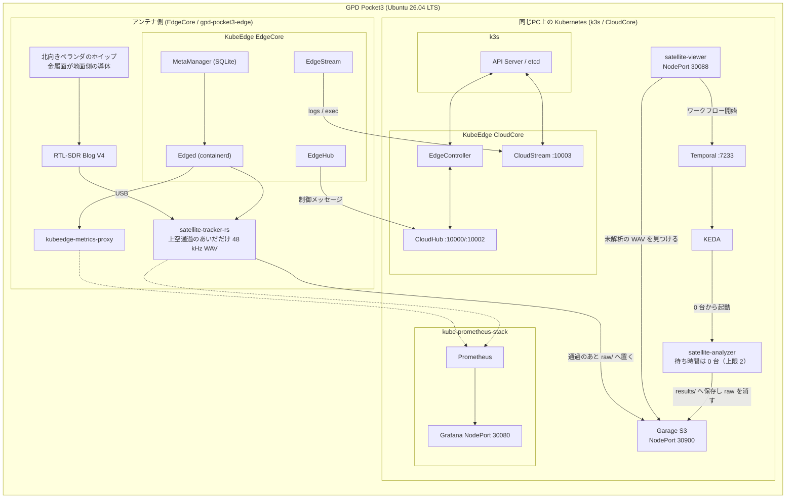

# ベランダ電波観測所のシステム構成

この文書は、北向きベランダのすぐ内側に置いた **GPD Pocket3（Ubuntu 26.04 LTS）** で、KubeEdge を使って衛星の電波を受信するいまの構成です。

受信と、保存・解析・監視は、同じ PC の中で役割を分けています。制御側（CloudCore）を別の PC へ移すときも、アンテナ側（EdgeCore）の参加手順はそのまま使えます。いまは 1 台にまとめています。

用語は [00_glossary.md](00_glossary.md)、アンテナ側と制御側の通信は [qa/13_kubeedge_architecture_and_edge_cloud_communication.md](qa/13_kubeedge_architecture_and_edge_cloud_communication.md) にあります。

---

## 1. いま動かしている処理

USB の受信機は 1 台です。アンテナ側の `satellite-tracker-rs` が、衛星の可視時間だけこの受信機を開きます。

| 処理 | 状態 | 置き場所 |
| :--- | :--- | :--- |
| `satellite-tracker-rs` | 通過のあいだだけ受信機を開き、48 kHz の WAV を書く | アンテナ側の Pod |
| Garage / Temporal / KEDA / `satellite-analyzer` / `satellite-viewer` | 通過が終わった録音を解析し、中身を見る | 同じ PC 上の Kubernetes |
| `kubeedge-metrics-proxy` | アンテナ側コンテナの CPU とメモリを中継する | アンテナ側 |
| `solar-station` | コードは残している。北向きベランダから太陽は直接見えないので、いまの観測には入れていない | `apps/ground-station` |

21cm 水素線を常時分光して貯める処理（生の IQ を 1 秒積算し、約 8 KB/s で保存する構成）は、このリポジトリでは動いていません。水素線の式は [02_radio_astronomy_guide.md](02_radio_astronomy_guide.md) に参照として残しています。

---

## 2. 全体図（GPD Pocket3 の 1 台）



オブジェクトの置き場（バケット `satellite-recordings`）:

```text
satellite-recordings/
├── raw/                              # 解析前の 48 kHz WAV（解析後に削除）
│   └── ISS/
│       └── ISS_20261010_090048.wav
└── results/                          # 残す成果物
    └── ISS/
        └── 20261010_090048/
            ├── summary.json
            ├── packets.json
            └── spectrogram.png
```

通過が終わったあとの解析の設計は [superpowers/specs/2026-10-10-event-driven-satellite-analysis-pipeline-design.md](superpowers/specs/2026-10-10-event-driven-satellite-analysis-pipeline-design.md) にあります。Garage の仕様は [公式ドキュメント](https://garagehq.deuxfleurs.fr/) と [deuxfleurs-org/garage](https://github.com/deuxfleurs-org/garage) を参照してください。

---

## 3. この観測に KubeEdge を使う理由

1. **制御側が止まっても受信を続ける**
   - EdgeCore は、コンテナの定義を MetaManager の SQLite（`/var/lib/kubeedge/edgecore.db`）に持っています。k3s や CloudCore が止まっても、アンテナ側は前回のコンテナを動かしたままにします。
2. **制御側が戻ったら状態を合わせる**
   - CloudCore が戻ると EdgeHub が再接続し、ノードの状態と ConfigMap、Secret を同期します。
3. **生の IQ をディスクに貯めない**
   - 2.4 MSPS の複素 IQ（8 bit）は、およそ 4.8 MB/s です。常時保存すると、アンテナ側の SSD が先にいっぱいになります。
   - 衛星の通過中だけ音声帯域（48 kHz）の WAV を書き、Garage へ置いたあと PC 上のファイルを消します。通過していないときは受信機を閉じます。
   - 復調とスペクトログラムは `satellite-analyzer` に寄せ、KEDA で必要なときだけ起動します。
4. **アンテナ側から外向きの接続だけで操作する**
   - CloudStream と EdgeStream を使うと、アンテナ側で待ち受けポートを開けなくても `kubectl logs` と `kubectl exec` が通ります。CloudCore を別 PC へ移しても、接続の向きは同じです。

一次情報は [KubeEdge](https://kubeedge.io/)、[アーキテクチャ](https://kubeedge.io/docs/architecture/)、[keadm の導入手順](https://kubeedge.io/docs/setup/install-with-keadm/)、[k3s](https://docs.k3s.io/)、[Temporal](https://temporal.io/)、[KEDA](https://keda.sh/) です。

---

## 4. レイヤー別の役割

| 層 | 実行場所 | コンポーネント | 役割 |
| :--- | :--- | :--- | :--- |
| アンテナ側の受信 | `gpd-pocket3-edge` | EdgeCore、`satellite-tracker-rs`、`kubeedge-metrics-proxy` | 上空通過のあいだだけ受信機を開き、48 kHz WAV を Garage へ置く。cAdvisor を中継する |
| 制御 | 同じ PC の k3s | CloudCore、API Server | ノードとコンテナの定義。別 PC へ分けたあとも、制御はここが担う |
| 解析 | 同じ PC の k3s | Garage、Temporal、KEDA、`satellite-analyzer`、`satellite-viewer` | 未解析の WAV を見つけ、ワーカーを 0 台から起動し、復号した文字列とスペクトログラムを残す。ビューアは NodePort 30088 |
| 監視 | 同じ PC の k3s | kube-prometheus-stack | Grafana は NodePort 30080。追尾プログラムのメトリクスと、アンテナ側の負荷を見る |

導入手順は [setup/03_kubeedge_deployment_guide.md](setup/03_kubeedge_deployment_guide.md) と [../infrastructure/kubeedge/README.md](../infrastructure/kubeedge/README.md) です。

---

## 5. インフラのディレクトリ

```text
infrastructure/
├── kubeedge/
│   ├── cloud/                          # k3s と CloudCore
│   └── edge/                           # EdgeCore
├── monitoring/
│   └── kube-prometheus-stack/          # Grafana は NodePort 30080
├── storage/garage/                     # 録音と解析結果の S3（NodePort 30900）
├── apps/
│   ├── temporal/
│   ├── satellite-tracker/
│   └── satellite-analyzer/             # KEDA ScaledObject を含む
├── keda/
├── viewer/                             # NodePort 30088
└── registry/
```

対応するコンテナイメージのソースは `apps/satellite-tracker-rs/`、`apps/satellite-analyzer/`、`apps/satellite-viewer/`、`apps/kubeedge-metrics-proxy/` です。
