## はじめに

こんにちは、戸澤（@tozastation）です！  
宇宙が好きで、自宅のベランダから個人で電波天文学や人工衛星の観測を行う「ベランダ電波観測所」プロジェクトを進めています。

本プロジェクトは AI アシスタントの Antigravity に相談しながら二人三脚で開発しています。いつも大変お世話になっております。

ソースコードや Kubernetes マニフェストはすべて GitHub に公開しています。  
[tozastation/radio-astronomy (GitHub)](https://github.com/tozastation/radio-astronomy)

---

## 前回の振り返りと今回のテーマ

これまでの歩みは次のとおりです。
- 第1弾: [【ベランダ電波観測所 #1】RTL-SDR Blog V4 と WSL2 で電波を受信してみる](https://qiita.com/tozastation/items/b7e411ba034ddf46be22)
- 第2弾: [【ベランダ電波観測所 #2】KubeEdge×SDRで始める衛星電波観測と単一ノード運用の記録](https://github.com/tozastation/radio-astronomy/blob/main/docs/articles/qiita_kubeedge_satellite_tracker.md)
- 第3弾: [【ベランダ電波観測所 #3】KubeEdgeを活かした衛星電波解析パイプラインの構築](https://github.com/tozastation/radio-astronomy/blob/main/docs/articles/qiita_kubeedge_pipeline.md)

第3弾では、Rust 製の軽量エッジ観測アプリで衛星の電波を受信し、Garage S3 と Temporal と KEDA を組み合わせて自動解析するパイプラインを構築しました。

今回はそのパイプラインの先にある「物理層の強化」「電波から画像への復調シーケンス」「観測結果を眺めるフロントエンド」の 3 つを紹介します。

---

## 1. ハードウェア強化：Vダイポールアンテナと FM ブロックフィルタ

ソフトウェア側の自動追尾パイプラインが動くようになっても、ベランダから届く衛星の電波がノイズに埋もれていては画像を復調できません。そこで今回は受信側の物理層（アンテナとフィルタ）を強化しました。

### 1.1 137MHz 帯 Vダイポールアンテナ（開き角 120°・前傾チルト）

気象衛星（METEOR-M2 3 / 4）が地球画像を送信しているのは **137MHz 帯（VHF）** です。第1弾で使っていた付属の伸縮ホイップアンテナから、137MHz 帯に共振させた Vダイポールアンテナ（片側エレメント長約 53cm）へ切り替えました。

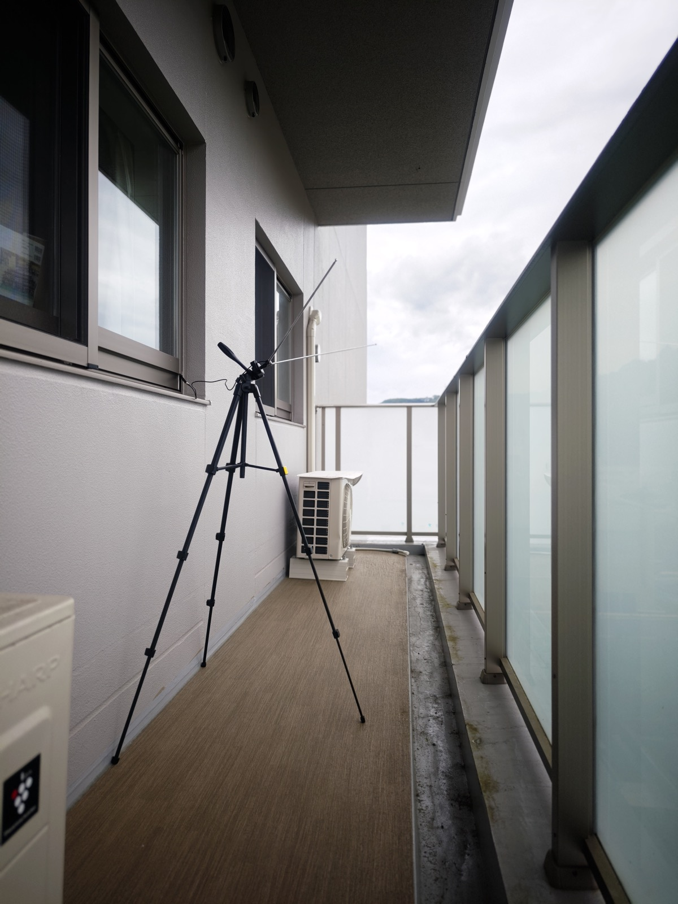
*▲ ベランダの三脚に設置した 137MHz 帯 Vダイポールアンテナ。窓の隙間から同軸ケーブルを室内へ引き込んでいます*

ポイントは開き角を 120°（時計の 10 時 10 分）にすることと、北向きに前傾チルトさせることです。
- インピーダンス整合: 直線（180°）のダイポールアンテナは約 73Ω ですが、120° に折り曲げることで一般的な同軸ケーブルや SDR と同じ約 50Ω に近づきます。ネットワークで言えば、ケーブルと機器の規格を揃えて信号の反射（ロス）を減らすようなイメージです。
- 死角の解消とベランダ最適化: 直線ダイポールは素子の延長線上に感度の死角（ヌル）ができます。V 字にした 2 本のエレメントがつくる「面」そのものを北側の空（仰角約 60° 付近）へ前傾させて向けることで、降ってくる電波を面ですくい上げるイメージです。上階の庇（ひさし）の影を避けつつ、北極側から飛んでくる極軌道衛星を正面から捉えやすくなります。

### 1.2 都心の必須アイテム「FM ブロックフィルタ」

アンテナを強化すると同時に導入したのが、RTL-SDR Blog の **Broadcast FM Bandstop Filter（FM ブロックフィルタ）** です。

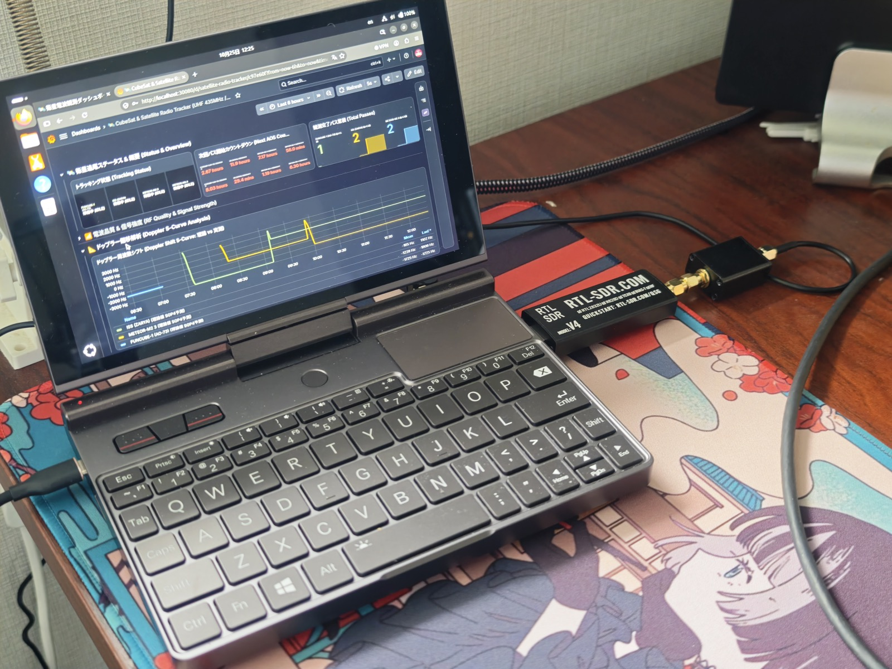
*▲ GPD Pocket3 の右側 USB に直結した RTL-SDR Blog V4 と、SMA コネクタの先にある黒い箱が FM ブロックフィルタ*

都心のベランダで衛星を受信しようとすると、すぐ近くにある 76〜95MHz 帯の FM 放送局の巨大な電波が同時にアンテナへ飛び込んできます。RTL-SDR Blog V4 のような安価な SDR ドングルは、対象外の帯域であっても強烈な電波が入るとフロントエンドの増幅器や A/D 変換器が飽和（ブロッキング）を起こします。想定外の大トラフィックで受信側の入力段がパンクし、肝心の 137MHz 帯の微弱な衛星信号がかき消されてしまう状態です。

IT インフラで例えるなら、FM ブロックフィルタは「特定の不要トラフィックだけを物理層で落とすハードウェアのファイアウォール（WAF）」のような存在です。76〜95MHz 帯の強力な FM 波だけを **40dB 以上（電力比で 1 万分の 1 以下）** 減衰させ、137MHz 帯の信号はそのまま通してくれます。

---

## 2. 電波を復調して画像になるまでのシーケンス（IT エンジニア向け解説）

アンテナとフィルタで受信した「目に見えない電波」は、一体どのような手順を経て「地球の雲画像」に変わるのでしょうか。無線工学の用語を、IT エンジニアに馴染みのあるネットワークやデータ処理の概念に言い換えながら追ってみます。

### 全体シーケンス

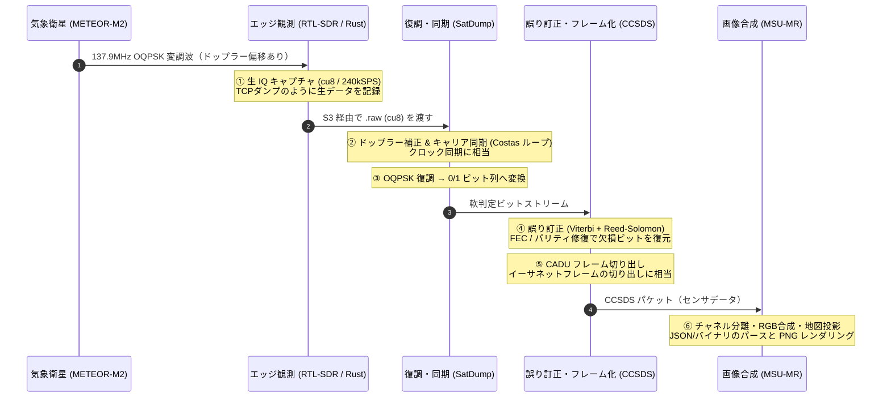

### 各ステップの IT エンジニア向け言い換え

| ステップ | 無線・信号処理の工程 | IT エンジニア向けの言い換え | やっていること |
| :--- | :--- | :--- | :--- |
| 1. 生 IQ キャプチャ | 240kSPS の `cu8` 形式で生ベースバンド録音 | パケットキャプチャ（pcap / Raw ダンプ） | 音声（WAV）に丸めるのは「HTTP ボディだけ残してヘッダを捨てる」ようなものです。生 IQ では波の高さとズレ（I/Q 成分）をそのまま生バイト列として保存します。 |
| 2. 周波数・位相の同期 | ドップラー追尾と Costas ループ（PLL） | クロック同期・キャリアロック | 時速約 2.7 万 km で飛ぶ衛星は周波数が大きくズレます。そのズレを追いかけながら、信号の「0° と 90°」の基準軸をロックします。 |
| 3. シンボル復調 | QPSK / OQPSK デモジュレーション | 物理層からビット列へのデシリアライズ | 位相の変化パターンを読み取り、連続したアナログの波を `0` と `1` のデジタルビット列（厳密には「たぶん 1（確信度 80%）」のような確からしさ付きの軟判定値）に戻します。 |
| 4. 誤り訂正（FEC） | Viterbi 復号 ＋ Reed-Solomon 符号 | RAID / パリティによる自動修復 | 宇宙空間から届く電波はノイズで一部が化けます。あらかじめ冗長化されている訂正符号を使い、受信側で欠損ビットを自己修復します。 |
| 5. フレーム切り出し | CADU（Channel Access Data Unit）同期 | L2 フレームのフレーミング | ただのビット列から固定長のヘッダ（同期マーカ）を探し出し、意味のあるパケット単位（CCSDS フレーム）に切り出します。 |
| 6. 画像レンダリング | MSU-MR チャネル展開・地図投影 | ペイロードのパース＆画像生成 | パケットの中身を可視光・赤外線などのチャネルごとに展開し、カラー合成や地球の歪み補正（投影変換）をかけて PNG 画像に出力します。 |

私たちのパイプラインではステップ 2〜6 を、気象衛星デコードの定番 OSS である **SatDump**（`meteor_m2-x_lrpt` パイプライン）に任せています。

---

## 3. 実際に取得できた衛星画像とスペクトログラム

Vダイポール＋FM ブロックフィルタの構成で実際に受信し、パイプラインが自動生成した成果物を紹介します。

### 3.1 METEOR-M2 4 の高解像度 LRPT 気象画像

3 分以上にわたって OQPSK のシンボル同期が切れずに維持できたパスから復調された画像（AVHRR 自然色風マルチスペクトル合成、1568 × 792 ピクセル）です。

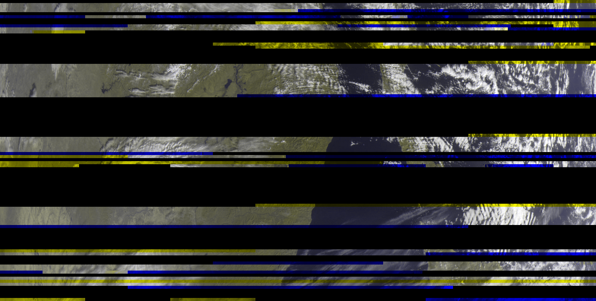
*▲ 2026年10月26日にベランダから受信・復調した METEOR-M2 の地球画像*

雲の様子や海岸線からなんとなく北海道のあたりが見えており、自宅ベランダに立てた 1m ほどのアンテナからこの地球画像が落ちてきた瞬間は思わず声が出ました。

### 3.2 受信電波のスペクトログラム（#3 からの宿題回収）

第3弾の末尾で「第4弾でたっぷりお届けします」と予告していた、METEOR-M2 通過時の実測スペクトログラムも紹介します。

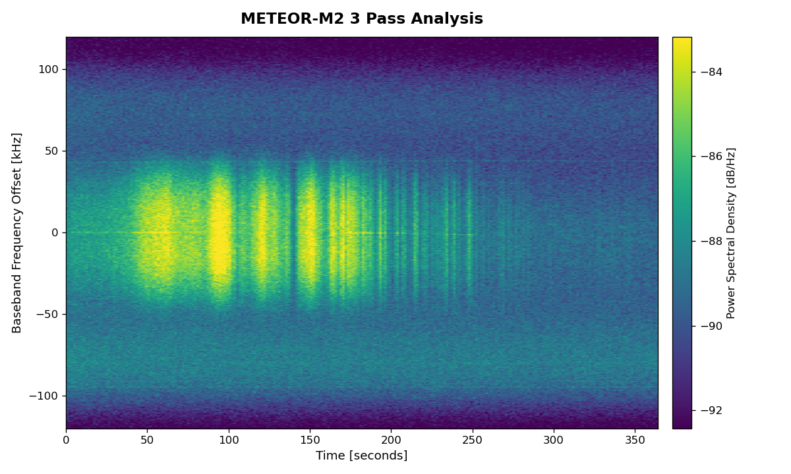
*▲ METEOR-M2 3（137.900 MHz）通過時のスペクトログラム。0kHz 付近に約 ±40kHz 幅の LRPT 信号が浮かび上がっています*

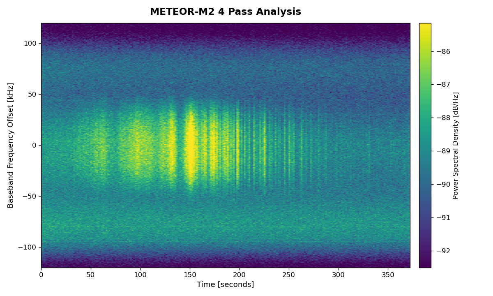
*▲ こちらは METEOR-M2 4（137.900 MHz）通過時のスペクトログラム。エッジ側でドップラー追尾しているため、信号の中心が 0kHz 付近に保たれています*

途中に見える縦の縞模様は、衛星の移動やベランダ周辺での反射によって起きるフェージング（電波の強弱）です。

### 3.3 FUNCUBE-1 (AO-73) の BPSK テレメトリ復号

気象衛星の画像だけでなく、アマチュア無線衛星 **FUNCUBE-1 (AO-73)**（145.935 MHz / 1200bps BPSK）のテレメトリも復号できています。

初期の FM 音声録音方式では位相情報が失われたり、ドップラー偏移で狭い帯域フィルタから信号が外れたりして復号に失敗していました。そこでエッジ側の録音を 240kSPS の生 IQ キャプチャ（`cu8`）へ切り替え、解析側でドップラー補正付きのチャンク変換と前処理フィルタを挟むことで、`CRC: PASS` の正常フレームとして宇宙機の状態を読み取れるようになりました。

| FUNCUBE-1 スペクトログラム | 復号されたテレメトリ HUD（CRC: PASS） |
| :---: | :---: |
| 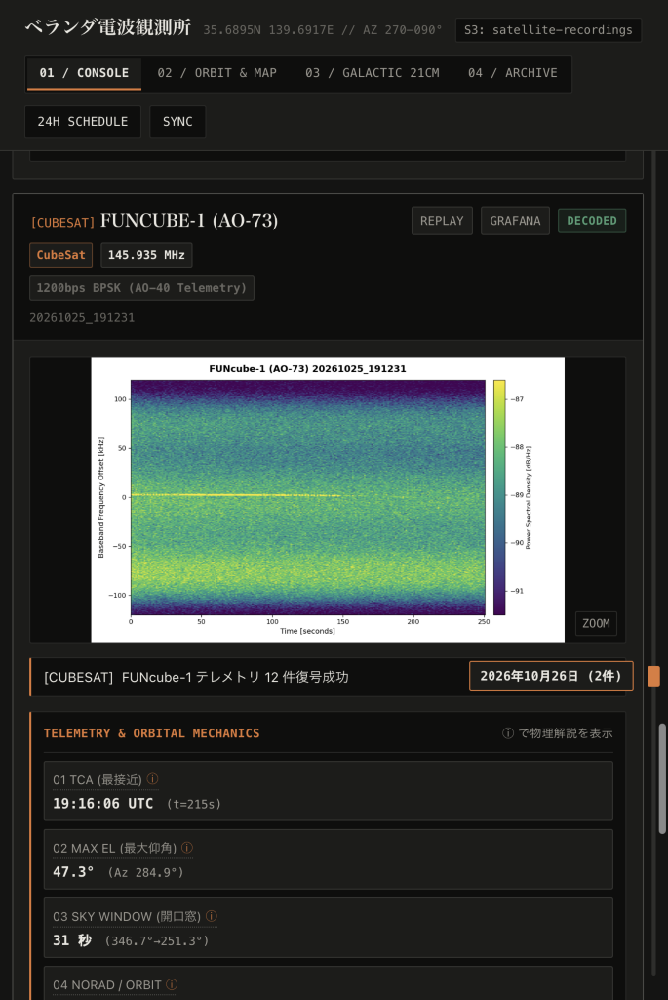 | 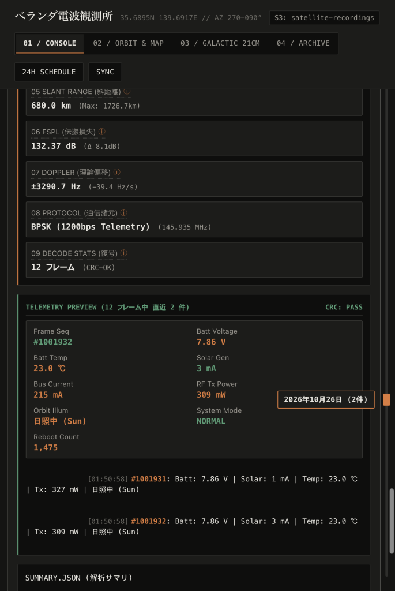 |

たとえば `20261025_191231` のパスでは 12 フレームの復号に成功し、バッテリー電圧（`7.86 V`）、バッテリー温度（`23.0 ℃`）、送信電力（`309 mW`）、日照状態（`日照中 (Sun)`）、システムモード（`NORMAL`）といった衛星内部の健康状態まで手元の画面で確認できました。

---

## 4. 観測結果ビューア：`satellite-viewer` の紹介

受信して復調した画像やテレメトリが S3 に溜まってきたので、それらを快適に眺めるための Web フロントエンド `satellite-viewer`（Python / Flask ＋ HTML5 Canvas 2D、NodePort `30088`）を用意しました。

| 観測結果ダッシュボード | 天球観測リプレイと実績ヒートマップ |
| :---: | :---: |
| 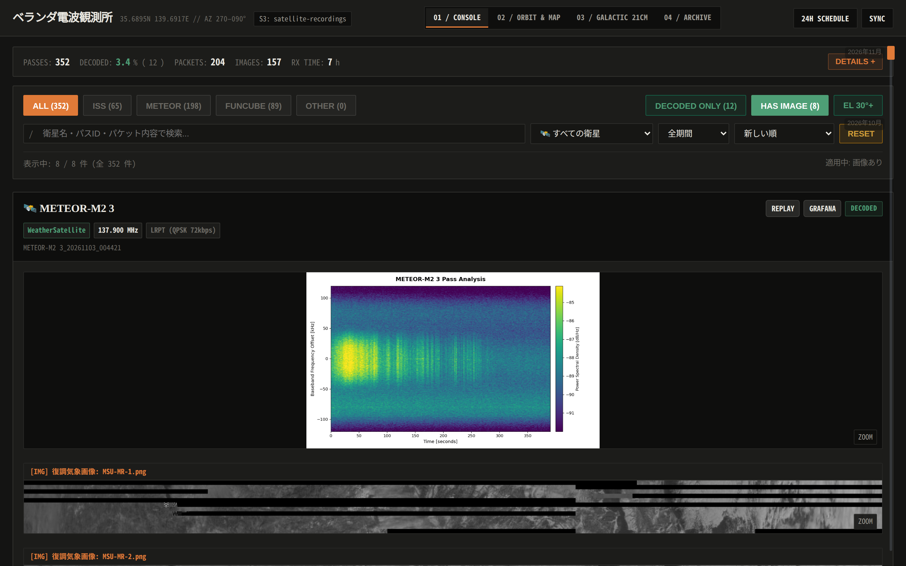 | 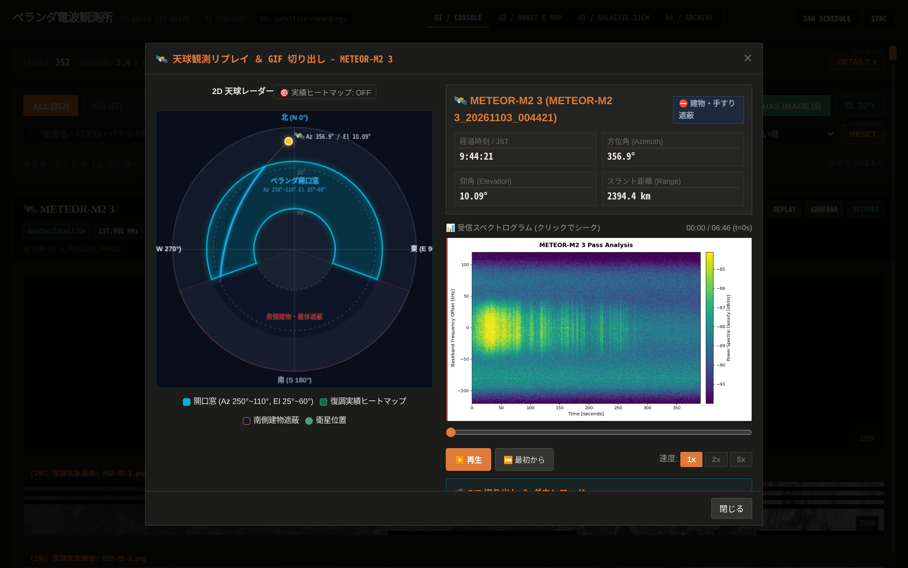 |

### 4.1 デザインコンセプト：`unslop` と `DESIGN.md` による計器盤 UI への刷新

最初は AI に任せて作った一般的なダッシュボード調（青いダーク背景や過剰なカード装飾）でしたが、[DESIGN.md](https://github.com/tozastation/radio-astronomy/blob/main/DESIGN.md) にデザイン指針を定義したうえで、AI 生成特有の見た目（AI Slop）を削ぎ落とす **`unslop`** スキルを使って画面全体を整理しました。

主役であるスペクトログラムや気象衛星画像（黒背景）の視認性を損なわないよう、深い黒鉛色（`#141413`）と計器オレンジ（`#E07A38`）を基調とした「黒鉛系計器盤 × インダストリアル設計図」の測定器コンソール風 UI に統一しています。

### 4.2 4 つのワークスペースと主な機能

用途に応じて画面を 4 つのタブに分けています。

1. `01 / CONSOLE`（観測結果コンソール）
   - 上部の統計バーや衛星カテゴリ・状態（復調成功 / 失敗）のフィルタ、次のベストパス表示をまとめています。
   - 各パスのカードを開くと、復調された地球画像や宇宙機テレメトリ HUD、極座標の天球リプレイ（Canvas 2D）とスペクトログラムの同期カーソルをその場で再生できます。気に入ったパスはブラウザ上でそのまま GIF アニメーションとして書き出しできます（`gifenc.js` 使用）。
   - 最接近時刻（TCA）や最大仰角、ドップラー実測による TCA 補正値の横には `ⓘ` ボタンを配置し、タップすると物理的背景の解説が読めるようにしました。
2. `02 / ORBIT & MAP`（軌道予測＆電波伝搬）
   - 過去の受信実績をもとにベイズ確率モデルで予測精度を更新する通過カレンダーと、世界地図上の衛星フットプリント（電波が届く範囲）のアニメーションを表示します。
3. `03 / GALACTIC 21CM`（銀河 21cm 水素線分光）
   - 衛星が飛んでいない空き時間に実行している銀河系の中性水素（21cm 線 / 1420.406 MHz）ドリフトスキャンの視線速度スペクトルと、銀河俯瞰図を確認できます。
4. `04 / ARCHIVE`（バックアップ＆運用）
   - Garage S3 バケットの容量・件数確認や、フルバックアップ・リストア操作を行えます。

また、帰宅中やベランダ作業中に手元のスマホ（Xiaomi 15 Ultra）からサッと確認できるよう、モバイル表示でのテーブル折り返しやタッチ操作も細かくチューニングしています。

---

## 5. 過去データの蓄積で見えてきた「狙い目のパス」とパラメータの微修正

観測を続けて過去の受信結果が溜まってくると、ただ画像を眺めるだけでなく「どの日・どの通過パスなら綺麗に受信できそうか」が見えてくるようになりました。

### 5.1 軌道予測 × 過去実績のベイズ確率モデル

衛星の通過自体は軌道計算（SGP4）で予測できますが、ベランダの環境では「幾何学的には見えているのに、手すりの反射や庇（ひさし）の遮蔽、アンテナの指向性によって復調に失敗する」ケースが起きます。

そこで `02 / ORBIT & MAP` や `01 / CONSOLE` の次のベストパス表示では、過去の復調成功実績（画像やパケットが取れたかどうか）を衛星ごと・仰角帯ごとに集計し、ラプラス平滑化を用いたベイズ確率モデルで「実際に復調できる期待確率」を動的に計算するようにしました。1 回試して 1 回成功しただけで「成功率 100%」と誤判定しないよう分母・分子に下駄を履かせて極端な振れを抑えており、データが増えるほど「この衛星は仰角何度のパスが狙い目か」が実績ベースで見えてきます。

| 月間軌道予測カレンダー＆期待度表示 | 世界地図＆電波伝搬アニメーション |
| :---: | :---: |
| 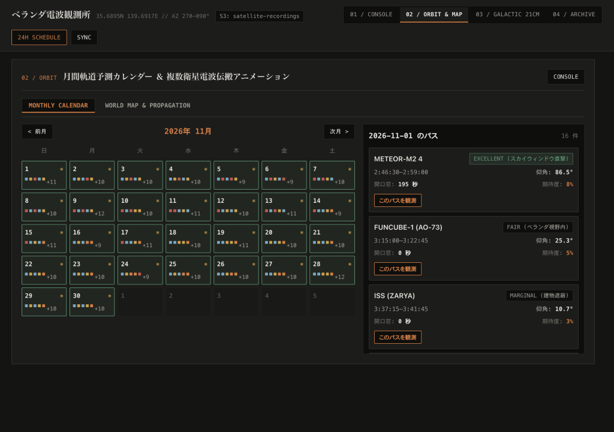 | 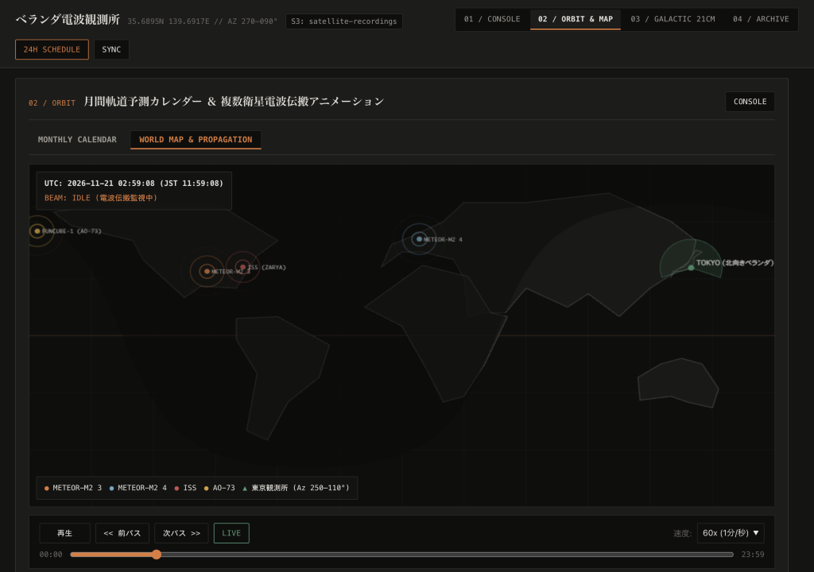 |

### 5.2 `cron` × Antigravity CLI（`agy`）による定期チューニングループ

さらに、直近の観測データを定期集計するスクリプト（`summarize_recent_observations.py`）を用意し、`cron` から **Antigravity CLI（`agy`）** を定期実行してパラメータを見直す仕組みも回しています。

- `summarize_recent_observations.py` で直近 7 日間の観測ログ（復調成否・仰角・方位角・ドップラー偏移のズレ）を集計してサマリを生成する
- 集計結果をもとに `agy` が改善案を検討し、前処理フィルタや TLE 更新設定の微修正を含む作業ブランチ（`chore/tuning-review-YYYYMMDD`）を切って PR を自動作成する

ハードウェアとパイプラインを作って終わりではなく、溜まった観測ログを次の受信精度へフィードバックするサイクルが回り始めたのは大きな手応えでした。

---

## おわりに

今回は物理層の強化（Vダイポール × FM ブロックフィルタ）、電波から画像になるまでの復調シーケンス、観測結果ビューア `satellite-viewer`、そして過去実績をもとに受信精度を高める仕組みを紹介しました。

第1弾で FM ラジオを鳴らすところから始まったプロジェクトですが、Kubernetes（KubeEdge）による自動追尾・ゼロスケール解析パイプラインと、物理層のアンテナ・フィルタ強化が噛み合い、ついに自宅のベランダから宇宙の地球画像を自分の手で受信・可視化できるところまで到達しました。

最後までお読みいただきありがとうございました！
