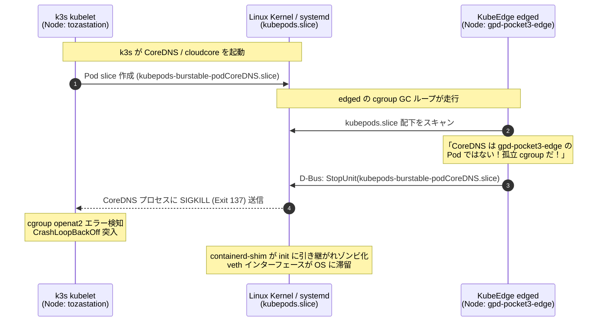

# KubeEdge 1台同居環境における cgroup & ボリューム GC 衝突と完全分離アーキテクチャ詳解

本ドキュメントでは、単一ホスト（GPD Pocket3: Ubuntu 26.04 LTS）上で Kubernetes（k3s コントロールプレーン）と KubeEdge（エッジノード `edgecore`）を同居させる初期 PoC 環境において発生した、**「cgroup およびボリュームの Garbage Collection（GC）共食いによるコンテナ強制終了（Exit Code 137）ループ」** の根本原因メカニズムと、その恒久的な完全分離アーキテクチャについて詳解します。

---

## 1. 概要と背景

GPD Pocket3（1台完結PoC）環境では、アンテナ直下のエッジノードとしての自律観測機能（RTL-SDR v4 制御、DSP 積算）と、将来の分析PC連携を見据えたオーケストレーション基盤（k3s + KubeEdge CloudCore / EdgeCore）を同一マシン上で同居稼働させています。

しかし、この構成において以下のような深刻な障害が連続して発生しました：
- エッジ観測 Pod（`satellite-tracker`）および k3s 側のシステム Pod（CoreDNS, cloudcore, local-path-provisioner, garage 等）が、起動から 1 秒未満で `Exit Code: 137`（SIGKILL）により強制終了を繰り返す（CrashLoopBackOff）。
- コンテナ終了時に親プロセス（containerd）との切断が発生し、`containerd-shim-runc-v2` プロセスがゾンビ化（PID 1 に養子縁組）して数百個単位で滞留。
- NetworkManager 内に 5,700 個を超える孤立 veth インターフェースが堆積し、OS リソース（PIDs, cgroup scopes, ファイルディスクリプタ）が枯渇。

調査の結果、これはリソース不足（OOM）やコンテナ実装のバグではなく、**「k3s の kubelet と KubeEdge の edged が同一ホスト上で互いの Pod を『管理外の孤立リソース（Orphaned Resource）』と判定し、バックグラウンドの GC ループで殺し合っていた」** ことが判明しました。

---

## 2. 第1の衝突：ボリューム GC（Orphaned Pod Volumes Dir）

### 2.1 メカニズム
Kubernetes の `kubelet` は、ディスクのクリーンアップのために定期的にボリュームディレクトリを走査します。

1. **デフォルトパスの重複**:
   KubeEdge v1.20 以降、`edged` のデフォルトデータルートは `/var/lib/kubelet` に変更されました。これにより、k3s の内蔵 kubelet と KubeEdge の edged が、同一の `/var/lib/kubelet/pods/<Pod-UID>/volumes/` ディレクトリを参照する状態が発生しました。
2. **Orphan Volume GC の発火**:
   k3s の kubelet は、自ノード（`tozastation-g1621-02`）にスケジュールされていない Pod（エッジノード `gpd-pocket3-edge` にスケジュールされた Pod）のボリュームディレクトリを発見すると、「Pod が削除されたにもかかわらずディスク上に残存している孤立ボリューム（Orphaned Pod Volume）」と判断します。
3. **強制アンマウントと SIGKILL**:
   kubelet の Volume Manager は孤立ボリュームを強制アンマウント（`umount`）し、そのボリュームを掴んでいるプロセスに対してカーネル経由で SIGKILL（Exit 137）を発行します。

### 2.2 対策
KubeEdge 設定ファイル（`/etc/kubeedge/config/edgecore.yaml`）において、データルートを k3s から完全分離します：

```yaml
modules:
  edged:
    rootDirectory: /var/lib/edged  # デフォルトの /var/lib/kubelet から分離
```

これにより、ボリューム管理のファイルシステム空間が分離され、k3s によるエッジ Pod ボリュームの誤解・強制アンマウントが解消されます。

---

## 3. 第2の衝突：cgroup GC（Orphaned Pod Cgroup GC 共食い）

ボリュームディレクトリを分離した後も、コンテナが起動 1 秒で SIGKILL (137) される事象が継続しました。SRE 的な追究により、Linux カーネルの cgroup レベルでさらに深い共食いが発生していることが判明しました。

### 3.1 Linux cgroup v2 と systemd ドライバーの構造
現代の Linux（systemd 統合環境）において、Kubernetes は `cgroupDriver: systemd` を使用して階層型リソース管理を行います。

- **Root cgroup**: `/sys/fs/cgroup/kubepods.slice/`
- **QoS cgroup**:
  - Burstable: `kubepods.slice/kubepods-burstable.slice/`
  - BestEffort: `kubepods.slice/kubepods-besteffort.slice/`
- **Pod cgroup**:
  - `kubepods-burstable-pod<Pod-UID>.slice`

コンテナが起動すると、systemd はそのコンテナ専用の scope/slice を動的に作成し、リソース制御（CPU/メモリ上限）を適用します。

### 3.2 kubelet の `cleanupOrphanedPodCgroups()` ロジック
Kubernetes の kubelet（および edged 内蔵の kubelet コア）には、ノード健全性を維持するための `cgroupManager.cleanupOrphanedPodCgroups()` メソッドが実装されています。

この GC ループは以下のアルゴリズムで動作します：
1. `cgroupRoot`（デフォルト: `/kubepods`）配下のすべての QoS slice を走査する。
2. ディレクトリ名から Pod UID を抽出し、**「現在このノード（Node）上でアクティブな Pod 一覧（`activePods`）」** と照合する。
3. `activePods` に存在しない Pod UID を発見した場合、**「クラスタから削除されたにもかかわらずカーネル内に取り残された孤立 cgroup（Orphaned cgroup）」** と判定する。
4. systemd の D-Bus API を叩き、`systemd1.Manager.StopUnit(sliceName)` を発行して slice を強制停止・破棄する。
5. **systemd は指定された slice に属するすべてのプロセス（PID）に対し、容赦無く SIGKILL (137) を送信してプロセスツリーを即時消滅させる。**

### 3.3 1台同居環境における「死の螺旋（Death Loop）」
同一ホスト上で 2 つの kubelet（k3s kubelet と KubeEdge edged）が同じ `cgroupRoot: ""`（デフォルト `/kubepods`）を参照していたため、以下の破滅的な共食いが発生していました：



1. k3s が CoreDNS や cloudcore などの Pod を起動する。
2. edgecore の edged が `kubepods.slice` をスキャンする。
3. edged の視点では、それらの Pod は「自ノード（`gpd-pocket3-edge`）に存在しない未知の UID」であるため、**孤立 cgroup と判定して systemd に `StopUnit` を発行する**。
4. k3s 側の Pod が 1 秒で SIGKILL され全滅する。
5. cloudcore が死ぬため、edgecore は `connection lost between EdgeCore and CloudCore` となり、ノードが `NotReady` に転落する。
6. k3s が Pod を再起動しようとすると、再び edged に殺される。
7. この死の螺旋が毎秒発生し、大量の containerd-shim プロセスと veth が OS に堆積し、ホストが麻痺する。

---

## 4. 恒久対策：cgroup 階層およびログディレクトリの完全分離

この問題を根本解決するには、**KubeEdge edged が参照・管理する cgroup ルートディレクトリを、k3s の `/kubepods` から物理的に切り離す** 必要があります。

### 4.1 公式設定パラメータの適用
Kubernetes / Kubelet の公式仕様に基づき、`/etc/kubeedge/config/edgecore.yaml` の `edged.tailoredKubeletConfig` に以下の 2 つのパラメータを追加・分離します：

| パラメータ | デフォルト値 | 分離後の設定値 | 目的・効果 |
| :--- | :--- | :--- | :--- |
| `cgroupRoot` | `""` (`/kubepods`) | `/edgedpods` | Pod が配置される cgroup スライスを `edgedpods.slice` に分離。k3s の `kubepods.slice` との干渉を物理的に根絶。 |
| `podLogsDir` | `/var/log/pods` | `/var/log/edged/pods` | コンテナログのシンボリックリンク配置先を分離。k3s とのファイル競合を回避。 |

### 4.2 設定差分（`/etc/kubeedge/config/edgecore.yaml`）

```yaml
modules:
  edged:
    enable: true
    hostnameOverride: gpd-pocket3-edge
    rootDirectory: /var/lib/edged          # [第1弾] ボリュームGC分離済み
    tailoredKubeletConfig:
      cgroupDriver: systemd
      cgroupsPerQOS: true
      cgroupRoot: /edgedpods               # [第2弾] cgroup GC の完全分離
      podLogsDir: /var/log/edged/pods      # [第2弾] Pod ログディレクトリ分離
```

### 4.3 分離後のアーキテクチャ

```text
/sys/fs/cgroup/
├── kubepods.slice/                 <-- k3s kubelet の排他管理領域
│   ├── kubepods-burstable.slice/   (CoreDNS, cloudcore, temporal, garage 等)
│   └── kubepods-besteffort.slice/
└── edgedpods.slice/                <-- KubeEdge edged の排他管理領域
    ├── edgedpods-burstable.slice/  (satellite-tracker)
    └── edgedpods-besteffort.slice/
```

- **k3s kubelet** は `/kubepods`（`kubepods.slice`）のみを走査・管理するため、`edgedpods.slice` には一切干渉しない。
- **KubeEdge edged** は `/edgedpods`（`edgedpods.slice`）のみを走査・管理するため、`kubepods.slice` には一切干渉しない。
- 両者の cgroup GC ループが完全に独立し、**互いの Pod を殺し合う現象が 100% 根絶** される。

---

## 5. 参考情報・一次情報リンク

- [Kubernetes Documentation: Kubelet Configuration (v1beta1)](https://kubernetes.io/docs/reference/config-api/kubelet-config.v1beta1/)
  - `cgroupRoot`: The root cgroup to use for pods. If `cgroupDriver: systemd`, defaults to `/kubepods`.
  - `cgroupsPerQOS`: Enable QoS based cgroup hierarchy: burstable, besteffort, guaranteed.
- [KubeEdge Official Documentation: EdgeCore Configuration](https://kubeedge.io/docs/advanced/configuration/)
  - `edged.tailoredKubeletConfig`: Kubelet 設定のカスタマイズ仕様。
- [Kubernetes GitHub Source: pkg/kubelet/cm/pod_container_manager_linux.go](https://github.com/kubernetes/kubernetes/blob/master/pkg/kubelet/cm/pod_container_manager_linux.go)
  - `cleanupOrphanedPodCgroups()` の実装ロジックと systemd StopUnit 発行メカニズム。
