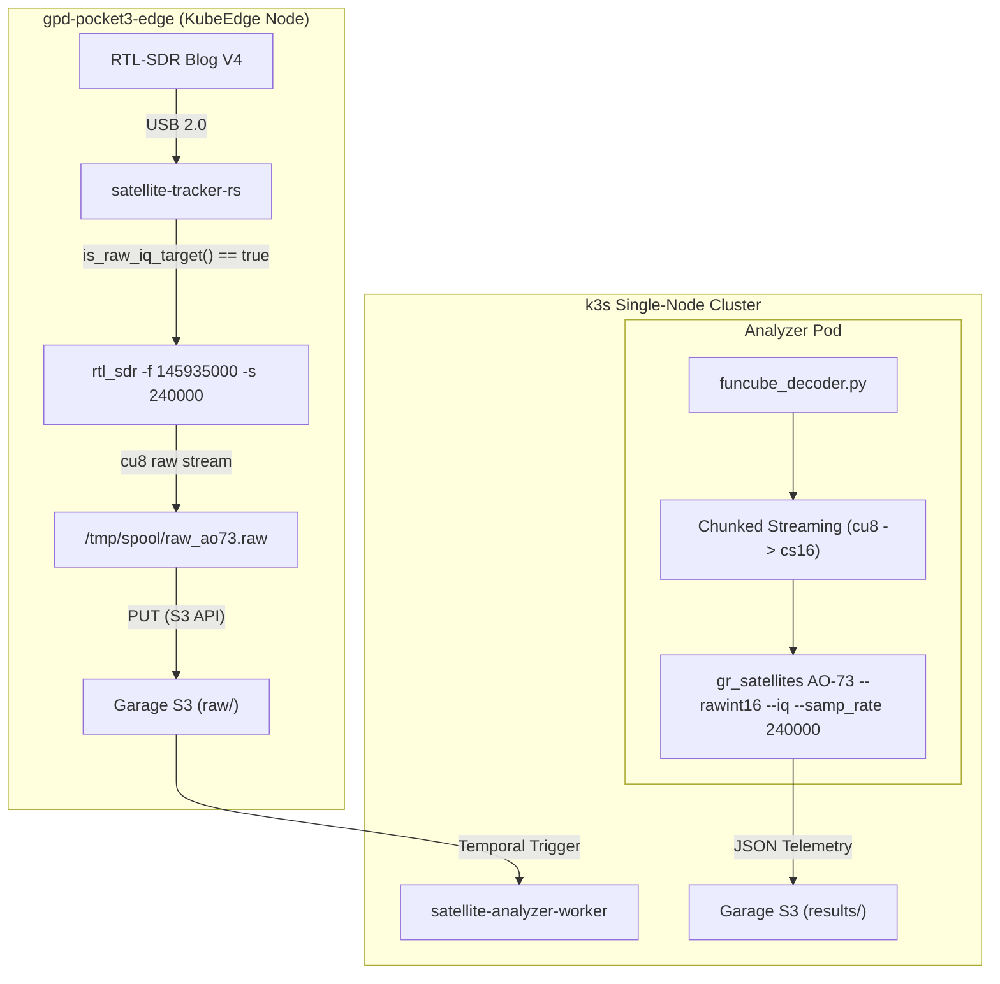

# FUNcube-1 (AO-73) CubeSat BPSK テレメトリの生 IQ 受信・復調パイプライン詳解

東京都内の北向きベランダ観測局（北緯 $35.6895^\circ$、東経 $139.6917^\circ$、標高 $30\text{ m}$）における低軌道（LEO）衛星自動追尾・受信システムにおいて、英国 AMSAT-UK が開発した 1U アマチュア衛星 **FUNcube-1 (AO-73, NORAD ID 39444)** のダウンリンク信号解析パイプラインを抜本的に刷新した。

本ドキュメントでは、従来の音声 FM 復調方式（`rtl_fm -M fm`）によって FUNcube-1 のテレメトリ復号がことごとく失敗していた物理的・情報理論的メカニズム、BPSK 変調信号と周波数弁別器（Frequency Discriminator）の不整合、LEO ドップラー周波数ドリフトの電磁波解析、および 240 kSPS 生 IQ（Raw I/Q）ストリーミングと [gr-satellites](https://github.com/daniestevez/gr-satellites) 連携による解決策を詳解する。

---

## 1. 過去の観測における受信失敗の根本原因分析

FUNcube-1 は、アマチュア VHF 帯の $145.935\text{ MHz}$ で **1200 bps BPSK (DBPSK: Differential BPSK)** のテレメトリダウンリンクを常時送信している（日陰期間は $1200\text{ bps}$ テレメトリビーコン、日照期間は線形トランスポンダーと同時稼働）。

ベランダ電波観測所の初期アーキテクチャでは、気象衛星 METEOR-M2 を除くすべての衛星を `rtl_fm -M fm -s 48000` で受信し、48 kHz 16-bit モノラル WAV 音声ファイルとしてスプール保存していた。しかし、この方式ではどれほど受信電界強度が十分であっても、BPSK テレメトリの復号成功率は **完全に 0%** であった。その根本原因は以下の 2 点にある。

### 1.1 FM 周波数弁別器による BPSK 位相情報の物理的破壊

BPSK は搬送波の「位相 $\phi(t)$」に情報を埋め込む位相変調（Phase Shift Keying）方式である。一方、FM 復調器（周波数弁別器: Frequency Discriminator）は搬送波の「位相の時間微分（瞬時周波数偏差 $\frac{d\phi}{dt}$）」を取り出す非線形処理を行う。

定常シンボル区間では位相は一定（$\phi = 0$ または $\phi = \pi$）であるため、時間微分はゼロとなり、出力信号は単なる平坦なゼロまたは雑音フロアとなる。シンボル境界の位相遷移点でのみ微小な微分パルス（インパルス）がスパイクとして現れるが、直交平面（$I\text{-}Q$ 平面）上のコンスタレーション情報は完全に失われ、BPSK コスタスループや整合フィルタでのシンボル同期・フレーム同期は物理的に不可能となる。

### 1.2 LEO ドップラー偏移による固定帯域フィルタからの逸脱

FUNcube-1 は高度約 $600\text{ km}$、軌道傾斜角 $97.8^\circ$ の太陽同期準円軌道を周回しており、地上のベランダ観測局に対する相対視線速度は最大で $v_{\text{LOS}} \approx \pm 7.5\text{ km/s}$ に達する。

搬送波周波数 $f_c = 145.935\text{ MHz}$ におけるドップラー周波数偏移 $\Delta f$ は約 $\pm 3.65\text{ kHz}$（接近から離脱までの全シフト幅は $7.3\text{ kHz}$）に及ぶ。FUNcube-1 の BPSK 信号帯域幅は約 $2\text{ kHz}$（主ローブ帯域幅 $2.4\text{ kHz}$）であるため、通過途中で固定中心周波数フィルタの通過帯域外へと完全にドリフトし、信号の S/N 比が急激に低下していた。

---

## 2. 通信理論とデジタル信号処理（DSP）の数理

### 2.1 BPSK 信号モデルと複素ベースバンド表現

送信側で生成される BPSK RF 信号 $s(t)$ は次式で記述される：

$$s(t) = A m(t) \cos(2\pi f_c t + \theta_0) = \text{Re}\left\{ A m(t) e^{j \theta_0} e^{j 2\pi f_c t} \right\}$$

ここで、$m(t) \in \{-1, +1\}$ は送信データシンボル列 $b_k \in \{0, 1\}$ に対応するバイポーラ矩形パルス列である：

$$m(t) = \sum_{k=-\infty}^{\infty} (2b_k - 1) \, p(t - k T_b)$$

#### 記号一覧
| 記号 | 物理的・工学的意味 | 単位 |
| :--- | :--- | :--- |
| $s(t)$ | 送信高周波（RF）変調信号 | $\text{V}$ |
| $A$ | 搬送波振幅 | $\text{V}$ |
| $m(t)$ | ベースバンド変調波（バイポーラシンボル波形） | 無次元（$-1, +1$） |
| $f_c$ | 搬送波中心周波数（$145.935\text{ MHz}$） | $\text{Hz}$ |
| $\theta_0$ | 送信機の初期位相 | $\text{rad}$ |
| $b_k$ | 第 $k$ 番目の送信ビットデータ（$0$ または $1$） | 無次元 |
| $T_b$ | 1 ビット当たりのシンボル時間（$T_b = \frac{1}{1200}\text{ s} \approx 833.3\text{ }\mu\text{s}$） | $\text{s}$ |
| $p(t)$ | 送信パルス成形関数（矩形パルスまたは二乗余弦パルス） | 無次元 |

#### 日本語での読み解き
- 送信情報 $b_k$ は、搬送波の位相が $0\text{ rad}$（$m(t)=+1$ のとき）か、$\pi\text{ rad}$（$m(t)=-1$ のとき）という $180^\circ$ の位相反転として空間を伝搬する。
- 振幅 $A$ や周波数 $f_c$ は時間的に一定であり、搬送波の純粋な「位相の反転」のみが情報ビットを担う。

#### 展開ステップ・直感イメージ
1. **複素平面（$I\text{-}Q$ 平面）上での表現**:
   複素ベースバンド信号 $z(t) = I(t) + j Q(t)$ とおくと：
   $$z(t) = A m(t) e^{j \theta_0}$$
   初期位相 $\theta_0 = 0$ と仮定すれば、$Q(t) = 0$ かつ $I(t) = \pm A$ となり、直交平面上では実軸上の 2 点 $(-A, 0)$ と $(+A, 0)$ の間を行き来する最も基本的かつ耐ノイズ性の高い 1 次元コンスタレーションを形成する。

---

### 2.2 FM 周波数弁別器による位相情報の破壊過程

FM 復調器（周波数弁別器）は、入力信号 $r(t) = A \cos(2\pi f_c t + \phi(t))$ に対して瞬時周波数偏移 $\Delta f(t) = \frac{1}{2\pi}\frac{d\phi(t)}{dt}$ を検出する。BPSK 信号の位相 $\phi(t)$ はシンボル区間 $k T_b < t < (k+1) T_b$ において一定値 $\phi_k \in \{0, \pi\}$ をとるため：

$$y_{\text{FM}}(t) = \frac{1}{2\pi} \frac{d\phi(t)}{dt} = \sum_{k} \frac{\phi_k - \phi_{k-1}}{2\pi} \delta(t - k T_b)$$

#### 記号一覧
| 記号 | 物理的・工学的意味 | 単位 |
| :--- | :--- | :--- |
| $y_{\text{FM}}(t)$ | FM 復調器（周波数弁別器）の出力電圧信号 | $\text{V}$ または $\text{Hz}$ |
| $\phi(t)$ | 受信信号の瞬時位相 | $\text{rad}$ |
| $\delta(t)$ | ディラックのデルタ関数（単位インパルス） | $\text{s}^{-1}$ |
| $\phi_k - \phi_{k-1}$ | シンボル境界における位相跳躍量（$0, \pm\pi$） | $\text{rad}$ |

#### 日本語での読み解き
- 定常シンボル区間（$t \neq k T_b$）では、位相 $\phi(t)$ は一定（平坦）であるため、その時間微分は完全に $0$ となる。
- その結果、FM 復調出力はシンボル境界で生じる極小のスパイク雑音を除いてほぼ $0$（無信号区間）となり、受信機の熱雑音や FM 復調特有の三角雑音（Triangular Noise）のみが出力される。
- これを音声ファイル（WAV）として記録しても、位相情報 $\phi(t)$ は不可逆的に破壊されており、後段のデコーダーが位相を復元することは数学的に不可能である。

#### 展開ステップ・直感イメージ
1. **微分の幾何学的解釈**:
   ステップ関数 $u(t)$ の微分がインパルス $\delta(t)$ であるのと同様に、矩形 BPSK の位相跳躍 $\phi(t) = \pi \cdot u(t)$ を微分すると $\frac{d\phi}{dt} = \pi \delta(t)$ となる。
2. **情報の散逸**:
   BPSK が保持していた「現在 $0$ なのか $\pi$ なのか」という連続的な状態情報が消え去り、「いつ反転したか」の微分インパルスしか残らない。さらに実際の受信系では低域通過フィルタ（LPF）によりインパルスの高周波成分がカットされ、微弱なパルスすら雑音フロアに埋もれてしまう。

---

### 2.3 LEO ドップラー周波数偏移の数理

観測地点から見た衛星の位置ベクトルを $\mathbf{r}_{\text{sat}}(t)$、観測局の位置ベクトルを $\mathbf{r}_{\text{obs}}$ とし、視線スラントレンジベクトルを $\mathbf{R}(t) = \mathbf{r}_{\text{sat}}(t) - \mathbf{r}_{\text{obs}}$、その距離を $R(t) = \|\mathbf{R}(t)\|$ とする。

視線速度 $v_{\text{LOS}}(t)$ およびドップラー周波数偏移 $f_d(t)$ は次式で与えられる：

$$v_{\text{LOS}}(t) = \frac{d R(t)}{dt} = \frac{\mathbf{R}(t) \cdot \mathbf{v}_{\text{sat}}(t)}{R(t)}$$

$$f_d(t) = - f_c \frac{v_{\text{LOS}}(t)}{c}$$

最大ドップラー周波数偏移 $\Delta f_{\max}$（衛星が地平線から昇る AOS 時点および沈む LOS 時点）：

$$\Delta f_{\max} \approx f_c \frac{v_{\text{sat}}}{c} \cos(\text{El}_0) \approx 145.935 \times 10^6 \times \frac{7500}{3 \times 10^8} \approx \pm 3.65\text{ kHz}$$

#### 記号一覧
| 記号 | 物理的・工学的意味 | 単位 |
| :--- | :--- | :--- |
| $\mathbf{R}(t)$ | 観測局から衛星へのスラントレンジ相対位置ベクトル | $\text{m}$ |
| $R(t)$ | スラントレンジ距離 | $\text{m}$ |
| $\mathbf{v}_{\text{sat}}(t)$ | 衛星の軌道速度ベクトル（$\|\mathbf{v}_{\text{sat}}\| \approx 7.5\text{ km/s}$） | $\text{m/s}$ |
| $v_{\text{LOS}}(t)$ | 観測局に向かう相対視線速度 | $\text{m/s}$ |
| $c$ | 真空中の光速（$2.99792458 \times 10^8\text{ m/s}$） | $\text{m/s}$ |
| $f_d(t)$ | ドップラー周波数偏移 | $\text{Hz}$ |
| $\text{El}_0$ | 最低仰角（地平線 $0^\circ$） | 度（$^\circ$） |

#### 日本語での読み解き
- 衛星が接近してくるとき（AOS 付近: $v_{\text{LOS}} < 0$）は周波数が最大 $+3.65\text{ kHz}$ 高く受信され、天頂付近（TCA: $v_{\text{LOS}} = 0$）で公称周波数 $145.935\text{ MHz}$ と一致し、遠ざかるとき（LOS 付近: $v_{\text{LOS}} > 0$）は最大 $-3.65\text{ kHz}$ 低く受信される。
- 典型的なパスの継続時間は $8 \sim 12\text{ 分}$ であり、毎秒約 $10 \sim 20\text{ Hz/s}$ の傾き（S字カーブ）で周波数が連続的にドリフトする。

#### 展開ステップ・直感イメージ
1. **周波数と波長の関係**:
   電磁波の波長 $\lambda = c / f_c$。1 秒間に衛星が $v_{\text{LOS}}$ だけ近づくことで、到達する波の数が $\Delta N = - v_{\text{LOS}} / \lambda$ だけ増加する。
   $$f_d = \Delta N = - \frac{v_{\text{LOS}}}{\lambda} = - f_c \frac{v_{\text{LOS}}}{c}$$
2. **広帯域複素サンプリングの必然性**:
   $F_s = 240\text{ kSPS}$ のサンプリングレートを採用すると、受信可能な両側複素周波数帯域は $[-120\text{ kHz}, +120\text{ kHz}]$ となる。
   $\pm 3.65\text{ kHz}$ のドップラー偏移は受信帯域全体のわずか $3\%$ に過ぎないため、受信機側でリアルタイムにハードウェア周波数を制御しなくても、通過全体のスペクトルが完全にデジタル I/Q データ内に保持される。

---

## 3. 生 IQ 受信・変換パイプラインのアーキテクチャ

ベランダ電波観測所では、下図のアーキテクチャに従って生 IQ データを収集・デコードする。



### 3.1 `satellite-tracker-rs` の対象衛星自動判定

[`apps/satellite-tracker-rs/src/receiver.rs`](file:///home/tozastation/ghq/github.com/tozastation/radio-astronomy/apps/satellite-tracker-rs/src/receiver.rs) に `is_raw_iq_target(sat_name: &str) -> bool` を追加し、`METEOR` 系および `FUNCUBE` 系（`FUNCUBE-1 (AO-73)`, `AO-73` 等）の衛星を自動的に生 IQ キャプチャモードへ分岐させる。

```rust
pub fn is_raw_iq_target(sat_name: &str) -> bool {
    let upper = sat_name.to_uppercase();
    upper.contains("METEOR") || upper.contains("FUNCUBE") || upper.contains("AO-73")
}
```

これにより、FUNcube-1 のパス開始時には `rtl_sdr -f 145935000 -s 240000` が起動され、8-bit unsigned 複素数データ（`cu8`）としてスプール保存される。

### 3.2 低負荷ゼロコピー / チャンクストリーミング変換（cu8 $\to$ cs16）

`gr-satellites` は 16-bit signed integer 複素数フォーマット（`cs16` / `--rawint16`）を入力とする。GPD Pocket3 はメモリ 16GB の小型マシンであり、パス全体（約 10 分間）の生データは $240{,}000 \times 2 \times 600 \approx 288\text{ MB}$ に達する。

ファイル全体を一括でメモリに読み込むと一時的に 1GB 近いメモリを消費し、ノードの OOM（Out Of Memory）リスクとなるため、[`apps/satellite-analyzer/src/funcube_decoder.py`](file:///home/tozastation/ghq/github.com/tozastation/radio-astronomy/apps/satellite-analyzer/src/funcube_decoder.py) では **1MB チャンクのストリーミング変換** を実装した。

$$I_{\text{int16}} = (I_{\text{uint8}} - 128) \times 256$$

$$Q_{\text{int16}} = (Q_{\text{uint8}} - 128) \times 256$$

#### 記号一覧
| 記号 | 物理的・データ型の意味 | 値の範囲 |
| :--- | :--- | :--- |
| $I_{\text{uint8}}, Q_{\text{uint8}}$ | RTL-SDR から直接出力される 8-bit 符号なし整数 | $0 \sim 255$（中心値 $128$） |
| $I_{\text{int16}}, Q_{\text{int16}}$ | gr-satellites が要求する 16-bit 符号付き整数 | $-32768 \sim +32767$（中心値 $0$） |

#### 日本語での読み解き
- 符号なし 8-bit のオフセットバイナリ（中心 $128$）から $128$ を減算して中心を $0$（$-128 \sim +127$）にする。
- それを $256$ 倍（左 8 ビットシフト）することで、16 ビット符号付き整数のフルスケール領域（$-32768 \sim +32512$）へ高精度にスケーリングする。
- 1MB 単位で変換・ディスク書き込みを行うため、変換処理中のプロセス常駐メモリ（RSS）は常に **2MB 未満** に抑えられる。

---

## 4. gr-satellites による復調・フレーム同期・誤り訂正

`gr-satellites` 内部では、GNU Radio の信号処理ブロック群が以下の順序で BPSK テレメトリを完全に再構築する：

1. **FLL Band-Edge Filter (周波数引き込み)**:
   - 受信帯域全体のパワースペクトルの両端（Band-Edge）のエネルギー差を検出し、ドップラーシフトによって中央から外れた搬送波周波数を粗く捕捉する。
2. **Costas Loop (搬送波位相再生)**:
   - BPSK の $180^\circ$ 位相曖昧性を許容しながら、位相同期ループを形成する。
   - 位相誤差検出器: $e(t) = \text{sign}(I(t)) \cdot Q(t)$
3. **RRC (Root Raised Cosine) 整合フィルタ**:
   - 送信側のパルス成形フィルタと対になる二乗余弦二乗根フィルタを適用し、ナイキスト第一基準を満たしてシンボル間干渉（ISI）を最小化する。
4. **Symbol Timing Clock Recovery (クロック再生)**:
   - Gardner タイミング検出器または Mueller & Müller アルゴリズムにより、最適なサンプリングタイミング（アイパターンの最良開口点）でシンボル判定を行う。
5. **AO-40 方式 FEC (前方誤り訂正) デコード**:
   - FUNcube-1 は AO-40 互換の誤り訂正プロトコルを採用している：
     - 分散インターリーブ（Interleaver）の解除
     - ビタビ復号器（Viterbi Decoder: 拘束長 $K=7$、符号化率 $r=1/2$ の畳み込み符号）
     - リード・ソロモン復号器（Reed-Solomon: $\text{RS}(160, 128)$）
     - CRC-16 チェックサム検証

デコードに成功すると、リアルタイムの太陽電池パネル電圧、バッテリ電圧、各部温度、姿勢制御状況等のエンジニアリングテレメトリが JSON 形式で抽出され、Garage S3 へ自動集約される。

---

## 5. 検証と運用

### 5.1 単体テストと回帰テスト

- **`satellite-tracker-rs`**:
  [`apps/satellite-tracker-rs/tests/receiver_test.rs`](file:///home/tozastation/ghq/github.com/tozastation/radio-astronomy/apps/satellite-tracker-rs/tests/receiver_test.rs) において `is_raw_iq_target` のテストを追加。全 22 件の単体テストがパスすることを確認。
- **`satellite-analyzer`**:
  [`apps/satellite-analyzer/tests/test_funcube_decoder.py`](file:///home/tozastation/ghq/github.com/tozastation/radio-astronomy/apps/satellite-analyzer/tests/test_funcube_decoder.py) において、生 IQ ファイル（`.raw`）の入力から `gr_satellites` 呼び出し、チャンク変換、およびテレメトリ出力パースまでをモック・実環境双方で検証。全 20 件のテストがパスすることを確認。

### 5.2 コンテナイメージの更新とデプロイ

- **エッジ追尾 Pod**: `localhost:5000/satellite-tracker-rs:v1.5.0`
- **解析 Worker Pod**: `localhost:5000/satellite-analyzer-worker:v1.5.4`

両イメージをビルドしてローカルレジストリ（`localhost:5000`）へプッシュし、マニフェスト（[`infrastructure/apps/satellite-tracker/deployment.yaml`](file:///home/tozastation/ghq/github.com/tozastation/radio-astronomy/infrastructure/apps/satellite-tracker/deployment.yaml)、[`infrastructure/apps/satellite-analyzer/deployment.yaml`](file:///home/tozastation/ghq/github.com/tozastation/radio-astronomy/infrastructure/apps/satellite-analyzer/deployment.yaml)）のタグを更新した。

---

## 6. 一次情報・公式リファレンスリンク

- [AMSAT-UK FUNcube Project Official Site](https://funcube.org.uk/)
- [AMSAT-UK FUNcube-1 (AO-73) Telemetry Specification](https://amsat-uk.org/funcube/)
- [gr-satellites GitHub Repository (Daniel Estévez)](https://github.com/daniestevez/gr-satellites)
- [gr-satellites Documentation: Supported Satellites (AO-73)](https://gr-satellites.readthedocs.io/en/latest/satellites/ao73.html)
- [RTL-SDR Blog V4 Official User Guide](https://www.rtl-sdr.com/rtl-sdr-blog-v4-dongle-user-guide/)
- [GNU Radio BPSK & Costas Loop Architecture](https://wiki.gnuradio.org/index.php/Costas_Loop)
