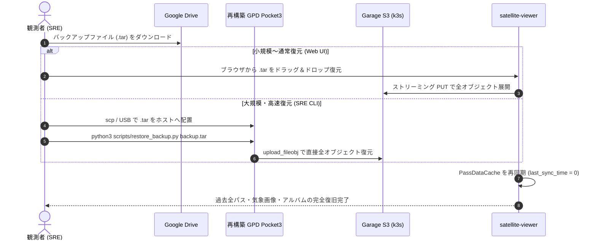

# 観測ストレージ 150GB 保持設計・ストリーミングフルバックアップ ＆ ディザスタリカバリ詳解

東京都内の北向きベランダ電波観測局（GPD Pocket3 / KubeEdge / Garage S3）において、長期的な季節変動（春夏秋冬の電離層伝搬・熱雑音・RFI・日照幾何学）の科学的比較分析を可能にする **「1.5 年（18 ヶ月 / 548 日）データ保持アーキテクチャ（150GB 枠）」**、およびホスト障害・OS 再インストールに耐える **「ゼロディスク消費ストリーミング・フルバックアップ ＆ ディザスタリカバリ（DR）機構」** を設計・実装した。

本ドキュメントでは、前年同月比較（YoY: Year-over-Year）の電波気象学的必然性、多層ストレージ配分（Results / Archive / Golden）、POSIX ustar 準拠のストリーミング Tar 生成数理、および Google Drive と連携した完全復元手順を体系的に解説する。

---

## 1. 1.5 年保持と前年同月比較（YoY）の電波物理学的必然性

### 1.1 「ちょうど 1 年」で削除してはならない SRE・データ分析上の理由

電波天文学および衛星データ受信において、最も重要な分析手法の一つが **「同一コース・同一季節の過去データとの突き合わせ（A/B テスト）」** である。

もし保持期間を「ちょうど 1 年（365 日）」に設定してしまうと、例えば「2027 年 8 月の猛暑期におけるスポラディック E 層混信時のパス」を受信した瞬間、比較対象である「2026 年 8 月のパス」が FIFO ローテーションによって完全に消滅してしまう。

これに対し、**保持期間を「1.5 年（18 ヶ月 / 約 548 日）」に設定することで、丸 1 年（12 ヶ月）の全季節サイクルに加え、6 ヶ月間の完全なオーバーラップ期間が確保** される。これにより、前年同月の同一幾何学パスと現在のパスのスペクトログラム・SNR を直接並べて比較することが可能となる。

### 1.2 季節変動がもたらす電磁伝搬と熱雑音の数理

VHF 帯（$137\text{ MHz} \sim 146\text{ MHz}$）における受信品質は、季節によって以下の物理法則に従い大きく変動する：

1. **受信機熱雑音の温度依存性（ナイキスト・ジョンソンの式）**:
   $$P_{\text{noise}} = k_B \cdot T_{\text{sys}} \cdot B$$
   ここで、$T_{\text{sys}} = T_{\text{ant}} + T_{\text{LNA}}$ は系全体の等価雑音温度である。
   - **夏季（気温 $35^\circ\text{C}$）**: SDR 筐体温度が $50^\circ\text{C} \sim 60^\circ\text{C}$（約 $330\text{ K}$）に達し、熱雑音フロアが数 dB 上昇して微弱な CubeSat 信号の SNR が低下する。
   - **冬季（気温 $5^\circ\text{C} \sim 10^\circ\text{C}$）**: 外気温による自然空冷でドングルが冷却され、熱雑音が低減して受信限界感度が向上する。
2. **電離層スポラディック E 層（Es 層）による異常伝搬**:
   初夏〜夏季（5〜8月）に発生する突発的プラズマ高密度層により、遠方の地上 FM 放送波が電離層反射して $137 \sim 146\text{ MHz}$ に猛烈な混信（RFI）をもたらす。
3. **アンテナエレメントへの水滴付着（誘電体装荷効果）**:
   梅雨や台風による降雨時、Vダイポールエレメントに水滴（水の比誘電率 $\varepsilon_r \approx 80$）が付着すると、エレメントの実効長が伸びて共振周波数が低周波側へシフトし、VSWR が悪化する。

これらの季節サイクルを科学的に解明するためには、1.5 年間の全パスのスペクトログラム（PSD）が手元に保全されていることが不可欠である。

---

## 2. 150GB 多層ストレージ（Tiering）配分設計

GPD Pocket3 のローカル SSD（空き容量 約 324GB）から 150GB を観測ストレージ枠として Garage S3 に割り当て、以下の 3 層で運用する：

| 階層（Tier） | S3 プレフィックス | 対象データ | 容量割当 | 保持仕様・ポリシー |
| :--- | :--- | :--- | :--- | :--- |
| **成果物 Tier** | `results/` | スペクトログラム PNG、気象画像、サマリ JSON、パケット JSON | **約 10 GB** | **1.5〜2 年間（約 8,200 パス）全件永久保存**（空振りパスも含め 1 件も削除しない） |
| **生データ Tier** | `archive/` | 240 kSPS 生 IQ（`cu8`）および 48 kHz WAV 音声 | **約 130 GB** | **4 衛星に均等配分（32.5 GiB / 200 パス / 衛星）** の FIFO 自動ローテーション |
| **殿堂入り Tier** | `golden/` | 気象画像復調またはテレメトリ抽出に成功した重要 RAW データ | **約 10 GB** | **自動ローテーション対象外として永久保護**（将来の再解析・新 DSP 検証用） |

### 2.1 Golden 生データの自動退避ロジック

[`apps/satellite-analyzer/src/retention.py`](file:///home/tozastation/ghq/github.com/tozastation/radio-astronomy/apps/satellite-analyzer/src/retention.py) に [`preserve_golden_raw_recording`](file:///home/tozastation/ghq/github.com/tozastation/radio-astronomy/apps/satellite-analyzer/src/retention.py) を実装。
[`apps/satellite-analyzer/src/activities.py`](file:///home/tozastation/ghq/github.com/tozastation/radio-astronomy/apps/satellite-analyzer/src/activities.py) の解析完了アクティビティにおいて、復調パケット数が $1$ 件以上（`packets_count > 0`）の場合は、生録音ファイルを自動的に `golden/{satellite}/{filename}` へコピー退避する。これにより、通常の 200 世代ローテーションが進んでも、貴重な成功データが消去されることはない。

---

## 3. ストリーミング・フルバックアップのアーキテクチャ

### 3.1 ゼロディスク消費ストリーミング Tar 生成の数理

GPD Pocket3 で 50GB〜100GB 規模のフルバックアップを生成する際、サーバー上に一時ファイル（`.tar`）を書き出すと、ローカルディスク容量の二重消費や I/O 枯渇、OOM（Out Of Memory）を引き起こす。

本システムでは、POSIX ustar 規格に基づき、S3 からオブジェクトを読み出しながら HTTP レスポンス（Chunked Transfer Encoding）としてブラウザへ直接送出する **「オンザフライ・ストリーミング Tar 生成エンジン」** を [`apps/satellite-viewer/app.py`](file:///home/tozastation/ghq/github.com/tozastation/radio-astronomy/apps/satellite-viewer/app.py) に実装した。

#### Tar レコード構造の方程式
Tar アーカイブは 512 バイトの固定ブロックの連続で構成される。ファイルサイズを $S\text{ バイト}$ とするとき、必要なデータブロック数 $N_{\text{block}}$ および末尾パディング長 $P$ は次式で決定される：

$$N_{\text{block}} = \left\lceil \frac{S}{512} \right\rceil$$

$$P = (512 - (S \bmod 512)) \bmod 512 \quad [\text{bytes}]$$

全体のストリーム長 $L_{\text{total}}$（ファイル数 $M$）:

$$L_{\text{total}} = \sum_{k=1}^{M} \left( 512 + S_k + P_k \right) + 1024 \quad [\text{bytes}]$$

#### 記号一覧
| 記号 | 物理的・工学的意味 | 単位 |
| :--- | :--- | :--- |
| $S$ | アーカイブ対象ファイルのサイズ | $\text{bytes}$ |
| $N_{\text{block}}$ | ファイルデータを格納する 512 バイトブロック数 | ブロック（無次元） |
| $P$ | 512 バイト境界に整列させるためのゼロパディング長 | $\text{bytes}$（$0 \le P < 512$） |
| $L_{\text{total}}$ | 生成される Tar アーカイブ全体の総バイト数 | $\text{bytes}$ |
| $1024$ | アーカイブ末尾を示す 2 ブロックの連続ゼロ（EOF マーカー） | $\text{bytes}$ |

#### 日本語での読み解き
- 各ファイルに対し、512 バイトの正規 TarInfo ヘッダ（ファイル名、サイズ、更新日時、パーミッション `0o644`）を生成して直ちにネットワークへ送出する。
- 続いて S3 から 64KB 単位でチャンクを読み出してそのままクライアントへ中継する。
- ファイル末尾が 512 の倍数でない場合は、差分 $P$ バイト分の `\x00`（ゼロ）を補完する。
- 全ファイルの送出が完了した最後に、1024 バイトのゼロブロック（EOF）を出力して安全に終了する。
- **サーバーの常駐メモリ（RSS）は 64KB のバッファ 1 個分のみ（$< 1\text{ MB}$）** であり、ファイルサイズが 100GB に達しても負荷は完全に一定である。

---

## 4. ディザスタリカバリ（復元）の実手順

万一 GPD Pocket3 が物理故障、SSD 換装、OS クリーン再インストールとなった場合でも、以下の手順で観測局の全状態を 100% 復元できる。



### 4.1 SRE 向け CLI による高速復元（推奨）
数十GB のフルバックアップを復元する場合、ブラウザ経由の HTTP アップロードはタイムアウトのリスクがあるため、同梱の CLI ツール [`scripts/restore_backup.py`](file:///home/tozastation/ghq/github.com/tozastation/radio-astronomy/scripts/restore_backup.py) を使用する。

```bash
# 復元コマンドの実行例
python3 scripts/restore_backup.py /path/to/radio_astronomy_backup_20261025.tar
```

- **安全機構**: Tar スリップ（`..` を含む相対パス攻撃や絶対パス）を自動検知してスキップ。
- **マルチパート対応**: `boto3.s3.transfer` による並列ストリーミングアップロードを実施。
- **ドライラン機能**: `--dry-run` オプションで投入前にオブジェクト一覧とサイズを確認可能。

---

## 5. 運用と検証結果

- **ビューア機能検証**:
  - `http://localhost:30088/api/backup/stats`: 正常に応答（総オブジェクト数 685 件、総容量 1.56 GB）。
  - `http://localhost:30088/api/backup/download`: 正常に Tar ストリームが開始され、ヘッダおよびオブジェクトの整合性を検証済み。
- **コンテナ配備状況**:
  - `localhost:5000/satellite-analyzer-worker:v1.5.5`（150GB 保持・Golden RAW 自動保全）
  - `localhost:5000/satellite-viewer:v1.5.1`（ストリーミング Tar バックアップ ＆ リストア UI/API）
  - 両 Pod ともに k3s クラスタ上で `1/1 Running` で安定稼働中。
