# METEOR-M2 気象衛星の受信から画像復調までの全段メカニズム詳解

本ドキュメントは、東京都北向きベランダ電波観測所において、**高度 820 km を周回するロシアの気象衛星 METEOR-M2（M2-3 / M2-4）から送信される $137.900\text{ MHz}$ の微弱な電波をアンテナで捉え、最終的な地球雲画像（PNG）およびテレメトリとして復号するまでの全物理・数学・工学プロセス** を徹底解説するものである。

電磁気学、高周波（RF）工学、直交サンプリング、デジタル信号処理（DSP）、誤り訂正符号理論（FEC）、CCSDS 宇宙通信規格、分散コンテナオーケストレーションに至る多層パイプラインのメカニズムを、情報量を落とさずに解き明かす。

---

## 1. エンドツーエンドの全体アーキテクチャ概要

宇宙空間の衛星アンテナから観測所ブラウザの画面に画像が届くまで、データは以下の 6 つのステージ（OSI 参照モデル L0 物理層から L7 アプリケーション層）を経て変換される。

```mermaid
flowchart TD
    subgraph S1["【ステージ 1】宇宙・電波・アンテナ (物理・電磁気学)"]
        Orbit["SGP4 軌道伝搬予測<br/>スカイウィンドウ判定 (El > 10°)"]
        SatTX["高度 820 km 送信機 (5W)<br/>137.900 MHz / RHCP 右旋円偏波<br/>QPSK 72 kSym/s"]
        Space["自由空間電波伝搬 (減衰 134 dB)<br/>ドップラー偏移 (±3 kHz)"]
        Antenna["V字ダイポールアンテナ (10時10分・北へ60°前傾)<br/>手すり反射波の相殺と直達波受波"]
        Orbit --> SatTX --> Space --> Antenna
    end

    subgraph S2["【ステージ 2】RF フロントエンドと直交サンプリング"]
        LNA["RTL-SDR Blog V4 LNA 増幅"]
        Mixer["直交ミキサ (Quadrature Downconversion)<br/>局部発振器 (LO: 137.900 MHz)"]
        ADC["8-bit ADC (RTL2832U)<br/>240 kSPS cu8 複素ベースバンドサンプリング"]
        Tracker["satellite-tracker-rs (Rust)<br/>通過時のみ USB 受信機を開放<br/>/tmp/spool/*.raw (150 MB) 保存"]
        Antenna --> LNA --> Mixer --> ADC --> Tracker
    end

    subgraph S3["【ステージ 3】エッジ・ストレージ連携とワーカー起動"]
        S3Up["Tracker S3Uploader<br/>Garage S3 raw/ へストリーミング転送"]
        Viewer["satellite-viewer<br/>raw/ の未解析ファイルを検知"]
        Temporal["Temporal ワークフロー発火<br/>AnalyzeSatellitePassWorkflow"]
        KEDA["KEDA ScaledObject<br/>analyzer ワーカーを 0 → 1 台へ自動起動"]
        Tracker --> S3Up --> Viewer --> Temporal --> KEDA
    end

    subgraph S4["【ステージ 4】デジタル信号処理 (DSP) による変調波復元"]
        DCBlock["1次 IIR 高域通過フィルタ (--dc_block true)<br/>0Hz DC オフセット (LO自己漏洩) 除去"]
        RRC["RRC (Root Raised Cosine) 整合フィルタ<br/>符号間干渉 (ISI) 除去 & SNR 最大化"]
        Timing["Gardner タイミング誤差検出器<br/>72 kSym/s 最適シンボル判定点抽出"]
        Costas["Costas ループ (搬送波位相同期 PLL)<br/>ドップラー周波数追従 & コンスタレーション静止"]
        KEDA --> DCBlock --> RRC --> Timing --> Costas
    end

    subgraph S5["【ステージ 5】情報理論・伝送路復号 (FEC / CCSDS)"]
        Viterbi["ビタビ復号器 (Viterbi, k=7, r=1/2)<br/>軟判定によるビット誤り強力訂正"]
        ASM["フレーム同期マーカー (ASM: 0x1ACFFC1D)<br/>1,024 バイト CADU フレーム境界抽出"]
        Derand["デランダマイザ (PN シーケンス XOR)"]
        RS["リード・ソロモン復号 RS(255, 223)<br/>残存バースト誤りの完全訂正"]
        Costas --> Viterbi --> ASM --> Derand --> RS
    end

    subgraph S6["【ステージ 6】画像生成とパノラマ幾何補正"]
        MSUMR["MSU-MR 放射計パケット展開<br/>Ch 1(可視光), Ch 2(近赤外), Ch 4(熱赤外)"]
        LineScan["回転鏡ラインスキャンラスタ化<br/>東西 1,568 px × 南北 792 行"]
        GeoCorr["地球曲率歪み補正 (Projected / Corrected)<br/>マルチスペクトル疑似カラー合成 (2,800 × 792 px)"]
        S3Res["Garage S3 results/ 保存<br/>Web ビューア表示 & ローカルアーカイブ"]
        RS --> MSUMR --> LineScan --> GeoCorr --> S3Res
    end
```



---

## 2. ステージ 1：宇宙・電波・アンテナ（電磁気学と軌道幾何）

### 2.1 SGP4 軌道伝搬とスカイウィンドウ突入判定
METEOR 衛星は高度約 $820\text{ km}$、軌道傾斜角 $98.7^\circ$ の**太陽同期準回帰軌道（SSO）** を周回している。地球を約 $101\text{ 分}$ で 1 周し、東京上空には 1 日に数回（南から北へ向かう昇交点パス、北から南へ向かう降交点パス）飛来する。

地上局プログラム（`satellite-tracker-rs`）は、NORAD が公開する 2 行軌道要素形式（TLE: Two-Line Elements）をもとに **SGP4（Simplified General Perturbations 4）モデル** を用いて 2 秒周期で衛星の位置ベクトル $\vec{r}(t)$ と速度ベクトル $\vec{v}(t)$ を計算する。

観測地点（北向きベランダ: 北緯 $35.6895^\circ$, 東経 $139.6917^\circ$）から見た方位角 $\text{Az}$ と仰角 $\text{El}$ が、ベランダ開口条件：
$$\text{El} \ge 10^\circ \quad \text{かつ} \quad (270^\circ \le \text{Az} \le 360^\circ \ \text{または} \ 0^\circ \le \text{Az} \le 110^\circ)$$
を満たした瞬間に「**AOS（Acquisition of Signal: 視界侵入）**」と判定し、受信機を起動する。

---

### 2.2 ドップラー効果による周波数偏移の数理
衛星が秒速約 $7.5\text{ km/s}$ で頭上を高速通過するため、受信周波数はドップラー効果により S 字カーブを描いて激しく時間変動する。

$$f_r(t) = f_0 \left( 1 - \frac{\vec{v}(t) \cdot \vec{u}(t)}{c} \right) = f_0 \left( 1 - \frac{v_r(t)}{c} \right)$$

#### 記号一覧
| 記号 | 物理的意味 | 単位 | 設定値・代表値 |
| :--- | :--- | :--- | :--- |
| $f_r(t)$ | 地上観測所で観測される受信搬送波周波数 | $\text{Hz}$ | $137.897\text{ MHz} \sim 137.903\text{ MHz}$ |
| $f_0$ | 衛星送信機の公称中心周波数 | $\text{Hz}$ | $137.900\text{ MHz}$ |
| $\vec{v}(t)$ | 地球固定座標系（ECEF）における衛星の速度ベクトル | $\text{m/s}$ | 約 $7,450\text{ m/s}$ |
| $\vec{u}(t)$ | 観測所から衛星へ向かう単位視線ベクトル | 無次元 | $\|\vec{u}(t)\| = 1$ |
| $v_r(t)$ | 視線方向の相対視線速度（接近が正、後退が負） | $\text{m/s}$ | $\pm 6,500\text{ m/s}$ |
| $c$ | 真空中における電磁波の伝搬速度（光速） | $\text{m/s}$ | $299,792,458\text{ m/s}$ |

#### 日本語での読み解き
衛星が地上局に向かって接近してくるとき（AOS 直後）、電波の波面が進行方向に押し縮められるため、周波数は公称値より約 $+3\text{ kHz}$ 高い $137.903\text{ MHz}$ で受波される。頭上を通り過ぎる瞬間（TCA: 最接近時）に周波数偏移はゼロ（$137.900\text{ MHz}$）を通過し、遠ざかるにつれて約 $-3\text{ kHz}$ 低い $137.897\text{ MHz}$ へと偏移していく。

#### 展開ステップ・直感イメージ
1. 接近時：$v_r \approx +6.5\text{ km/s} \implies \Delta f = -137.9\times 10^6 \times \frac{-6500}{3\times 10^8} \approx \mathbf{+2,988\text{ Hz}}$（高くなる）。
2. 後退時：$v_r \approx -6.5\text{ km/s} \implies \Delta f \approx \mathbf{-2,988\text{ Hz}}$（低くなる）。
3. 全通過時間（約 300 秒）の間に周波数が約 $6\text{ kHz}$ も連続スライドするため、復調器の PLL（Costas ループ）がこの S 字カーブに脱調することなく追従し続けなければならない。

---

### 2.3 円偏波（RHCP）と V 字ダイポールアンテナの受波電磁気学
METEOR 衛星の送信アンテナは、電離層でのファラデー回転（偏波面の回転）による信号途絶を防ぐため、電界ベクトル $\vec{E}$ が回転しながら進む **右旋円偏波（RHCP: Right Hand Circular Polarization）** を射出している。

$$\vec{E}(t, z) = E_0 \left[ \cos(\omega t - kz) \hat{x} + \sin(\omega t - kz) \hat{y} \right]$$

これを直線偏波アンテナ（ダイポール）で受けると理論上 $-3\text{ dB}$（電力半分）の偏波損失が生じる。しかし、当観測所では 2 本のエレメントを **開き角 $120^\circ$ の V 字（「10時10分」配置）とし、文字盤を北へ $60^\circ$ 前傾（仰角 $30^\circ$ 見上げ）** させることで以下の効果を得ている：
1. **RHCP の直交ベクトル成分を左右エレメントで立体的に受波** し、偏波不整合を最小化。
2. アンテナの最大感度ビーム（腹）を北向き開口窓の仰角 $45^\circ \sim 60^\circ$ に正面から一致させる。
3. ベランダの水平金属手すりバーとの平行配置を破綻させ、手すり反射波（マルチパス干渉フェージング、Lloyd's Mirror 効果）を極小化する。

---

## 3. ステージ 2：RF フロントエンドと直交サンプリング（RTL-SDR Blog V4）

### 3.1 アナログ直交ミキサ（I/Q 分離）の数学
アンテナで受信された微弱な RF 信号 $s(t)$（振幅数マイクロボルト）は、RTL-SDR 内の LNA で増幅された後、アナログ直交ミキサに入力される。

$$s(t) = A(t) \cos(2\pi f_{\text{RF}} t + \phi(t))$$

ミキサ内部では、水晶発振器で生成された局部発振信号（LO: $f_{\text{LO}} = 137.900\text{ MHz}$）と同相搬送波 $\cos(2\pi f_{\text{LO}} t)$、および $90^\circ$ 位相をずらした直交搬送波 $-\sin(2\pi f_{\text{LO}} t)$ をそれぞれ乗算する。

$$I(t) = \text{LPF}\left\{ s(t) \cdot 2\cos(2\pi f_{\text{LO}} t) \right\} = A(t) \cos(\Delta\omega t + \phi(t))$$
$$Q(t) = \text{LPF}\left\{ s(t) \cdot (-2\sin(2\pi f_{\text{LO}} t)) \right\} = A(t) \sin(\Delta\omega t + \phi(t))$$

#### 記号一覧
| 記号 | 物理的意味 | 単位 |
| :--- | :--- | :--- |
| $s(t)$ | アンテナで受波された高周波（RF）帯域通過信号 | $\text{V}$ |
| $I(t)$ | 同相成分（In-phase: 実部）ベースバンド信号 | $\text{V}$ |
| $Q(t)$ | 直交成分（Quadrature: 虚部）ベースバンド信号 | $\text{V}$ |
| $f_{\text{RF}}$ | 受信信号周波数（$137.900\text{ MHz} + \Delta f_{\text{Doppler}}$） | $\text{Hz}$ |
| $f_{\text{LO}}$ | RTL-SDR 局部発振周波数（$137.900\text{ MHz}$） | $\text{Hz}$ |
| $\Delta\omega = 2\pi(f_{\text{RF}} - f_{\text{LO}})$ | ダウンコンバージョン後のベースバンド角周波数偏移 | $\text{rad/s}$ |
| $\text{LPF}\{\cdot\}$ | アナログ低域通過フィルタ（和周波数 $f_{\text{RF}} + f_{\text{LO}} \approx 276\text{ MHz}$ を除去） | 演算子 |

#### 日本語での読み解き
高周波の $137.900\text{ MHz}$ 信号をそのまま A/D 変換するには毎秒 3 億回以上の超高速 ADC が必要となる。そこで、$137.900\text{ MHz}$ の基準波を掛け算して引き算周波数（数 kHz のベースバンド）へ引きずり下ろす。このとき、実部 $I(t)$ と虚部 $Q(t)$ の 2 系統のペア信号（複素解析信号 $z(t) = I(t) + j Q(t)$）として取り出すことで、**「プラスの周波数」と「マイナスの周波数」を数学的に完全に区別** できるようになる。

---

### 3.2 なぜ 48 kHz 音声 WAV ではなく 240 kSPS 生 IQ（`cu8`）が必要なのか
ISS などのアマチュア無線音声中継は FM 音声帯域（約 $15\text{ kHz}$）に収まるため、48 kHz サンプリングの WAV ファイルで録音できる。

しかし、METEOR の LRPT はシンボルレート $R_s = 72\text{ kSym/s}$ の 4相変調（QPSK）である。ルートレイズドコサインフィルタのロールオフ率 $\alpha = 0.6$ を考慮すると、信号の占有帯域幅 $B$ は：
$$B = R_s (1 + \alpha) = 72\text{ kHz} \times (1 + 0.6) = \mathbf{115.2\text{ kHz}}$$
さらにドップラー偏移幅（$\pm 3\text{ kHz}$）を加えると、最低でも $120\text{ kHz}$ 以上の帯域幅を歪みなくサンプリングしなければならない。

シャノン＝ナイキストの標本化定理により、複素 IQ サンプリング周波数 $f_s$ は占有帯域幅 $B$ 以上である必要がある（複素サンプリングでは負の周波数も表現できるため $f_s \ge B$）：
$$f_s = 240\text{ kSPS} > 115.2\text{ kHz}$$
このため、`satellite-tracker-rs` は 8-bit unsigned 複素数（`cu8`: $I, Q$ それぞれ 1 バイト、1 サンプル計 2 バイト）で直接 raw ファイルへストリーミング録音する（データレート: $240,000 \times 2 = 480\text{ kB/s}$、5分間のパスで約 $150\text{ MB}$）。

---

## 4. ステージ 3：デジタル信号処理（DSP）による変調波復元（SatDump）

録音された生 IQ データは S3 を経由してワーカー Pod 内の SatDump に引き渡される。SatDump の内部では以下の 4 段階の DSP 処理がリアルタイムに実行される。

```text
[生 IQ cu8 (240kSPS)]
       │
       ▼
┌──────────────────────────┐
│ 1次 IIR DC ブロック      │ ── 0Hz スパイク (未変調キャリア) を完全切除
└──────────────────────────┘
       │
       ▼
┌──────────────────────────┐
│ RRC 整合フィルタ         │ ── 符号間干渉 (ISI) ゼロ化 ＆ 熱雑音低減
└──────────────────────────┘
       │
       ▼
┌──────────────────────────┐
│ Gardner タイミング再生   │ ── 240kSPS → 72kSym/s (シンボル中心を抽出)
└──────────────────────────┘
       │
       ▼
┌──────────────────────────┐
│ Costas ループ (4相 PLL)  │ ── ドップラー追従 ＆ 位相ロック (回転停止)
└──────────────────────────┘
       │
       ▼
[軟判定シンボル (I, Q)] ──> ビタビ復号器へ
```

---

### 4.1 1次 IIR 高域通過フィルタ（`--dc_block true`）による DC スパイク根絶
RTL-SDR のハードウェアミキサからの局部発振器漏洩により、ベースバンド周波数 $0\text{ Hz}$（中心周波数 $137.900\text{ MHz}$ の真上）に鋭い直流スパイク（未変調キャリア）が定常的に重畳する。これが後段の Costas ループを狂わせる最大の原因となっていた。

SatDump の `--dc_block true` は、以下の差分方程式で定義される高域通過フィルタを入力時系列 $x[n]$ に適用する：

$$y[n] = x[n] - x[n-1] + \alpha y[n-1], \qquad H(z) = \frac{1 - z^{-1}}{1 - \alpha z^{-1}}$$

#### 記号一覧
| 記号 | 物理的意味 | 設定値・代表値 |
| :--- | :--- | :--- |
| $x[n]$ | フィルタ入力複素ベースバンド時系列 | サンプリング周期 $T_s = 1/240000\text{ s}$ |
| $y[n]$ | DC 除去後のクリーン複素ベースバンド信号 | 直流ゼロ・位相保存 |
| $\alpha$ | 極（Pole）の配置係数（$0 < \alpha < 1$） | $\alpha \approx 0.9995$ |
| $f_c$ | $-3\text{ dB}$ カットオフ周波数 | 約 $20\text{ Hz}$ |

分子の $(1 - z^{-1})$ は $z = 1$（$f = 0\text{ Hz}$）に厳密な零点を持ち、DC スパイクを $-\infty\text{ dB}$（完全ゼロ）に削ぎ落とす。一方、分母によって $20\text{ Hz}$ 以上の信号成分は損失 $0\text{ dB}$・位相回転なしで通過させるため、$72\text{ kHz}$ の広帯域 QPSK 変調波に一切の悪影響を与えない。

---

### 4.2 ルートレイズドコサイン（RRC）整合フィルタ
送信側（衛星）と受信側（SatDump）でそれぞれルートレイズドコサインフィルタ $H_{\text{RRC}}(f)$ を通すことで、送受信トータルの周波数応答が **レイズドコサイン特性 $H_{\text{RC}}(f) = H_{\text{RRC}}(f)^2$** となる。

$$H_{\text{RRC}}(f) = \sqrt{H_{\text{RC}}(f)}$$

これにより、通信理論における **ナイキストの第1基準（Nyquist ISI Criterion）** が満たされ、サンプリング点において前後のシンボルからの波形の尾引きが厳密にゼロ（**符号間干渉 ISI = 0**）となる。同時に、受信側 RRC フィルタは白色ガウス雑音（AWGN）環境下で **SN 比（信噪比）を理論的に最大化する整合フィルタ（Matched Filter）** として機能する。

---

### 4.3 タイミング再生（Gardner アルゴリズム）
受信信号は $240\text{ kSPS}$ の固定クロックでサンプリングされているが、衛星の真のシンボルレートは $72\text{ kSym/s}$ であり、サンプリングレート比 $240 / 72 = 3.333\dots$ は整数倍ではない。

SatDump は **Gardner タイミング誤差検出器（TED: Timing Error Detector）** を用いてシンボルの遷移点（中間サンプル）と決定点（ピークサンプル）の内積からクロック誤差を算出する：

$$e_{\tau}[k] = I[k - 1/2] \cdot (I[k] - I[k-1]) + Q[k - 1/2] \cdot (Q[k] - Q[k-1])$$

この誤差信号 $e_{\tau}$ をループフィルタに通し、分数遅延多項式補間器（Farrow フィルタ）を駆動することで、**シンボルの最も「アイが開いている」中央のタイミング** で $72\text{ kSym/s}$ の複素シンボルを正確にリサンプリングする。

---

### 4.4 搬送波周波数・位相再生（Costas ループ）
タイミングが合っても、ドップラー偏移や水晶発振器の温度ドリフトにより、コンスタレーション（QPSK の 4 つの信号点）は複素平面上を激しく回転している。

SatDump は **4相 Costas ループ（Carrier Recovery PLL）** を用いて位相誤差 $e_{\theta}[k]$ を検出する：

$$e_{\theta}[k] = \text{sgn}(I[k]) \cdot Q[k] - \text{sgn}(Q[k]) \cdot I[k]$$

#### 日本語での読み解き
QPSK の信号点は 4 つの象限（$(\pm 1, \pm 1)/\sqrt{2}$）に配置されている。もし位相が反時計回りに少しズレていると、$I[k]$ と $Q[k]$ の符号の組み合わせから「右に何ミリラジアン回転しているか」という復元トルク $e_{\theta}$ が計算される。

この誤差信号によって内部の数値制御発振器（NCO）の回転速度を微調整することで、ドップラー偏移による周波数変動を完全に相殺し、**コンスタレーションを 4 つの象限にピタッと静止（位相同期ロック）** させる。

---

## 5. ステージ 4：情報理論・伝送路復号（FEC / CCSDS 規格）

コンスタレーションが静止すると、複素平面上の各シンボルからビットストリームを取り出す伝送路復号（CCSDS 規格）に進む。

```text
[軟判定シンボル (I, Q)]
       │
       ▼
┌────────────────────────────────────────┐
│ ビタビ復号器 (畳み込み符号 k=7, r=1/2) │ ── ランダムビット誤りを訂正
└────────────────────────────────────────┘
       │
       ▼
┌────────────────────────────────────────┐
│ CADU フレーム同期 (ASM: 0x1ACFFC1D)    │ ── 1,024 バイトのフレーム境界検出
└────────────────────────────────────────┘
       │
       ▼
┌────────────────────────────────────────┐
│ デランダマイザ (PN シーケンス XOR)     │ ── 0/1 の連続を平坦化
└────────────────────────────────────────┘
       │
       ▼
┌────────────────────────────────────────┐
│ リード・ソロモン復号 RS(255, 223)      │ ── 残存バースト誤りを完全消去
└────────────────────────────────────────┘
       │
       ▼
[完全訂正済み CCSDS パケットストリーム]
```

---

### 5.1 畳み込み符号とビタビ復号（Viterbi Algorithm）
METEOR 衛星は、送信データを拘束長 $k=7$、符号化率 $r=1/2$ の畳み込み符号（Convolutional Code）で冗長化して送信している（1 ビットの情報から 2 つのシンボルを生成）。

SatDump は **ビタビ復号器（軟判定: Soft-Decision Viterbi）** を走らせる。硬判定（0 か 1 かの二値判定）ではなく、受信シンボルの電圧値（「0.85 くらい 1 っぽい」という確率情報）をそのまま **ユークリッド距離（ブランチメトリック）** としてトレリス線図（状態遷移木）に沿って累積加算し、**最尤系列推定（MLSE: 最も確率の高い送信ビット列）** を逆引き探索する。これにより、受信 SNR が極めて低い雑音まみれの電波からでも、約 $5\text{ dB}$ のコーディングゲイン（実効電力 3 倍以上の改善効果）を発揮してビット誤りを強力に修復する。

---

### 5.2 フレーム同期マーカー（ASM）と CADU
復号されたビットストリームの中から、SatDump は宇宙通信標準規格 CCSDS（Consultative Committee for Space Data Systems）で定められた **32 ビットのフレーム同期マーカー（ASM: Attached Sync Marker）** をスライディング相互相関で探索する：

$$\text{ASM} = \texttt{0x1ACFFC1D} \quad (\texttt{00011010110011111111110000011101}_2)$$

この同期パターンが検出されると、それに続く **1,024 バイト**（8,192 ビット）のブロックを 1 つの **CADU（Channel Access Data Unit）フレーム** として切り出す。

---

### 5.3 デランダマイズとリード・ソロモン復号（RS(255, 223)）
1. **デランダマイザ**:
   送信波のエネルギースペクトルが特定の周波数に集中するのを防ぎ、かつクロック同期を維持するために、衛星側で疑似ランダムビット列（PN9 シーケンス）が XOR されている。受信側でも同一の多項式 $h(x) = x^8 + x^7 + x^5 + x^3 + 1$ で生成された PN 列を XOR して元の平文データへ戻す。
2. **リード・ソロモン復号（Reed-Solomon RS(255, 223)）**:
   ガロア体 $GF(2^8)$ 上で定義された強力なブロック誤り訂正符号。ビタビ復号器をすり抜けた集中ノイズ（バースト誤り）に対し、255 バイトのブロックあたり **最大 16 バイトまでの誤りを 100% 完全に訂正** する。1 バイトでも訂正不能な誤りが残ったフレームは安全に破棄される。

---

## 6. ステージ 5：画像再構成とパノラマ幾何補正（MSU-MR 放射計）

### 6.1 MSU-MR 放射計のラインスキャン構造
誤り訂正を通過したクリーンなパケットの中身は、衛星底面に搭載された **MSU-MR 多チャンネル走査放射計** のディジタル観測データである。

```text
       衛星の進行方向（秒速 7.5 km）
              ↑
              │
    ┌─────────┴─────────┐
    │ 衛星本体          │
    └─────────┬─────────┘
              │  回転鏡走査（東西方向）
 ◀────────────┼────────────▶
西地平線      直下点 (Nadir)     東地平線
(幅 約 2,800 km / 1,568 画素)
```

1. **東西方向（X軸: $1,568\text{ px}$）**:
   - 内部の反射鏡が東西方向に高速回転（複写機のスキャンミラーと同じ原理）し、東の地平線から西の地平線まで（全幅約 $2,800\text{ km}$）を 1 回の回転で一気に走査する。
2. **南北方向（Y軸: 行送り）**:
   - 衛星が軌道を秒速約 $7.5\text{ km}$ で北へ前進することで、次の回転鏡スキャンが南北方向に約 $2\text{ km}$ ズレた新しい地表面を捉える。
   - 電波同期が維持された秒数に応じて、縦のライン数（行数）が 1 行ずつ積み上がっていく。

---

### 6.2 3 つの主要観測チャンネル
MSU-MR は同時に複数の光学バンドで同一地点をスキャンしている：
- **チャンネル 1（可視光: $0.5 \sim 0.7\ \mu\text{m}$）**:
  雲、雪氷、陸地の可視光反射率を捉える。人間の肉眼に近い白黒写真（`MSU-MR-1.png`）。
- **チャンネル 2（近赤外: $0.7 \sim 1.1\ \mu\text{m}$）**:
  陸地植生（クロロフィル）が強く反射するため、陸地と海面のコントラストが明瞭（`MSU-MR-2.png`）。
- **チャンネル 4（熱赤外: $3.5 \sim 4.1\ \mu\text{m}$）**:
  地表面や雲頂からの熱放射（赤外線エネルギー）を計測。夜間でも雲の高度や海面水温を捉える（`MSU-MR-4.png`）。

---

### 6.3 地球曲率の幾何補正（Corrected）とマルチスペクトル疑似カラー合成
1. **パノラマ歪み補正（Corrected）**:
   回転鏡が一定の角速度で回転するため、真下（直下点 Nadir）に比べて地平線付近（左右の端）は斜めから地球を見下ろすことになり、画像が東西方向に圧縮されて歪む。SatDump は地球楕円体モデル（WGS84）に基づき、各ピクセルの視野角を地表面弧長へ射影変換し、幅 $1,568\text{ px}$ から **幅 $2,800\text{ px}$ の歪みのないパノラマ画像** へ幾何補正する。
2. **疑似カラー合成（MSU-MR 1-2-4 False Color）**:
   Ch 1（可視光）を青、Ch 2（近赤外）を緑、Ch 4（熱赤外）を赤の各カラーチャンネルにマッピングし、大気散乱補正（レイリー散乱除去）を施すことで、**陸地が黄緑、海が深い藍色、雲が白〜シアン色に美しく分離された地球雲写真**（`msu_mr_rgb_MSU-MR_124_False_Color_corrected.png`）を生成する。

---

## 7. ステージ 6：エッジ＆クラウド連携基盤（KubeEdge / Temporal / KEDA）

この一連の高度な処理を、ベランダに置かれた超小型端末（GPD Pocket3）上で CPU や SSD をパンクさせずに 24 時間完全自動で回すインフラ設計が施されている。

| コンポーネント | 実行環境 | 技術的役割・インフラ的工夫 |
| :--- | :--- | :--- |
| **`satellite-tracker-rs`** | KubeEdge エッジ側 Pod（Rust） | メモリ消費わずか $3.8\text{ MiB}$。平時は SDR を給電停止（スタンバイ）。衛星通過時のみ $240\text{ kSPS}$ で録音し、終了直後に Garage S3 の `raw/` へ転送してローカル SSD から生ファイルを即時消去。 |
| **Garage S3** | k3s（ローカル NVMe） | 分散オブジェクトストレージ。生録音（`raw/`）と解析結果成果物（`results/`）をオブジェクトキーで一元管理。NodePort 30900。 |
| **`satellite-viewer`** | k3s（NodePort 30088） | バックグラウンドで Garage の `raw/` をポーリング。新しい録音を検知すると Temporal サーバへ `AnalyzeSatellitePassWorkflow` を発火。 |
| **KEDA** | k3s | Temporal のタスクキュー長（未処理ジョブ数）を監視。平常時はワーカー Pod 数を **0 台** にスケールインし、ジョブ到着時のみ **1 台** を起動して解析。 |
| **`satellite-analyzer`** | k3s（Temporal Worker） | コンテナ内に SatDump CLI を内蔵。S3 から raw データを引き込み、DSP・FEC・幾何補正を実行。11〜31 枚の画像とメタデータを S3 `results/` に保存。 |

---

## 8. まとめ：なぜ画像が復調できるようになったのか

当観測所において、初期の「信号微弱・同期未確立」から「792 行・2.4 MB の超巨大画像復調」に至るブレークスルーを可能にした物理・工学的要因は以下の 4 点に集約される：

1. **電磁気的アプローチ**:
   アンテナを「10時10分・北へ60°前傾」に刷新し、手すり反射マルチパスを相殺しつつ円偏波ビームを北向き開口窓へ直撃させた（実効 SNR がマイナスから $+3.42\text{ dB}$ の正の領域へ向上）。
2. **DSP 的アプローチ**:
   SatDump の `--dc_block true` により、RTL-SDR 固有の $0\text{ Hz}$ キャリアスパイクを切除し、Costas ループの位相ロックを安定化させた。
3. **情報理論的アプローチ**:
   ビタビ軟判定復号とリード・ソロモン RS(255, 223) の多段 FEC により、微弱電波から CADU 同期マーカー `0x1ACFFC1D` を捕捉し、ビット誤りを完全修復した。
4. **分散システム的アプローチ**:
   KubeEdge と KEDA によるイベント駆動アーキテクチャにより、重い生データと計算負荷をエッジ受信から即座に切り離し、オンデマンドで完結させた。
