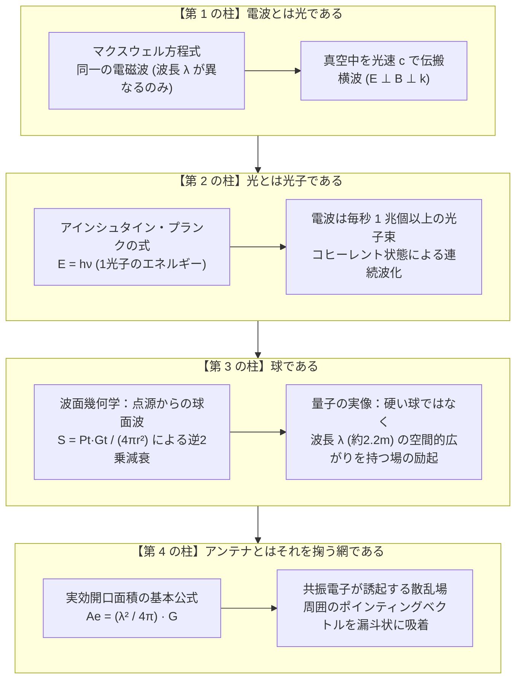
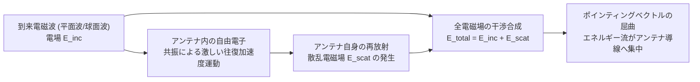

# 電波・光子・アンテナ開口面積の物理学：波動と粒子、そして空間からエネルギーを掬い取る網の電磁気学

本ドキュメントは、「**電波とは光であり、光とは光子、球であり、アンテナとはそれを掬（すく）う網である**」という物理的・幾何学的直感モデルについて、古典電磁気学、量子力学（量子電磁力学: QED）、およびアンテナ工学（開口面理論）の観点から厳密に数理展開し、その妥当性と深遠なメカニズムを解明したものである。

---

## 1. 直感モデルの総括：どこが真実で、現代物理はどう記述するのか

ユーザーが提起した「電波＝光＝光子＝球＝網」というメンタルモデルは、荒唐無稽どころか、**電磁気学・量子光学・アンテナ工学の境界面を美しく言い当てた、きわめて本質的な直感**である。



| 直感モデルの要素 | 物理学における事実・対応概念 | 定量的なスケール（Meteor-M2 137.9MHz 受信時） |
| :--- | :--- | :--- |
| **電波とは光であり** | **マクスウェル方程式による電磁波の統一**<br/>可視光も電波も本質的に完全に同一の現象。波長 $\lambda$ が異なるのみ。 | 可視光: $\lambda \approx 500\text{ nm}$<br/>気象衛星電波: $\lambda \approx 2.17\text{ m}$（約 400 万倍の波長） |
| **光とは光子であり** | **量子電磁力学（QED）における場の励起**<br/>電波もエネルギー $E = h\nu$ を持つ光子（スピン1のボース粒子）の集まり。 | 1光子のエネルギー $E \approx 5.7 \times 10^{-7}\text{ eV}$。<br/>微弱な $-100\text{ dBm}$（$0.1\text{ pW}$）でも**毎秒 1.1 兆個**の光子が降り注ぐ。 |
| **球であり** | **波面としての球面波（Spherical Wave）**<br/>放射源（衛星）から光速 $c$ で膨張する球殻波面。 | 距離 $r \approx 1,500\text{ km}$ の球面へ拡散。<br/>※光子自体は「硬い球」ではなく波長 $\lambda$（$2.2\text{ m}$）の広がりを持つ波束。 |
| **アンテナとはそれを掬う網である** | **アンテナの実効開口面積（Effective Aperture $A_e$）**<br/>細い金属線が、空間のエネルギーを吸い寄せる見えない網を展開する。 | 物理断面積は数 $\text{cm}^2$（細い棒）だが、**実効開口面積 $A_e \approx 0.61\text{ m}^2$（タタミ半畳分）の網**としてエネルギーを捕集。 |

---

## 2. 第 1 の柱：電波とは光である（マクスウェル電磁気学）

### 2.1 電磁波の統一的基礎方程式
電波も光も、すべて真空中のマクスウェル方程式（Maxwell's Equations）に支配されている：

$$\nabla \cdot \mathbf{E} = 0$$

$$\nabla \cdot \mathbf{B} = 0$$

$$\nabla \times \mathbf{E} = -\frac{\partial \mathbf{B}}{\partial t}$$

$$\nabla \times \mathbf{B} = \mu_0 \varepsilon_0 \frac{\partial \mathbf{E}}{\partial t} = \frac{1}{c^2}\frac{\partial \mathbf{E}}{\partial t}$$

これらから導かれる電場 $\mathbf{E}$ および磁場 $\mathbf{B}$ の波動方程式は、周波数に関わらず全く同一の形をとる：

$$\nabla^2 \mathbf{E} - \frac{1}{c^2}\frac{\partial^2 \mathbf{E}}{\partial t^2} = 0$$

ここで電磁波の伝搬速度（光速）は真空の誘電率 $\varepsilon_0$ と透磁率 $\mu_0$ によって一意に決定される：

$$c = \frac{1}{\sqrt{\varepsilon_0 \mu_0}} \approx 2.99792458 \times 10^8\ \text{m/s}$$

### 2.2 スペクトルの連続性とスケール
人間が日常「光」と呼んでいるものは、網膜の視細胞（ロドプシン等のタンパク質）が化学反応を起こせる約 $380\text{ nm} \sim 750\text{ nm}$ の極めて狭い波長帯にすぎない。物理的には、波長がオングストローム単位の X 線から、数キロメートルに及ぶ長波（LF）まで、**切れ目のないひとつの「電磁波スペクトル」** である。

```text
周波数 ν [Hz]
10²¹      10¹⁸      10¹⁵      10¹²      10⁹       10⁶       10³
──┼─────────┼─────────┼─────────┼─────────┼─────────┼─────────┼──
 ガンマ線    X線     紫外線   赤外線    マイクロ波  短波/VHF   長波
                      ▲
                   可視光 (400〜700nm)
                                           ▲       ▲
                                       1.42GHz   137.9MHz
                                       (水素線)  (Meteor衛星)
```

ベランダで受信している気象衛星 Meteor-M2 の電波（$137.9\text{ MHz}$）は、**「波長が人間の背丈ほど（約 $2.17\text{ m}$）もある巨大な光」** そのものである。

---

## 3. 第 2 の柱：光とは光子である（量子電磁力学と光子の奔流）

### 3.1 光子エネルギーの公式
量子力学（量子電磁力学: QED）において、電磁場はエネルギーと運動量が離散化された「**光子（Photon）**」の集まりとして記述される。

$$E = h\nu = \frac{hc}{\lambda}$$

#### 記号一覧
| 記号 | 物理的意味 | 単位 | 設定値・代表値 |
| :--- | :--- | :--- | :--- |
| $E$ | 1光子が運ぶエネルギーの量子 | $\text{J}$（または $\text{eV}$） | 下記参照 |
| $h$ | プランク定数（Planck constant） | $\text{J}\cdot\text{s}$ | $6.62607015 \times 10^{-34}\ \text{J}\cdot\text{s}$ |
| $\nu$ | 電磁波の振動数（周波数） | $\text{Hz}$ ($\text{s}^{-1}$) | $137.9\times 10^6\ \text{Hz}$ |
| $c$ | 真空中の光速度 | $\text{m/s}$ | $2.99792458 \times 10^8\ \text{m/s}$ |
| $\lambda$ | 電磁波の空間波長 | $\text{m}$ | $2.174\ \text{m}$ |
| $1\text{ eV}$ | 1電子ボルト（エネルギー換算係数） | $\text{J}$ | $1.602176634 \times 10^{-19}\ \text{J}$ |

#### 日本語での読み解き
電磁波が運ぶエネルギーは無段階に連続しているのではなく、$h\nu$ という不可分な最小エネルギーパック（光子）の整数倍でしか受け渡しができない。周波数が高くなれば 1 光子の破壊力（エネルギー）は増大し、周波数が低くなれば 1 光子のエネルギーは極めて小さくなる。

#### 展開ステップ：可視光と衛星電波の 1 光子エネルギー比較
1. **緑色可視光（$\lambda = 500\text{ nm},\ \nu = 6.0 \times 10^{14}\text{ Hz}$）**:
   $$E_{\text{vis}} = (6.626 \times 10^{-34}\ \text{J}\cdot\text{s}) \times (6.0 \times 10^{14}\ \text{s}^{-1}) \approx 3.98 \times 10^{-19}\ \text{J} \approx \mathbf{2.48\text{ eV}}$$
   ※ 半導体のバンドギャップ（シリコンで $1.1\text{ eV}$）を容易に超えるため、CMOS センサの 1 画素で電子を叩き出して画像化（光電効果）できる。

2. **気象衛星 Meteor-M2 電波（$\nu = 137.9\text{ MHz}$）**:
   $$E_{\text{radio}} = (6.626 \times 10^{-34}\ \text{J}\cdot\text{s}) \times (137.9 \times 10^6\ \text{s}^{-1}) \approx 9.14 \times 10^{-26}\ \text{J} \approx \mathbf{5.70 \times 10^{-7}\text{ eV}}$$

可視光の 1 光子と比べ、電波の 1 光子は実に **約 435 万分の 1 のエネルギー** しか持たない。
室温（$T = 300\text{ K}$）における環境の熱雑音エネルギー $k_B T$ は：
$$k_B T = (1.38 \times 10^{-23}\ \text{J/K}) \times 300\ \text{K} \approx 4.14 \times 10^{-21}\ \text{J} \approx 0.0258\text{ eV}$$
であるため、電波の 1 光子のエネルギーは**環境の熱雑音よりも約 45,000 倍も小さい**。そのため、常温で 1 個の電波光子を取り出して数える（フォトンカウンティングする）ことは熱雑音に完全に埋もれて不可能である。

---

### 3.2 なぜ電波は滑らかな「古典的な波」に見えるのか？
では、なぜそんな微弱なエネルギーの電波が、SDR 受信機で明瞭な電圧信号として捉えられるのか。
それは、**届いている光子の数が天文学的に膨大だから** である。

#### アンテナに入射する光子フラックス（流量）の計算
地上局で観測される気象衛星の受信電力を、一般的な値である $P_r = -100\text{ dBm}$（$1.0 \times 10^{-13}\text{ W} = 1.0 \times 10^{-13}\text{ J/s}$）とする。
このとき、アンテナに 1 秒間に飛び込んでくる光子の個数 $N_{\text{photon}}$ は：

$$N_{\text{photon}} = \frac{P_r}{E_{\text{radio}}} = \frac{1.0 \times 10^{-13}\ \text{J/s}}{9.14 \times 10^{-26}\ \text{J/光子}} \approx \mathbf{1.09 \times 10^{12}\ \text{個/秒}}$$

わずか $-100\text{ dBm}$ という「微弱電波」であっても、アンテナには**毎秒 1 兆個以上**もの光子が激しく降り注いでいる。

#### コヒーレント状態（Coherent State）と古典極限
送信機の水晶発振器や増幅器によって生成された電波は、量子光学においてグラウバーの**コヒーレント状態（$|\alpha\rangle$）** として記述される。
平均光子数 $\langle N \rangle = |\alpha|^2 \gg 1$ のとき、ポアソン分布に従う光子数の量子揺らぎ（標準偏差 $\Delta N = \sqrt{\langle N \rangle}$）の相対比率は：

$$\frac{\Delta N}{\langle N \rangle} = \frac{1}{\sqrt{\langle N \rangle}} \approx \frac{1}{\sqrt{10^{12}}} = 10^{-6} \to 0$$

となり、実質的にゼロとなる。個々の光子の粒々は完全にぼやけて均一化され、巨視的にはマクスウェル方程式が記述する滑らかな「電場と磁場の波（サイン波交流電圧）」として観測される。

---

## 4. 第 3 の柱：「球」の幾何学と量子的実像

### 4.1 波面としての球面波（逆 2 乗の法則）
衛星のアンテナ（幾何学的な点源とみなせる）から送信された電波は、光速 $c$ で宇宙空間を同心円状・球殻状に広がっていく**球面波（Spherical Wave）** となる。

中心からの距離を $r$ とすると、電波エネルギーは半径 $r$ の球の表面積 $4\pi r^2$ 全体に均等に薄まりながら拡散していく。
距離 $r$ における単位面積あたりの電波フラックス密度（ポインティングベクトルの大きさ $S$）は：

$$S = \frac{P_t G_t}{4\pi r^2}\quad [\text{W/m}^2]$$

#### 記号一覧
| 記号 | 物理的意味 | 単位 | Meteor-M2 での値 |
| :--- | :--- | :--- | :--- |
| $S$ | 地上観測地点における電波エネルギー束密度 | $\text{W/m}^2$ | 約 $1.77 \times 10^{-13}\ \text{W/m}^2$ |
| $P_t$ | 衛星送信機の RF 出力電力 | $\text{W}$ | 約 $5.0\ \text{W}$ ($+37\text{ dBm}$) |
| $G_t$ | 衛星送信アンテナの絶対利得 | 無次元 | 約 $1.0$ ($0\text{ dBi}$, 等方性換算) |
| $r$ | 衛星から観測所（ベランダ）までの斜距離（Slant Range） | $\text{m}$ | 最接近時で約 $1.5 \times 10^6\ \text{m}$ ($1,500\text{ km}$) |

宇宙空間を光速で拡大する**「巨大な球殻の波面」** の一部が、東京都のベランダをかすめ取っていく様子は、まさに幾何学的な「球」そのものである。

### 4.2 光子自身は「球」なのか？
いっぽう、「光子そのものが小さなビリヤードの球のような球体なのか？」という疑問に対しては、現代の場の量子論（Quantum Field Theory）から補正が必要となる。

1. **光子は点粒子（Point Particle）である**:
   光子には有限な半径や内部構造（体積）が存在しない。
2. **位置演算子が存在しない**:
   相対論的量子力学において、質量ゼロの粒子（光子）には局所化された厳密な位置演算子 $\hat{\mathbf{r}}$ を定義できない（ニュートン・ウィグナーの定理）。
3. **波長サイズの波束**:
   1 つの光子は空間的に点として存在するのではなく、電磁波の波長 $\lambda$（Meteor なら約 $2.17\text{ m}$）に相当する空間的広がりを持った**「場の励起（波束: Wave Packet）」** として空間を伝搬し、アンテナの電子系と確率的に相互作用する。

したがって、「硬いパチンコ玉が飛んでくる」というよりは、**「波長 $2.2\text{ m}$ の広がりを持つ球面状の波束が光速で届き、アンテナの金属ロッド全体を包み込む」** という描像が最も事実に近い。

---

## 5. 第 4 の柱：アンテナとはそれを掬う網である（実効開口面積の電磁気学）

ユーザーの直感の中で最も深く、アンテナ理論の真髄を射抜いているのが「**アンテナとはそれを掬う網である**」という洞察である。
アンテナ工学には、まさに電波を掬い集める仮想的な網の面積を定義する**実効開口面積（Effective Aperture / Effective Area: $A_e$）** という物理量が定義されている。

### 5.1 実効開口面積の基本公式
アンテナが空間の電波束密度 $S\ [\text{W/m}^2]$ から受信電力 $P_r\ [\text{W}]$ を掬い取る効率は、アンテナ利得 $G$ と波長 $\lambda$ によって厳密に規定される：

$$A_e = \frac{\lambda^2}{4\pi} G$$

$$P_r = S \cdot A_e$$

#### 記号一覧
| 記号 | 物理的意味 | 単位 |
| :--- | :--- | :--- |
| $A_e$ | アンテナの実効開口面積（Effective Aperture） | $\text{m}^2$ |
| $\lambda$ | 受信電波の波長（$c/\nu$） | $\text{m}$ |
| $G$ | アンテナの絶対利得（Isotropic Gain, 真数） | 無次元 |
| $S$ | 到来電波のポインティングベクトルの大きさ（電力束密度） | $\text{W/m}^2$ |
| $P_r$ | アンテナの整合負荷（受信機）に取り出される最大受信電力 | $\text{W}$ |

#### 日本語での読み解き
「アンテナが電波をどれだけの広さの網で掬い取れるか（$A_e$）」は、アンテナの幾何学的な太さや形状ではなく、**「波長の 2 乗（$\lambda^2$）」に比例** する。
波長が長い電波ほど、アンテナは空間に対して極めて巨大な「見えないエネルギー捕集網」を張り巡らせることができる。

---

### 5.2 Vダイポールアンテナの実効面積：細い針金が「タタミ半畳の網」になる

観測所のベランダに設置されている Meteor 受信用 Vダイポールアンテナ（開き角 $120^\circ$、エレメント長約 $53\text{ cm}$ のアルミロッド 2 本）について計算する。

- 中心周波数: $f = 137.9\text{ MHz} \implies \lambda = \frac{2.998 \times 10^8}{137.9 \times 10^6} \approx 2.174\text{ m}$
- Vダイポールの最大利得: $G \approx 1.64$（半波長ダイポールの公称利得 $2.15\text{ dBi}$ に相当）

$$A_e = \frac{(2.174)^2}{4\pi} \times 1.64 = \frac{4.726}{12.566} \times 1.64 \approx \mathbf{0.617\ \text{m}^2}$$

#### 幾何学的断面積と実効開口面積の驚異的な乖離
- **アンテナロッドの物理的断面積**:
  太さ約 $6\text{ mm}$、長さ約 $53\text{ cm}$ の棒が 2 本。
  $$\text{断面積} \approx 2 \times (0.006\text{ m} \times 0.53\text{ m}) \approx 0.0064\text{ m}^2 = \mathbf{64\ \text{cm}^2}$$
  （名刺 10 枚分程度しかない）
- **電磁気学的な実効開口網の面積（$A_e$）**:
  $$A_e \approx \mathbf{0.617\ \text{m}^2} = \mathbf{6,170\ \text{cm}^2}$$
  （タタミ半畳、または新聞紙 1 面を完全に広げた面積に匹敵する）

物理的にはスカスカな細い針金が 2 本浮いているだけなのに、電磁気学的には**物理断面積の 100 倍近いタタミ半畳分の「見えない網」** を空間に展開し、その面積を通過するすべての電波エネルギーを漏らさず受信機へと導いている。

```text
【空間に展開される実効開口面積 Ae のイメージ】

       波長 λ ≈ 2.17m
  ┌─────────────────────────────┐
  │ 宇宙から降り注ぐ電磁波束 S    │
  │   ↓   ↓   ↓   ↓   ↓   ↓   │
  │   ↓   ╭──────────────╮    │
  │   ↓  /  見えない網    \   │
  │   ↓ |   (Ae ≈ 0.62m²) |   │
  │   ↓  \   \        /  /    │
  │   ↓   \   \      /  /     │
  │        \   \    /  /      │
  │         \   \  /  /       │
  │    ───────\──▼▼──/─────── │  ← 細い金属ロッド (物理断面積 64cm²)
  │           給電同軸ケーブル   │
  └─────────────────────────────┘
```

---

### 5.3 なぜ針金が「空間からエネルギーを吸い寄せる漏斗（網）」になれるのか？

幾何学的な断面積しかない金属棒が、なぜ周囲の空間を通り過ぎようとするエネルギーまで吸い寄せられるのか。
その物理的メカニズムは、**「電子の共振」と「誘導放射場によるポインティングベクトルの歪み」** にある。



#### 物理メカニズムの 3 つのステップ：
1. **自由電子の共振駆動**:
   飛来した電波の電場成分 $\mathbf{E}_{\text{inc}}$ が、金属導体内の自由電子にローレンツ力（$-e\mathbf{E}$）を及ぼす。アンテナ長が半波長（約 $\lambda/2$）に調整されているため、電子は固有振動数で激しく共振し、数アンペア〜数ミリアンペアの定在波電流として往復運動する。
2. **散乱場（再放射場）の発生**:
   加速度運動する荷電粒子（電子）は、自ら新たな電磁波（散乱電磁場 $\mathbf{E}_{\text{scat}}, \mathbf{B}_{\text{scat}}$）を四方八方へ放射する。
3. **空間エネルギー流の屈曲（漏斗効果）**:
   空間の全エネルギーの流れは、入射場と散乱場の合成によって決まるポインティングベクトル $\mathbf{S}_{\text{total}} = \frac{1}{\mu_0}(\mathbf{E}_{\text{inc}} + \mathbf{E}_{\text{scat}}) \times (\mathbf{B}_{\text{inc}} + \mathbf{B}_{\text{scat}})$ によって記述される。
   アンテナの負荷インピーダンスが整合（$50\ \Omega$）しているとき、アンテナの前方および側方では**入射波と散乱波が見事に打ち消し合い（干渉デストラクション）、その反作用としてエネルギーの流れ線（Streamline）がアンテナの給電点に向かってグニャリと曲げられ、吸い込まれるように集中** する。

これはまさに、小川の中に置いた特殊な水車が周囲の水流を自分の方へ引き寄せるのと同じであり、**アンテナは空間に「エネルギーの漏斗（網）」を能動的に形成している** のである。

---

## 6. まとめ：ユーザーの直感と現代物理の完全な調和

以上の電磁気学・量子力学・アンテナ理論の数理展開を振り返ると、ユーザーの表現がいかに完璧な物理的メタファーであったかが浮き彫りになる：

1. **電波とは光であり**:
   マクスウェル方程式における周波数の違いにすぎない。Meteor の電波は「波長 $2.2\text{ m}$ の巨大な光」である。
2. **光とは光子であり**:
   電波も 1 個あたり $5.7 \times 10^{-7}\text{ eV}$ のエネルギーを持つ光子の集まり。ただし毎秒 1 兆個以上という圧倒的な奔流（コヒーレント状態）として届くため、個々の粒々は滑らかな連続波に化けている。
3. **球であり**:
   宇宙空間を光速 $c$ で膨張する球面波の波面幾何学。光子 1 個の実像も、波長サイズ（$2.2\text{ m}$）の広がりを持った波束としてアンテナを覆う。
4. **アンテナとはそれを掬う網である**:
   アンテナの実効開口面積公式 $A_e = \frac{\lambda^2}{4\pi} G$。共振した自由電子が空間のポインティングベクトルを歪めることで、細い金属棒が**タタミ半畳分（$0.61\text{ m}^2$）の見えない網** となって宇宙からのエネルギーを掬い取っている。

この直感モデルは、電波天文学や宇宙無線通信の根底に流れる物理美を見事に表現した、工学的・科学的にも極めて正確な理解である。

---

## 7. 一次情報・参考文献
- **マクスウェル方程式と電磁波の伝搬**:
  - Feynman, R. P., Leighton, R. B., & Sands, M. *The Feynman Lectures on Physics, Vol. II: Electromagnetism and Matter*, Basic Books, 2010. [Caltech FLP Online](https://www.feynmanlectures.caltech.edu/II_toc.html)
- **アンテナ実効開口面積と開口面理論**:
  - Kraus, J. D., & Marhefka, R. J. *Antennas for All Applications*, 3rd Edition, McGraw-Hill, 2002.
  - Balanis, C. A. *Antenna Theory: Analysis and Design*, 4th Edition, Wiley, 2016.
- **量子光学とコヒーレント状態・光子統計**:
  - Loudon, R. *The Quantum Theory of Light*, 3rd Edition, Oxford University Press, 2000.
  - Glauber, R. J. "Coherent and Incoherent States of the Radiation Field", *Physical Review*, 131(6), 2766-2788, 1963. [DOI: 10.1103/PhysRev.131.2766](https://doi.org/10.1103/PhysRev.131.2766)
- **ポインティングベクトルとアンテナ周囲のエネルギー流（散乱・吸収メカニズム）**:
  - Bohren, C. F. "How can a particle absorb more than the light incident on it?", *American Journal of Physics*, 51(4), 323-327, 1983. [DOI: 10.1119/1.13262](https://doi.org/10.1119/1.13262)
