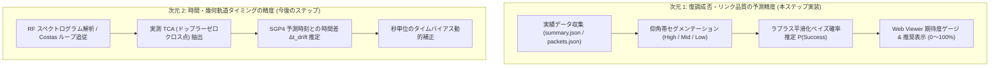
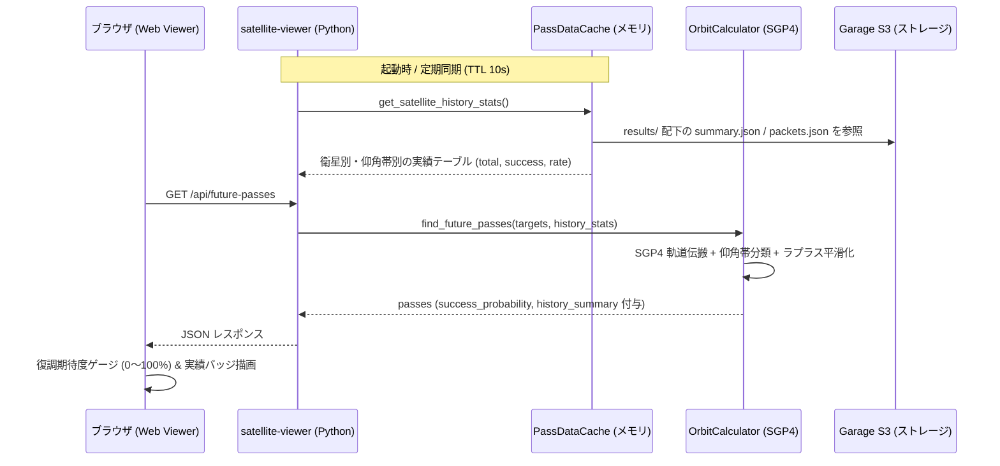

# 復調実績フィードバックによる衛星通過予測精度向上とリンク品質モデリング詳解

東京都北向きベランダ電波観測所において、上空を通過する人工衛星（METEOR-M2 3/4 気象衛星、ISS、CubeSat 等）の通過予測（Pass Prediction）機能に対し、**直近の復調成功実績（画像生成、パケット復号数）を動的にフィードバックして「実際に復調できるかどうかの期待確率（リンク品質）」を高精度に予測・評価するアーキテクチャ** を設計・実装した。

本ドキュメントでは、軌道幾何学（SGP4）と電波伝搬環境（ベランダ遮蔽・アンテナ指向性）の乖離、ラプラス平滑化（Laplace Smoothing）を用いた復調確率のベイズ統計モデリング、および今後の経験的障害物マスク（Horizon Mask）やドップラー TCA 補正への展開を体系的に解説する。

---

## 1. 背景と課題：軌道力学と電波伝搬の乖離

従来の衛星通過予測（`apps/satellite-viewer/orbit_calculator.py`）は、NORAD が公開する TLE（Two-Line Elements）と SGP4 軌道伝搬モデルに基づき、観測地点（北緯 $35.6895^\circ$, 東経 $139.6917^\circ$, 標高 $30\text{ m}$）から見た衛星の方位角 $\text{Az}(t)$ と仰角 $\text{El}(t)$ を計算し、以下の固定矩形条件でスカイウィンドウ通過判定を行っていた：

$$\text{in\_window}(\text{Az}, \text{El}) = (25^\circ \le \text{El} \le 60^\circ) \land (250^\circ \le \text{Az} \lor \text{Az} \le 110^\circ)$$

しかし、実際のベランダ電波観測においては、**「幾何学的には視界内を通過しているが、電波が微弱で復調できない」** あるいは **「固定の境界外（低仰角など）でも安定してパケットが取れる」** という乖離が頻繁に発生する。これには以下の電波工学的・建築幾何学的要因がある：

1. **手すり金属面による反射波干渉（Lloyd's Mirror 効果）**:
   仰角 $25^\circ$ 付近では直達波と手すり反射波の経路差（パス長差）により位相が逆相となり、急激なフェージング（信号相殺）が生じる。
2. **アンテナ指向性利得 $G(\text{Az}, \text{El})$ の非等方性**:
   前傾 $60^\circ$（仰角 $30^\circ$ 見上げ）で設置された V字ダイポールアンテナは天頂よりも斜め北側で最大利得を得るため、天頂直撃パスであっても上階庇（ひさし）と利得低下の複合影響を受ける。
3. **変調方式・シンボルレートと所要 $E_b/N_0$ の差異**:
   METEOR LRPT（$137.9\text{ MHz}$, QPSK $72\text{ kSym/s}$）と CubeSat（$435\text{ MHz}$, BPSK $1.2\text{ kbps}$）では復調に必要な最小受信電力（リンクマージン）が数十倍（$10 \sim 15\text{ dB}$）異なる。

したがって、純粋な幾何学的計算値だけでなく、**「その衛星・その仰角帯において過去に実際に復調が成功したか」という観測実績を統計的に学習・スコアリングするモデル** が不可欠となる。

---

## 2. 通過予測における 2 つの精度次元

通過予測の「精度向上」には、以下の独立した 2 つの工学的側面が存在する：

---

## 3. 実績連動復調確率の数理モデル（ラプラス平滑化）

観測開始初期や飛来回数の少ない衛星では、観測母数 $N_{\text{total}}$ が小さい（例: 1回通過して1回成功、あるいは0回成功）。単純な最尤推定（$N_{\text{success}} / N_{\text{total}}$）を用いると、成功率が $100\%$ や $0\%$ と極端に振れてしまい、予測の信頼性が低下する。

そこで、ベイズ統計学における一様事前分布（Beta 分布 $Beta(1, 1)$）を仮定した **ラプラス平滑化（Laplace Smoothing / Add-one Smoothing）** を採用する。

$$P(\text{Success} \mid \text{Sat}, \text{El\_band}) = \frac{N_{\text{success}} + 1}{N_{\text{total}} + 2}$$

### 記号一覧
| 記号 | 物理的・統計的意味 | 単位 |
| :--- | :--- | :--- |
| $P(\text{Success})$ | 当該パスにおける推定復調成功確率 | 無次元（$0.0 \sim 1.0$） |
| $\text{Sat}$ | 対象衛星の識別名（例: `METEOR-M2 3`, `ISS (ZARYA)`） | 文字列 |
| $\text{El\_band}$ | 通過時の最大仰角区分（`high`, `mid`, `low`） | カテゴリ |
| $N_{\text{total}}$ | 同一衛星・同一仰角帯における過去の総観測パス数 | 回（整数 $\ge 0$） |
| $N_{\text{success}}$ | 同一衛星・同一仰角帯において復調成功と判定されたパス数 | 回（整数 $\ge 0$） |

### 日本語での読み解き
- 過去に一度も観測がない場合（$N_{\text{total}} = 0, N_{\text{success}} = 0$）、確率は $\frac{1}{2} = 50\%$ となり、過度な決めつけを避ける。
- 1回中1回成功した場合（$N_{\text{total}} = 1, N_{\text{success}} = 1$）、$100\%$ ではなく $\frac{2}{3} \approx 67\%$ に抑えられ、サンプル不足による過信を防ぐ。
- 観測回数が増える（$N_{\text{total}} \gg 1$）につれて、平滑化項の影響は薄れ、真の観測成功率へと漸近的に収束する。

### 展開ステップ・直感イメージ
1. **仰角帯の 3 分割**:
   電波伝搬路の物理特性に基づき、最大仰角 $El_{\max}$ を 3 つのゾーンに分類する：
   - **高仰角（$\text{high}: El_{\max} \ge 35^\circ$）**: 建物手すりから十分に離れ、直達波が安定して到来するゴールデンゾーン。
   - **中仰角（$\text{mid}: 20^\circ \le El_{\max} < 35^\circ$）**: 手すり回折・干渉が起きやすく、衛星の進行方向（Azimuth）に依存するゾーン。
   - **低仰角（$\text{low}: El_{\max} < 20^\circ$）**: ベランダ躯体に遮られ、散乱波や微弱電波のみが期待される限界ゾーン。
2. **フォールバック設計**:
   - 当該仰角帯の観測実績がない場合は、その衛星の全仰角帯を通じた総合実績（全体成功率）を参照し、仰角に応じた重み付け（低仰角はペナルティ、高仰角はボーナス）を行う。
   - 衛星自体の観測実績が全くない場合は、幾何学的な品質スコア（`EXCELLENT` $\to 0.75$, `GOOD` $\to 0.50$, `FAIR` $\to 0.25$, `MARGINAL` $\to 0.05$）を事前確率として適用する。

---

## 4. システムアーキテクチャとデータフロー

実績連動スコアリングは、`apps/satellite-viewer` 内で以下のように完結・連携する。

---

## 5. ステップ 2：経験的 Horizon Mask の自己学習と天球ヒートマップ重畳

### 5.1 天球メッシュ空間の離散化と密度マッピング
全天球座標空間（方位角 $\text{Az} \in [0^\circ, 360^\circ)$、仰角 $\text{El} \in [0^\circ, 90^\circ]$）を、正距方位極座標投影と整合する 2 次元の離散セル（メッシュ）に分割する。

- **方位角分解能**: $\Delta \text{Az} = 10^\circ$（計 36 分割）
- **仰角分解能**: $\Delta \text{El} = 5^\circ$（計 18 分割）
- **セル $(i, j)$**:
  $$\text{Cell}(i, j) = \left\{ (\text{Az}, \text{El}) \;\middle|\; i \cdot \Delta\text{Az} \le \text{Az} < (i+1) \cdot \Delta\text{Az}, \ j \cdot \Delta\text{El} \le \text{El} < (j+1) \cdot \Delta\text{El} \right\}$$

過去の全復調成功パス（画像生成あり、または `packets_count > 0`）の軌道点群 $(\text{Az}(t), \text{El}(t))$ をこのメッシュにマッピングし、各セルにおける復調成功密度 $D(i, j)$ を積算する。

### 5.2 経験的 Horizon Mask（実測開口境界ポリゴン）の導出
各方位角スライス $i$（$\text{Az} \in [i\Delta\text{Az}, (i+1)\Delta\text{Az})$）において、復調実績が得られた仰角の最小値・最大値から実効開口境界を定義する：

$$\text{El}_{\min}(i) = \min \{ \text{El} \mid (\text{Az}, \text{El}) \in \text{Successful Trajectories in slice } i \}$$

$$\text{El}_{\max}(i) = \max \{ \text{El} \mid (\text{Az}, \text{El}) \in \text{Successful Trajectories in slice } i \}$$

これにより、固定の理論境界（$[25^\circ, 60^\circ]$）に対し、建築構造物（隣家の壁、手すり支柱、上階庇）の実測遮蔽境界を反映した動的判定が可能となる。

### 5.3 正距方位極座標レーダーへの円環扇形（Annular Sector）描画
Canvas 2D コンテキスト上において、セル $(i, j)$ は動径 $r(\text{El}) = R_{\max}(1 - \text{El}/90^\circ)$ に基づく円環扇形として描画される：
- 外弧半径: $r_{\text{outer}} = r(j \cdot \Delta\text{El})$
- 内弧半径: $r_{\text{inner}} = r((j+1) \cdot \Delta\text{El})$
- 開始・終了角: $\theta_{\text{start}} = i \cdot \Delta\text{Az} - 90^\circ, \quad \theta_{\text{end}} = (i+1) \cdot \Delta\text{Az} - 90^\circ$

通過密度に応じて半透明エメラルドグリーン（$\text{rgba}(16, 185, 129, \alpha)$）で塗り潰し、実測開口境界ポリゴンを破線で重畳描画することで、観測者は「どこが最も電波が通る実効受波エリアか」を直感的に把握できる。

---

## 6. 全体ロードマップと進捗状況

| ステップ | 概要 | 実装・数理アプローチ | ステータス |
| :--- | :--- | :--- | :--- |
| **ステップ 1** | 復調実績連動スコアリング | キャッシュ統計集計・ラプラス平滑化・UI 期待度ゲージ | **完了** |
| **ステップ 2** | 経験的 Horizon Mask の自己学習 | 復調成功点群 $(Az, El)$ の天球グリッド累積・ヒートマップ重畳 | **完了** |
| **ステップ 3** | ドップラー TCA ドリフト補正 | RF スペクトログラムのゼロクロス実測による TLE 時間補正 $\Delta t$ | 次期予定 |
