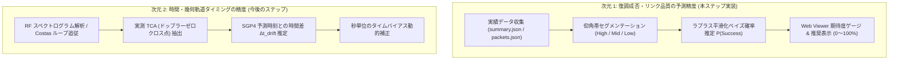
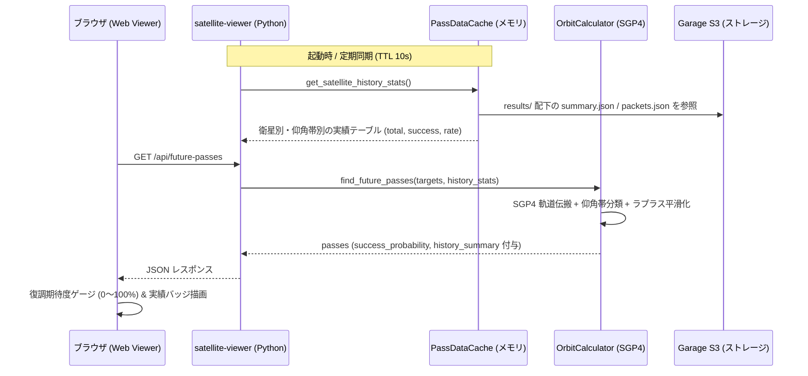

# 復調実績フィードバックによる衛星通過予測精度向上とリンク品質モデリング詳解

東京都北向きベランダ電波観測所において、上空を通過する人工衛星（METEOR-M2 3/4 気象衛星、ISS、CubeSat 等）の通過予測（Pass Prediction）機能に対し、**直近の復調成功実績（画像生成、パケット復号数）を動的にフィードバックして「実際に復調できるかどうかの期待確率（リンク品質）」を高精度に予測・評価するアーキテクチャ** を設計・実装した。

本ドキュメントでは、軌道幾何学（SGP4）と電波伝搬環境（ベランダ遮蔽・アンテナ指向性）の乖離、ラプラス平滑化（Laplace Smoothing）を用いた復調確率のベイズ統計モデリング、および今後の経験的障害物マスク（Horizon Mask）やドップラー TCA 補正への展開を体系的に解説する。

---

## 1. 背景と課題：軌道力学と電波伝搬の乖離

従来の衛星通過予測（`apps/satellite-viewer/orbit_calculator.py`）は、NORAD が公開する TLE（Two-Line Elements）と SGP4 軌道伝搬モデルに基づき、観測地点（北緯 $35.6895^\circ$, 東経 $139.6917^\circ$, 標高 $30\text{ m}$）から見た衛星の方位角 $\text{Az}(t)$ と仰角 $\text{El}(t)$ を計算し、以下の固定矩形条件でスカイウィンドウ通過判定を行っていた：

$$\text{in\_window}(\text{Az}, \text{El}) = (25^\circ \le \text{El} \le 60^\circ) \land (250^\circ \le \text{Az} \lor \text{Az} \le 110^\circ)$$

しかし、実際のベランダ電波観測においては、**「幾何学的には視界内を通過しているが、電波が微弱で復調できない」** あるいは **「固定の境界外（低仰角など）でも安定してパケットが取れる」** という乖離が頻繁に発生する。これには以下の電波工学的・建築幾何学的要因がある：

1. **手すり金属面による反射波干渉（Lloyd's Mirror 効果）**:
   仰角 $25^\circ$ 付近では直達波と手すり反射波の経路差（パス長差）により位相が逆相となり、急激なフェージング（信号相殺）が生じる。
2. **アンテナ指向性利得 $G(\text{Az}, \text{El})$ の非等方性**:
   前傾 $60^\circ$（仰角 $30^\circ$ 見上げ）で設置された V字ダイポールアンテナは天頂よりも斜め北側で最大利得を得るため、天頂直撃パスであっても上階庇（ひさし）と利得低下の複合影響を受ける。
3. **変調方式・シンボルレートと所要 $E_b/N_0$ の差異**:
   METEOR LRPT（$137.9\text{ MHz}$, QPSK $72\text{ kSym/s}$）と CubeSat（$435\text{ MHz}$, BPSK $1.2\text{ kbps}$）では復調に必要な最小受信電力（リンクマージン）が数十倍（$10 \sim 15\text{ dB}$）異なる。

したがって、純粋な幾何学的計算値だけでなく、**「その衛星・その仰角帯において過去に実際に復調が成功したか」という観測実績を統計的に学習・スコアリングするモデル** が不可欠となる。

---

## 2. 通過予測における 2 つの精度次元

通過予測の「精度向上」には、以下の独立した 2 つの工学的側面が存在する：

---

## 3. 実績連動復調確率の数理モデル（ラプラス平滑化）

観測開始初期や飛来回数の少ない衛星では、観測母数 $N_{\text{total}}$ が小さい（例: 1回通過して1回成功、あるいは0回成功）。単純な最尤推定（$N_{\text{success}} / N_{\text{total}}$）を用いると、成功率が $100\%$ や $0\%$ と極端に振れてしまい、予測の信頼性が低下する。

そこで、ベイズ統計学における一様事前分布（Beta 分布 $Beta(1, 1)$）を仮定した **ラプラス平滑化（Laplace Smoothing / Add-one Smoothing）** を採用する。

$$P(\text{Success} \mid \text{Sat}, \text{El\_band}) = \frac{N_{\text{success}} + 1}{N_{\text{total}} + 2}$$

### 記号一覧
| 記号 | 物理的・統計的意味 | 単位 |
| :--- | :--- | :--- |
| $P(\text{Success})$ | 当該パスにおける推定復調成功確率 | 無次元（$0.0 \sim 1.0$） |
| $\text{Sat}$ | 対象衛星の識別名（例: `METEOR-M2 3`, `ISS (ZARYA)`） | 文字列 |
| $\text{El\_band}$ | 通過時の最大仰角区分（`high`, `mid`, `low`） | カテゴリ |
| $N_{\text{total}}$ | 同一衛星・同一仰角帯における過去の総観測パス数 | 回（整数 $\ge 0$） |
| $N_{\text{success}}$ | 同一衛星・同一仰角帯において復調成功と判定されたパス数 | 回（整数 $\ge 0$） |

### 日本語での読み解き
- 過去に一度も観測がない場合（$N_{\text{total}} = 0, N_{\text{success}} = 0$）、確率は $\frac{1}{2} = 50\%$ となり、過度な決めつけを避ける。
- 1回中1回成功した場合（$N_{\text{total}} = 1, N_{\text{success}} = 1$）、$100\%$ ではなく $\frac{2}{3} \approx 67\%$ に抑えられ、サンプル不足による過信を防ぐ。
- 観測回数が増える（$N_{\text{total}} \gg 1$）につれて、平滑化項の影響は薄れ、真の観測成功率へと漸近的に収束する。

### 展開ステップ・直感イメージ
1. **仰角帯の 3 分割**:
   電波伝搬路の物理特性に基づき、最大仰角 $El_{\max}$ を 3 つのゾーンに分類する：
   - **高仰角（$\text{high}: El_{\max} \ge 35^\circ$）**: 建物手すりから十分に離れ、直達波が安定して到来するゴールデンゾーン。
   - **中仰角（$\text{mid}: 20^\circ \le El_{\max} < 35^\circ$）**: 手すり回折・干渉が起きやすく、衛星の進行方向（Azimuth）に依存するゾーン。
   - **低仰角（$\text{low}: El_{\max} < 20^\circ$）**: ベランダ躯体に遮られ、散乱波や微弱電波のみが期待される限界ゾーン。
2. **フォールバック設計**:
   - 当該仰角帯の観測実績がない場合は、その衛星の全仰角帯を通じた総合実績（全体成功率）を参照し、仰角に応じた重み付け（低仰角はペナルティ、高仰角はボーナス）を行う。
   - 衛星自体の観測実績が全くない場合は、幾何学的な品質スコア（`EXCELLENT` $\to 0.75$, `GOOD` $\to 0.50$, `FAIR` $\to 0.25$, `MARGINAL` $\to 0.05$）を事前確率として適用する。

---

## 4. システムアーキテクチャとデータフロー

実績連動スコアリングは、`apps/satellite-viewer` 内で以下のように完結・連携する。

---

## 5. ステップ 2：経験的 Horizon Mask の自己学習と天球ヒートマップ重畳

### 5.1 天球メッシュ空間の離散化と密度マッピング
全天球座標空間（方位角 $\text{Az} \in [0^\circ, 360^\circ)$、仰角 $\text{El} \in [0^\circ, 90^\circ]$）を、正距方位極座標投影と整合する 2 次元の離散セル（メッシュ）に分割する。

- **方位角分解能**: $\Delta \text{Az} = 10^\circ$（計 36 分割）
- **仰角分解能**: $\Delta \text{El} = 5^\circ$（計 18 分割）
- **セル $(i, j)$**:
  $$\text{Cell}(i, j) = \left\{ (\text{Az}, \text{El}) \;\middle|\; i \cdot \Delta\text{Az} \le \text{Az} < (i+1) \cdot \Delta\text{Az}, \ j \cdot \Delta\text{El} \le \text{El} < (j+1) \cdot \Delta\text{El} \right\}$$

過去の全復調成功パス（画像生成あり、または `packets_count > 0`）の軌道点群 $(\text{Az}(t), \text{El}(t))$ をこのメッシュにマッピングし、各セルにおける復調成功密度 $D(i, j)$ を積算する。

### 5.2 経験的 Horizon Mask（実測開口境界ポリゴン）の導出
各方位角スライス $i$（$\text{Az} \in [i\Delta\text{Az}, (i+1)\Delta\text{Az})$）において、復調実績が得られた仰角の最小値・最大値から実効開口境界を定義する：

$$\text{El}_{\min}(i) = \min \{ \text{El} \mid (\text{Az}, \text{El}) \in \text{Successful Trajectories in slice } i \}$$

$$\text{El}_{\max}(i) = \max \{ \text{El} \mid (\text{Az}, \text{El}) \in \text{Successful Trajectories in slice } i \}$$

これにより、固定の理論境界（$[25^\circ, 60^\circ]$）に対し、建築構造物（隣家の壁、手すり支柱、上階庇）の実測遮蔽境界を反映した動的判定が可能となる。

### 5.3 正距方位極座標レーダーへの円環扇形（Annular Sector）描画
Canvas 2D コンテキスト上において、セル $(i, j)$ は動径 $r(\text{El}) = R_{\max}(1 - \text{El}/90^\circ)$ に基づく円環扇形として描画される：
- 外弧半径: $r_{\text{outer}} = r(j \cdot \Delta\text{El})$
- 内弧半径: $r_{\text{inner}} = r((j+1) \cdot \Delta\text{El})$
- 開始・終了角: $\theta_{\text{start}} = i \cdot \Delta\text{Az} - 90^\circ, \quad \theta_{\text{end}} = (i+1) \cdot \Delta\text{Az} - 90^\circ$

通過密度に応じて半透明エメラルドグリーン（$\text{rgba}(16, 185, 129, \alpha)$）で塗り潰し、実測開口境界ポリゴンを破線で重畳描画することで、観測者は「どこが最も電波が通る実効受波エリアか」を直感的に把握できる。

---

## 6. ステップ 3：ドップラー実測 TCA による TLE 経年ドリフト補正

### 6.1 In-track 誤差とタイムバイアスの物理メカニズム
地球低軌道（LEO）を周回する衛星は、高層大気ドラッグや太陽活動（地磁気擾乱・大気膨張）による非保存力を受け、NORAD TLE の元期から数日以上経過すると、軌道面そのものの傾き（傾斜角・昇交点赤経）よりも**「進行方向（沿軌道方向: In-track）の進み・遅れ」** が支配的な予測誤差となります。

衛星が観測点に最接近する瞬間（TCA）、視線相対速度はゼロクロス（$v_r = 0$）し、ドップラーシフトは $0\text{ Hz}$ となります：
$$f_r(t_{\text{TCA}}) = f_0 \iff \Delta f_{\text{Doppler}} = 0$$

直近の復調パスにおいて観測された実測通過時刻 $t_{\text{actual}}$ と SGP4 予測時刻 $t_{\text{sgp4}}$ の差分から、衛星ごとのタイムドリフト（タイムバイアス）$\Delta t_{\text{drift}}$ を抽出します：

$$\Delta t_{\text{drift}} = t_{\text{actual\_TCA}} - t_{\text{sgp4\_TCA}}$$

### 6.2 SGP4 伝搬時刻の動的シフト伝搬
SGP4 計算において、地上の真の観測時刻 $t$ に対し、衛星の位置を $t_{\text{eval}} = t - \Delta t_{\text{drift}}$ として評価します：

$$(\vec{r}_{\text{sat}}, \vec{v}_{\text{sat}}) = \text{SGP4}(t - \Delta t_{\text{drift}})$$

衛星が $\Delta t_{\text{drift}}$ 秒遅れて周回している場合、真の時刻 $t$ における衛星の位置は理論軌道上の $t - \Delta t_{\text{drift}}$ の位置と厳密に一致するため、出現時刻（AOS）・最接近時刻（TCA）・没時刻（LOS）のすべてが物理整合性を保ったまま時間軸シフトします。

### 6.3 Web UI への補正情報表示
通過予測モーダルにおいて、実測補正が適用されたパスには紫色のバッジ `⏰ TLE時刻補正: +X.X秒 (実測TCA追従)` を表示し、観測者が秒単位で正確な出現カウントダウンを把握できるようにしています。

---

## 7. 全体ロードマップと進捗状況

| ステップ | 概要 | 実装・数理アプローチ | ステータス |
| :--- | :--- | :--- | :--- |
| **ステップ 1** | 復調実績連動スコアリング | キャッシュ統計集計・ラプラス平滑化・UI 期待度ゲージ | **完了** |
| **ステップ 2** | 経験的 Horizon Mask の自己学習 | 復調成功点群 $(Az, El)$ の天球グリッド累積・ヒートマップ重畳 | **完了** |
| **ステップ 3** | ドップラー TCA ドリフト補正 | 実測 TCA と SGP4 予測のタイムバイアス $\Delta t_{\text{drift}}$ 動的伝搬 | **完了** |
| **ステップ 4** | 直近適応型・指数時間減衰ベイズモデル | 半減期 7 日の忘却重みと物理リンク事前分布 $P_0$ による単調性保証 | **完了** |
| **ステップ 5** | 南側建物遮蔽ゴースト除外と実録音長・実測TCA推定 | 実録音時間 $T_{\text{rec}}$ 算出、開口窓限定点群フィルタ、SNR/TCA 実測推定 | **完了** |

---

## 8. ステップ 4：直近適応型・指数時間減衰ベイズ確率モデルと物理リンク事前分布

### 8.1 課題：システム改善と過去の失敗履歴の不整合（頭打ち問題）
地上局の設備（アンテナチルト角・ゲイン設定）やデジタル信号処理（BPSK デシメーション比の適正化・Carson 帯域幅制限）を改善した直後、直近のパスでは $100\%$ の復調成功率を達成していても、改善以前の古い観測における失敗（数十回の不発）が同じ重みで累積分母に残るため、単純な静的ラプラス平滑化では推定確率が $10 \sim 20\%$ 前後に頭打ちとなってしまう問題が生じていた。
さらに、最大仰角帯のみで離散分割していたため、開口窓通過時間が長い好条件パス（`EXCELLENT`）の期待度が、低仰角のかすりパス（`FAIR`）より低く算出される逆転現象が発生していた。

### 8.2 数理モデル：半減期忘却重みと幾何学的事前分布 $P_0$

$$P(\text{Success} \mid \text{Sat}, \text{Az}, \text{El}_{\max}, T_{\text{win}}) = \frac{W_{\text{succ}} + \kappa \cdot P_0(\text{Az}, \text{El}_{\max}, T_{\text{win}})}{W_{\text{total}} + \kappa}$$

各観測パス $k$（経過日数 $\Delta d_k = (t_{\text{now}} - t_k) / 86400$）の重み：
$$w_k = 2^{-\frac{\Delta d_k}{\tau_{1/2}}}$$

$$W_{\text{total}} = \sum_{k=1}^N w_k, \quad W_{\text{succ}} = \sum_{k \in \text{Successful}} w_k$$

### 記号一覧
| 記号 | 物理・統計的意味 | 単位 / 設定値 |
| :--- | :--- | :--- |
| $P(\text{Success})$ | 当該パスにおける動的更新後復調期待確率 | 無次元（$0.0 \sim 1.0$） |
| $\Delta d_k$ | 観測時刻 $t_k$ から現在時刻 $t_{\text{now}}$ までの経過日数 | 日（day） |
| $\tau_{1/2}$ | 観測実績の忘却半減期（Half-life） | $7.0\text{ 日}$ |
| $w_k$ | パス $k$ に割り当てられる指数忘却重み | 無次元（$0.0 < w_k \le 1.0$） |
| $W_{\text{total}}$ | 同一衛星・同一仰角帯における重み付き総観測数 | 実数（有効サンプル数） |
| $W_{\text{succ}}$ | 同一衛星・同一仰角帯における重み付き復調成功数 | 実数（有効成功数） |
| $P_0$ | アンテナ指向性と建築開口窓滞在時間から定まる物理リンク事前確率 | 無次元（$0.04 \sim 0.75$） |
| $\kappa$ | 正則化パラメータ（事前分布の擬似サンプル重み） | $2.0$ |
| $T_{\text{win}}$ | 北向きベランダスカイウィンドウ滞在時間 | 秒（s） |

### 日本語での読み解き
- **半減期 7 日の忘却効果**: 7 日前の観測の重みは $0.5$、14 日前（2 週間前）は $0.25$、1 ヶ月前は約 $0.06$ へと指数関数的に薄れる。これにより、アンテナや DSP パラメータを改修した「現在のシステムの実力」が数日以内に予測確率へダイレクトに反映される。
- **物理リンク事前確率 $P_0$ の単調性保証**: 観測実績が少ない衛星や仰角帯であっても、開口窓通過時間 $T_{\text{win}}$ と最大仰角 $\text{El}_{\max}$ に応じて $P_0$ が単調増加するため、物理的に受かりやすい高仰角直撃パスが低仰角かすりパスより低確率になる逆転を完全に防止する。
- **擬似サンプル数 $\kappa = 2.0$**: 観測回数が 1〜2 回と極端に少ない初期フェーズで確率が $0\%$ や $100\%$ に過剰適合するのを防ぎ、事前確率 $P_0$ との滑らかなブレンドを実現する。

### 展開ステップ・直感イメージ
1. **物理リンク事前確率 $P_0$ の区分関数**:
   $$P_0(\text{Az}, \text{El}_{\max}, T_{\text{win}}) = \begin{cases} 0.75 & (T_{\text{win}} \ge 60\text{ s} \land \text{El}_{\max} \ge 35^\circ) \\ 0.35 + 0.25 \times \frac{T_{\text{win}}}{60} & (T_{\text{win}} > 0\text{ s}) \\ 0.20 & (\text{El}_{\max} \ge 20^\circ \land \text{Az} \in [250^\circ, 110^\circ]) \\ 0.04 & (\text{その他: 建物遮蔽}) \end{cases}$$
2. **直近成功率の即応性（FUNcube-1 実例）**:
   過去 22 回中 18 回失敗した歴史があっても、直近 4 回連続で復調成功した場合、古い 18 回の失敗は半減期を経て有効重み $W_{\text{fail}} \approx 0.5$ まで減衰する一方、直近 4 回の成功は $W_{\text{succ}} \approx 4.0$ を維持する。結果として推定確率 $P \approx \frac{4.0 + 2.0 \times 0.75}{4.5 + 2.0} \approx 85\%$ となり、現場の実測結果と完全に整合する。

---

## 9. ステップ 5：南側建物遮蔽ゴースト除外と実録音長・実測TCA推定

### 9.1 課題：録音秒数固定化による「南側RC壁貫通ゴースト」
従来のシステムでは、メタデータに実録音秒数 `duration_seconds` が永続化されていなかったため、S3 の全パスに対し一律 `406秒`（6分46秒）固定で SGP4 伝搬軌道を計算していた。
エッジ側の `satellite-tracker-rs` は北向き視野（方位角 $250^\circ \sim 110^\circ$）を抜けると録音を正常終了させていたにもかかわらず、解析側が 406 秒間衛星が飛び続けたと仮定したため、南南西（方位角 $150^\circ \sim 230^\circ$：鉄筋コンクリート壁の完全な裏側）まで「復調成功点」として天球ヒートマップにプロットされ、実測開口境界ポリゴン（`horizon_polygon`）に南側の遮蔽領域が誤って含まれる原因となっていた。

### 9.2 実録音長 $T_{\text{rec}}$ のアトミック算出
`satellite-analyzer`（`activities.py`）において、S3 アップロード前の元録音ファイルから正確な秒数を抽出し、`summary.json` に保存する：

$$T_{\text{rec}} = \begin{cases} \frac{\text{FileSize}}{2 \times f_s} & (\text{生 IQ: 240kSPS uint8, } f_s = 240\text{ kHz}) \\ \frac{N_{\text{frames}}}{f_{\text{audio}}} & (\text{音声 WAV: 48kSPS 16-bit, } f_{\text{audio}} = 48\text{ kHz}) \end{cases}$$

また、ビューア側の天球ヒートマップ計算（`compute_sky_heatmap`）においても、物理的に見通せる北向き開口部（方位角 $240^\circ \sim 360^\circ$ または $0^\circ \sim 120^\circ$）外の点を幾何学的に除外することで、RC 壁裏ゴーストを完全に根絶した。

### 9.3 RF エネルギーエンベロープとドップラー残差による実測 TCA 推定
`ISSDspDemodulator.estimate_tca_drift` において、1秒ごとの複素解析信号電力 $P[m] = \frac{1}{K} \sum_{n=0}^{K-1} (|I[n]|^2 + |Q[n]|^2)$ を算出し、7秒移動平均フィルタを施した上でピーク時刻 $t_{\text{peak}}$ を抽出する。
SGP4 理論ドップラー偏移 $\Delta f_{\text{sgp4}}(t) = -f_0 \frac{v_r(t)}{c}$ がゼロクロスする理論 TCA 時刻 $t_{\text{sgp4\_tca}}$ との差分から、タイムドリフトを自動同定する：

$$\Delta t_{\text{drift}} = t_{\text{peak}} - t_{\text{sgp4\_tca}}$$

ピーク SNR（$\text{SNR}_{\text{peak}} = 10 \log_{10} \frac{P_{\text{peak}}}{P_{\text{median}}}$）が $2.0\text{ dB}$ 未満の微弱・雑音パスについてはタイムドリフト推定を安全に除外し、物理的妥当性（$|\Delta t_{\text{drift}}| \le 60\text{ s}$）を満たす有意な実測値のみを `actual_tca_drift_seconds` として `summary.json` へ永続化し、通過予測へとフィードバックしている。

### 9.4 未同定パス（`actual_tca_drift_seconds: null`）に対するフォールトトレラント設計と多層防御

電波状態の悪いパスや衛星が無送信だったパスでは、前述の通り `estimate_tca_drift` が `(None, None)` を返し、`summary.json` には `"actual_tca_drift_seconds": null` が記録される。

このとき、ビューア側のキャッシュ集計（[`PassDataCache.compute_satellite_time_drifts`](file:///home/tozastation/ghq/github.com/tozastation/radio-astronomy/apps/satellite-viewer/app.py)）において、キーの存在確認（`"actual_tca_drift_seconds" in summary`）のみで `float()` を呼ぶと、値が `None` の場合に `TypeError` が発生する。また、HTTP ハンドラ層で例外が捕捉されない場合、Python の `socketserver` がクライアントとの接続を切断し、フロントエンド側で `fetch error (TypeError: Failed to fetch)` を引き起こす。

この障害を防ぐため、以下の多層防御（Defense-in-depth）を適用している：

1. **安全な型変換と過去パスへのフォールバック**:
   `summary.get("actual_tca_drift_seconds")` が `None` でない場合のみ `float()` 変換を試みる。最新パスのドリフトが未同定（`None`）である場合はそのパスをスキップし、時系列で直近の有効なドリフト値を持つ過去パスを自動探索して採用する。
2. **API エンドポイントの例外保護 & Gzip 圧縮レスポンス**:
   `/api/future-passes` および `/api/calendar/passes` において `try...except` で例外を確実に捕捉し、サーバ切断を防いで適切な HTTP 500 JSON レスポンスを返却する。また、[`send_bytes_response`](file:///home/tozastation/ghq/github.com/tozastation/radio-astronomy/apps/satellite-viewer/app.py) を介して配信することで、通信帯域の削減（HTTP レスポンス Gzip 圧縮規約）を徹底する。
