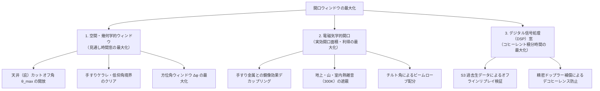

# ベランダ電波観測所の開口ウィンドウ最大化とアンテナ設置幾何学・電磁気学詳解

本ドキュメントは、東京都の北向きベランダ（マンション中高層階）において、衛星ダウンリンク（NOAA, Meteor-M, ISS, CubeSat 等）の受信品質、搬送波対雑音比（SNR）、およびデコード成功率を物理限界まで引き上げるための「設置の最大化（開口ウィンドウの極大化）」について、幾何学、電波伝搬、電磁気学、アンテナ工学の観点から詳細に解説したものです。

---

## 1. 開口ウィンドウ最大化の 3 階層モデル

衛星受信システムにおける「開口ウィンドウ（Aperture Window）」の最適化は、以下の 3 つの階層に分類されます。



| 階層 | 主な支配方程式 | 最大化のアプローチ | 可逆性・調整タイミング |
| :--- | :--- | :--- | :--- |
| **空間・幾何学** | $t_{\text{window}} = t_{\text{LOS}} - t_{\text{AOS}}$ | ベランダ最前線配置による天井・手すり遮蔽角の克服 | **不可逆（リアルタイム観測時のみ）** |
| **アンテナ電磁気学** | $A_e(\theta, \phi) = \frac{\lambda^2}{4\pi} G(\theta, \phi)$ | マスト高による鏡像効果回避・仰角 45° チルト | **不可逆（リアルタイム観測時のみ）** |
| **DSP・ソフトウェア** | $\Delta T_{\text{min}} = \frac{T_{\text{sys}}}{\sqrt{B\tau}}$ | ドップラー周波数補償・低 SNR コスタスループ適応 | **可逆（保存データから何度でも再解析可能）** |

ソフトウェアや DSP のアルゴリズムは、Garage S3 に永続化された Raw IQ や WAV を用いて後からいくらでもリプレイ検証・最適化が可能です。しかし、**アンテナが物理的に捕捉できなかった電波エネルギー（フォトン）は、どんな高度な信号処理を用いても復元できません（シャノンの通信路容量の限界）**。そのため、ハードウェア設置における開口ウィンドウの最大化が最優先課題となります。

---

## 2. ベランダ幾何学と天井遮蔽角の数理

### 2.1 天井（上階ベランダ庇）による上限仰角カットオフの式

マンションのベランダにおいて、アンテナを室内側（奥）へ後退させた際に生じる上限仰角 $\theta_{\text{max}}$ の制限は、以下の幾何学的関係で決まります。

$$\tan \theta_{\text{max}} = \frac{H_{\text{ceil}}}{D_{\text{back}}}$$

| 記号 | 物理的意味 | 代表値・単位 |
| :--- | :--- | :--- |
| $\theta_{\text{max}}$ | アンテナから見通せる上限仰角（天井カットオフ角） | 度（$\text{deg}$） |
| $H_{\text{ceil}}$ | アンテナ給電点から上階ベランダ庇（天井）までの垂直クリアランス | 約 $1.5\text{ m}$ |
| $D_{\text{back}}$ | ベランダ最外周（手すり天端・庇先端の鉛直面）からアンテナまでの後退距離 | $0.1 \sim 1.0\text{ m}$ |

#### 日本語での読み解き
アンテナをベランダの奥（室内側）へ引っ込めるほど、$D_{\text{back}}$ が増大して $\tan\theta_{\text{max}}$ が小さくなり、見上げられる空の上限角度が急激に下がります。

#### 展開ステップと直感イメージ
* **手すり直近（$D_{\text{back}} = 0.15\text{ m}$）**:
  $$\theta_{\text{max}} = \arctan\left(\frac{1.5}{0.15}\right) = \arctan(10) \approx 84.3^\circ$$
  天頂（$90^\circ$）直下まで空が完全に抜け、高仰角パスを逃しません。
* **わずかに後退（$D_{\text{back}} = 0.8\text{ m}$）**:
  $$\theta_{\text{max}} = \arctan\left(\frac{1.5}{0.8}\right) = \arctan(1.875) \approx 61.9^\circ$$
  仰角 $62^\circ$ 以上の最も電波が強い区間が、上階の鉄筋コンクリートスラブで遮断されます。
* **さらに奥（$D_{\text{back}} = 1.2\text{ m}$）**:
  $$\theta_{\text{max}} = \arctan\left(\frac{1.5}{1.2}\right) = \arctan(1.25) \approx 51.3^\circ$$
  空の半分近くがコンクリートで覆われ、衛星通信のゴールデンタイムが消失します。

---

### 2.2 なぜ「高仰角（TCA）」の死守が生命線なのか

低軌道衛星（LEO）の受信において、低仰角（地平線付近）の時間をいくら伸ばしても、高仰角を失うとデコード成功率は壊滅します。これには 2 つの明確な物理法則が存在します。

#### (1) フリスの伝達公式による自由空間伝搬損失（FSPL）

$$L_{\text{FS}} = \left(\frac{4\pi d}{\lambda}\right)^2$$

| 記号 | 物理的意味 | 単位 |
| :--- | :--- | :--- |
| $L_{\text{FS}}$ | 自由空間伝搬損失（Free Space Path Loss） | 無次元（真数）または $\text{dB}$ |
| $d$ | 衛星とアンテナ間のスラントレンジ（直線距離） | $\text{m}$ |
| $\lambda$ | 受信電波の波長（$137\text{MHz}$ で約 $2.19\text{ m}$） | $\text{m}$ |

* **低仰角（$\theta = 15^\circ$）**: 衛星までの距離 $d \approx 1,800\text{ km}$
* **高仰角（$\theta = 80^\circ$）**: 衛星までの距離 $d \approx 600\text{ km}$（軌道高度近傍）

距離の差は 3 倍であり、伝搬損失の差は対数で以下の通りになります：

$$\Delta L_{\text{FS}} = 20 \log_{10}\left(\frac{1800}{600}\right) \approx 9.54\text{ dB}$$

天頂付近は、低仰角に比べて**信号強度が約 10 倍（約 +10 dB）強力**です。

#### (2) デコーダ同期のしきい値効果（Threshold Effect）
Meteor-M LRPT（QPSK）や CubeSat（BPSK/GMSK）などのデジタル変調では、コスタスループ（搬送波位相同期）およびビタビ軟判定誤り訂正が正常にロックするために、必要最低限の $E_b/N_0$（ビットエネルギー対雑音電力比、通常 6〜8 dB 以上）を要求します。
低仰角の微弱信号区間ではパケット破棄が連続し、**画像やテレメトリの有効フレームの大部分は、SNR が跳ね上がる高仰角（$\theta > 40^\circ$）の数分間に集中**して復号されます。したがって、天井遮蔽を避けて高仰角を維持することは、システム全体の成否に直結します。

---

## 3. 金属手すりとの電磁気的結合（鏡像効果）とデカップリング

### 3.1 水平接近時の容量結合と離調（Detuning）

Vダイポールアンテナのエレメントと金属製手すり（アルミ・鉄）が同じ高さ（水平並行）に近接すると、導体間に強い浮遊容量 $C_{\text{stray}}$ が形成されます。

$$C_{\text{stray}} \approx \frac{\pi \epsilon_0}{\ln(d / r)}$$

この浮遊容量により、アンテナの電気的共振周波数 $f_0 = \frac{1}{2\pi\sqrt{L(C+C_{\text{stray}})}}$ が設計周波数（137.5MHz）から低域側へ大きく離調（Detuning）し、放射抵抗が低下して定在波比（SWR）が悪化します。

---

### 3.2 垂直持ち上げによる「疑似反射板（グラウンドプレーン）」化

アンテナ給電点を手すりの天端（トップレール）より **$+15 \sim 25\text{ cm}$ 垂直に持ち上げる** と、手すり金属の位置関係が「真横」から「アンテナの真下」へシフトします。

```
               [ 120° Vダイポール ]
                   \       /
                    \     /
                     \   /
                       ●  ← 給電点（手すりより +15〜25cm 上）
                       |
                       | （三脚センターポール）
     ==================■==================  ← 手すり天端（金属）
     |                                    |
     |          手すり格子（導体）        |
```

導体表面における鏡像法（Image Theory）により、直接波と反射波の位相差 $\Delta\Phi$ は以下のように表されます。

$$\Delta\Phi = \frac{2\pi}{\lambda} (2h \sin\theta) + \pi$$

| 記号 | 物理的意味 |
| :--- | :--- |
| $\Delta\Phi$ | 直接波と反射波の全位相差（$\text{rad}$） |
| $h$ | 手すり導体から給電点までの高さ（約 $0.2\text{ m}$） |
| $\lambda$ | 電波の波長（$137\text{MHz} \to 2.19\text{ m}$） |
| $\theta$ | 到来電波の仰角 |
| $\pi$ | 完全導体表面での電界反射に伴う $180^\circ$ 位相反転 |

#### 物理的メリット：
1. **地上雑音の遮蔽（シールド効果）**:
   真下の金属手すりが、下層階、道路、室内から立ち上るインバータ雑音・スイッチングノイズ等の人工雑音を物理的に遮断します。
2. **上空方向へのビーム合成利得**:
   仰角 $\theta \approx 30^\circ \sim 60^\circ$ において直接波と反射波が強め合い、上空を向いたアンテナ利得が **約 $+1 \sim 2\text{ dB}$ 底上げ** されます。

---

## 4. 120° Vダイポールの放射パターンと仰角 45° チルトの数理

### 4.1 アンテナロッドの「先端」は感度ゼロ（ヌル点）

細長いダイポールアンテナの表面を流れる高周波電流分布 $I(z)$ は、中央給電点で最大、両端の先端で厳密にゼロとなる定在波を形成します。

$$I(z) = I_0 \sin\left[ k \left( \frac{L}{2} - |z| \right) \right]$$

先端（$|z| = L/2$）では電流が流れる余地がないため、$I(\pm L/2) = 0$ となります。ポインティングベクトル $\mathbf{S} = \mathbf{E} \times \mathbf{H}$ から導かれる放射電界強度 $E_\theta$ は、エレメントの軸方向（先端方向）においてゼロ（ヌル点）になります。

$$\text{ロッドの先端方向: } E = 0 \quad (\text{感度ゼロ})$$
$$\text{ロッドの側面・直角方向: } E = E_{\text{max}} \quad (\text{最大感度})$$

したがって、**アンテナの金属棒の先端を目的の空や地平線に向けてはならず、ロッドの「側面（腹）」を到来電波に向ける** 必要があります。

---

### 4.2 仰角 45° チルト（空の真ん中を仰ぐ）の工学的合理性

北向きベランダにおいて、北側に山の稜線（障害物境界、仰角約 $10^\circ \sim 15^\circ$）が存在する場合、アンテナ正面（V字の開口面）の照準を **「稜線と天頂の中間（仰角 $40^\circ \sim 45^\circ$）」** に設定するのが最も理想的です。

```
                     【天頂（真上：80°）】
                            ▲
                          ／  ＼
                        ／      ＼
                      ／    ●     ＼  ← 【仰角 45° チルトビーム】
                    ／     / \      ＼    半値幅 HPBW ≈ 70°
     【空】        /      /   \       \   天頂から山の稜線までカバー
     -------------+--------------------+-------  ← 山の稜線（境界線：10°〜15°）
     【山・地面】  （300K の熱雑音源はビーム外へ除外）
```

#### 理由 1: メインビーム半値幅（HPBW）による全域包含
120° Vダイポールの半値幅（HPBW: Half Power Beamwidth）は約 $70^\circ$ 前後あります。
中心軸を $45^\circ$ に向けると、感度領域は $45^\circ \pm 35^\circ$、すなわち **仰角 $10^\circ \sim 80^\circ$ の全領域をすっぽり包含** します。

#### 理由 2: 地球・山の熱雑音（300K）の受感防止
電波天文学において、アンテナ雑音温度 $T_A$ は全天の輝度温度分布 $T_B(\theta, \phi)$ とアンテナの規格化指向性 $P_n(\theta, \phi)$ の積分で決定されます。

$$T_A = \frac{1}{4\pi} \iint_{4\pi} T_B(\theta, \phi) P_n(\theta, \phi) \, d\Omega$$

* **天頂方向の宇宙背景雑音**: $T_B \approx 10 \sim 30\text{ K}$（極めて低温・クリーン）
* **山・大地・建物の熱雑音**: $T_B \approx 300\text{ K}$（常温の熱黒体放射）

アンテナの照準を低くして山の稜線に直接向けると、$P_n$ の大部分が $300\text{ K}$ の大地を捉え、システム雑音温度 $T_{\text{sys}}$ が跳ね上がります。照準を $45^\circ$ に持ち上げることで、山をビーム端（感度減衰域）に落とし、ノイズフロアを最小限に抑えることができます。

---

## 5. 現場設置の実践と力学安定性

### 5.1 三脚センターポール（エレベーター機構）の活用

* カメラ用三脚（ナショナルジオグラフィック製・マンフロット系等）のセンターポール固定ノブを緩めることで、追加パーツなしで **$+20 \sim 35\text{ cm}$ の鉛直リフト** が可能。
* これにより、手すり金属との電磁気的デカップリングが追加投資 0 円・待ち時間ゼロで成立。

### 5.2 力学バランスと安全対策
* **重心（CG）と風圧トルク**:
  アンテナ（約 $150\text{ g}$）はカメラ＋望遠レンズ（約 $1\text{ kg}$ 超）と比較して約 1/6 と極めて軽量であり、センターポール伸長に伴う転倒モーメントの増加は軽微。
* **センターポール下端フックの活用**:
  突風対策として、センターポール下部の荷物フックにペットボトル（水入り）を吊るすことで、重心を強制的に足元へ集約可能。
* **落下防止ワイヤー（命綱）の義務付け**:
  ベランダ高層階運用における絶対原則として、アンテナ給電ベースと手すりをワイヤーやナイロンロープで締結し、万が一の固定緩み時にも下層への脱落を物理阻止する。

---

## 6. まとめと今後の運用・評価

| 項目 | 以前の状態 | 改善後の状態（本施策） | 得られた電波工学的利得 |
| :--- | :--- | :--- | :--- |
| **アンテナ高さ** | 手すりと同等の高さ | 手すりより約 $15\sim 25\text{ cm}$ 上 | 手すり金属との容量結合解消・SWR改善・グラウンド遮蔽 |
| **天井クリアランス** | ベランダ最前線 | ベランダ最前線を維持 | 天頂遮蔽なし（$\theta_{\text{max}} \ge 80^\circ$ 維持） |
| **アンテナチルト** | 水平〜不定 | 北天へ仰角約 $45^\circ$ 見上げ | 天頂〜稜線の全域包含 ＋ 大地熱雑音（300K）のカット |

今後は、`satellite-tracker-rs` および `satellite-viewer` において、NOAA や Meteor-M 等のパス通過時の実測 SNR および復調画像・テレメトリの欠損率の変化を観測し、効果を定量評価します。
