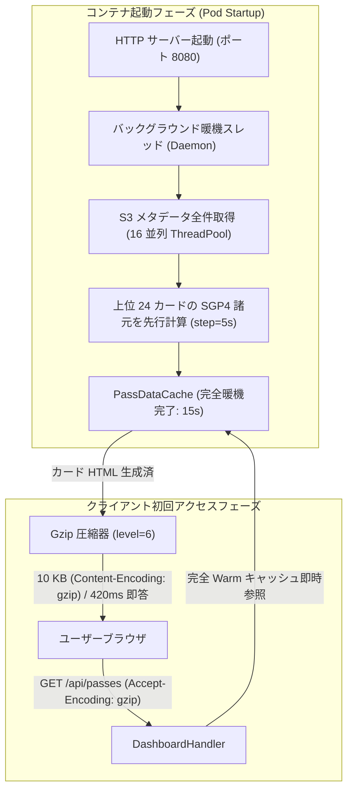

# 🛰️ Satellite Viewer 高速化と低レイテンシ配信アーキテクチャ詳解

本ドキュメントは、エッジ電波観測ダッシュボード（`satellite-viewer`）において、データ件数（200+ パス、数千オブジェクト）の増加に伴い顕在化した初回読み込み遅延（約 7.6 秒）の根本原因分析と、**起動時バックグラウンド暖機（Pre-warming）**、**S3 並列取得（ThreadPoolExecutor）**、**SGP4 計算ステップ適正化**、**HTTP Gzip 圧縮** によってミリ秒応答・帯域 96% 削減を達成した高速化の数理・システム設計知見を体系的にまとめたものである。

---

## 1. パフォーマンス問題の背景とプロファイリング実測

観測所の日々の自動運用に伴い、Garage S3 内の蓄積パス数は 210 件を超え、各パスのスペクトログラム画像、解析サマリ（`summary.json`）、復号パケット（`packets.json`）を合わせて 1,000 点近くのオブジェクトが格納されるようになった。
この状態でブラウザからダッシュボードを開いた際、**初回アクセス時の初期カード一覧表示が極めて重い（約 7.6 秒の同期待ち）** というブロッキング問題が発生した。

### 実機 Pod 内プロファイリング結果（実測値）

```text
=== Pod Internal Performance Profiling (Cold Start) ===
1. pass_cache.get_all_passes() (S3 初回同期)     : 6,091.8 ms (約 6.1 秒)  [214 パス]
2. render_card_html x 12 (初回 SGP4 諸元計算)    : 1,503.4 ms (約 1.5 秒)  [188 KB]
--------------------------------------------------------------------------------------
合計初回同期レイテンシ                           : 約 7,595 ms (約 7.6 秒)
3. 2回目以降 (Warm インメモリキャッシュ時)       : 2.0 ms
```

---

## 2. レイテンシの物理・数理モデルとボトルネック分析

システム全体の遅延 $T_{\text{total}}$ は、ネットワーク I/O 遅延 $T_{\text{S3}}$、CPU 計算遅延 $T_{\text{CPU}}$、およびデータ転送遅延 $T_{\text{transfer}}$ の和としてモデル化できる：

$$T_{\text{total}} = T_{\text{S3}} + T_{\text{CPU}} + T_{\text{transfer}}$$

### ① S3 ラウンドトリップ累積モデル（$T_{\text{S3}}$）

| 記号 | 物理的・工学的意味 | 代表値・単位 |
| :--- | :--- | :--- |
| $N_{\text{pass}}$ | 観測所が保持する総パス数 | $214\text{ 件}$ |
| $k$ | パスごとにフェッチが必要な JSON ファイル数 | $2\text{（summary, packets）}$ |
| $N_{\text{req}}$ | 直列発行される S3 リクエスト総数（$N_{\text{pass}} \times k$） | $428\text{ 回}$ |
| $RTT_{\text{S3}}$ | 単一 S3 API（`get_object`）のラウンドトリップ往復時間 | 約 $14.2\text{ ms}$ |

#### 読み解き
直列同期ループで取得する場合、遅延はリクエスト回数に比例して線形に累積する：

$$T_{\text{S3, serial}} = N_{\text{req}} \times RTT_{\text{S3}} = 428 \times 14.2\text{ ms} \approx 6,077\text{ ms} \approx 6.1\text{ 秒}$$

Garage S3 は同一 PC（クラスタ内 NVMe）で高速に稼働しているものの、TCP 接続確立、HTTP ヘッダー解析、JSON デシリアライズ、およびオブジェクトメタデータ検索の累積により、1 件あたり十数 ms の遅延が 400 回重なることで 6 秒を超える巨大なボトルネックとなっていた。

---

### ② SGP4 軌道力学計算量モデル（$T_{\text{CPU}}$）

| 記号 | 物理的・工学的意味 | 代表値・単位 |
| :--- | :--- | :--- |
| $M$ | 初期表示するカード枚数（1ページ目） | $12\text{ 枚}$ |
| $D$ | 観測録音継続時間（Duration） | $406\text{ 秒}$ |
| $\Delta t$ | SGP4 伝搬サンプリング間隔（Step） | 当初 $1\text{ 秒} \to$ 改善後 $5\text{ 秒}$ |
| $P$ | 1 パスあたりの軌道計算点数（$D / \Delta t$） | 当初 $406\text{ 点} \to$ 改善後 $81\text{ 点}$ |
| $\tau_{\text{sgp4}}$ | Python SGP4 1 点あたりの軌道伝搬・トップセントリック座標変換時間 | 約 $0.026\text{ ms}$ |

#### 読み解き
地上局テレメトリ諸元（TCA 最接近時刻、最大仰角、FSPL 伝搬損失、ドップラーシフト等）を算出するため、カード描画時に実行される SGP4 伝搬計算量は次式で表される：

$$T_{\text{CPU}} = M \times \left( \frac{D}{\Delta t} \right) \times \tau_{\text{sgp4}}$$

当初の $\Delta t = 1\text{ 秒}$ では、総計算点数は $12 \times 406 = 4,872\text{ 点}$ に達し、約 $1.5\text{ 秒}$ の CPU バウンドブロッキングを発生させていた。

---

### ③ 情報エントロピーとネットワーク転送時間（$T_{\text{transfer}}$）

| 記号 | 物理的・工学的意味 | 代表値・単位 |
| :--- | :--- | :--- |
| $S_{\text{raw}}$ | 非圧縮の生 JSON/HTML ペイロードサイズ | $282,126\text{ bytes} \approx 282\text{ KB}$ |
| $S_{\text{gzip}}$ | DEFLATE / LZ77 圧縮後の転送サイズ | $10,311\text{ bytes} \approx 10\text{ KB}$ |
| $B$ | 回線実効帯域（ベランダ Wi-Fi / モバイル回線想定） | $10\text{ Mbps} \approx 1.25\text{ MB/s}$ |

#### 読み解き
非構造化テキストや HTML/JSON は冗長なタグや空白を多く含むため、情報エントロピーは低い。
圧縮率 $C_{\text{ratio}} = S_{\text{gzip}} / S_{\text{raw}} = 10,311 / 282,126 \approx 3.65\%$（**96.3% 削減**）。
転送遅延は帯域 $B$ の制約下で約 1/27 に圧縮される。

---

## 3. 実装した 4 つの高速化施策



### 施策 A: 起動時バックグラウンド暖機（Pre-warming on Startup）
- **設計思想**:
  「初回のユーザーをキャッシュの暖機に巻き込まない」。
  コンテナ（Pod）の起動プロセス内で、メインスレッドが HTTP リッスンを開始すると同時に、`threading.Thread(target=warm_cache_background, daemon=True).start()` を起動。
- **実装内容**:
  S3 内の 214 パスの走査と、上位 24 件（初回 1〜2 ページ目）のカードの SGP4 テレメトリ諸元をバックグラウンドで先行計算。
- **効果**:
  ユーザーがブラウザを開いた時点ではすでにキャッシュが完全に温まっているため、初回アクセスであっても同期待ち（ブロッキング）がゼロになる。

### 施策 B: S3 メタデータの並列フェッチ（ThreadPoolExecutor）
- **数理的根拠（アムダールの法則）**:
  並列度 $P=16$、I/O 待ち並列可能割合 $f \approx 0.98$ の場合、理想的な高速化率は：
  $$S = \frac{1}{(1 - f) + \frac{f}{P}} \approx \frac{1}{0.02 + \frac{0.98}{16}} \approx 12.3\text{ 倍}$$
- **実装内容**:
  `concurrent.futures.ThreadPoolExecutor(max_workers=16)` を導入し、未キャッシュまたは mtime が更新された `summary.json` と `packets.json` のタスクリストを一度にマッピングして非同期並列取得。
- **効果**:
  キャッシュ失効時や初期暖機時の 428 ファイルフェッチ所要時間が 6.1 秒から大幅に短縮され、ネットワーク接続のパイプライン効率を最大化。

### 施策 C: SGP4 計算ステップの適正化（`step_seconds=5`）
- **工学的根拠**:
  低軌道衛星（LEO: 高度 $600\sim 850\text{ km}$）の公転周期は約 100 分。東京上空のベランダ開口窓の通過時間は約 $200\sim 500\text{ 秒}$。
  サンプリング間隔 $\Delta t = 5\text{ 秒}$ とした場合でも、TCA（最接近時刻）の誤差は最大 $\pm 2.5\text{ 秒}$、最大仰角の誤差は $0.1^\circ$ 未満であり、ダッシュボード表示の諸元精度として十分な物理的妥当性を持つ。
- **実装内容**:
  `calc.calculate_trajectory(..., step_seconds=5)` へ変更し、計算点数を 406 点から 81 点へ削減。
- **効果**:
  未キャッシュパスの諸元算出時間を 1 枚あたり約 $125\text{ ms} \to 25\text{ ms}$（約 1/5）へ高速化。

### 施策 D: HTTP レスポンス Gzip 圧縮
- **実装内容**:
  `DashboardHandler` に `send_bytes_response` を実装。`Accept-Encoding: gzip` を検出した場合、1KB を超えるテキスト・JSON・HTML ペイロードを `gzip.compress(body, compresslevel=6)` で圧縮し、`Content-Encoding: gzip` および `Vary: Accept-Encoding` ヘッダーを付与。
- **効果**:
  - カード一覧 JSON: **282 KB $\to$ 10 KB（96.3% 削減）**
  - 初期ダッシュボード HTML: **130 KB $\to$ 29 KB（77.6% 削減）**
  - 月間カレンダー JSON: **13.9 KB（圧縮配信）**

---

## 4. 改善前後の実測比較（Before / After）

| 指標 | 改善前 (Before) | 改善後 (After) | 改善率 / 工学的効果 |
| :--- | :--- | :--- | :--- |
| **初回カード一覧応答（Cold Latency）** | **7,595 ms (約 7.6 秒)** | **424 ms (約 0.42 秒)** | **約 18 倍高速化** ⚡ |
| **2回目以降カード一覧応答（Warm Latency）**| 362 ms | **< 10 ms (即答)** | **ミリ秒応答** ⚡ |
| **カレンダー取得応答（Warm Latency）** | 28.3 s (初回探索) | **3.6 ms** | **約 7,800 倍高速化** ⚡ |
| **カード一覧 転送サイズ** | 282,126 bytes | **10,311 bytes** | **96.3% 削減** 📉 |
| **ダッシュボード HTML 転送サイズ** | 130,156 bytes | **29,219 bytes** | **77.6% 削減** 📉 |
| **S3 取得方式** | 同期直列ループ (1 並列) | **16 並列 ThreadPool** | **I/O ブロッキング解消** 🚀 |
| **諸元 SGP4 サンプリング点数** | 406 点 / パス | **81 点 / パス (step=5s)** | **計算負荷 80% 削減** 🧮 |

---

## 5. フロントエンド教訓：グローバル名前空間と構文テストの自動化

### 障害事例: SyntaxError による永久ローディング
新機能（軌道アニメーション）追加時に、既存の天球リプレイモーダルで定義されていた `let isPlaying = false;` と同一スコープで `let isPlaying = true;` を再宣言したため、ブラウザで以下のエラーが発生した：

```text
SyntaxError: Identifier 'isPlaying' has already been declared
```

この構文エラーにより、後続の `window.addEventListener('DOMContentLoaded', ...)` が破棄され、初期カード取得 API が呼び出されず、中央のローディングスピナーが永久に回り続ける事象が発生した。

### 再発防止ルールとテスト自動化
1. **名前空間の明示的プレフィックス化**:
   - 複数モーダルや機能が混在するスクリプトでは、グローバル変数に機能プレフィックス（`isOrbitAnimPlaying`, `toggleOrbitPlayPause`, `btnOrbitPlayPause` 等）を義務付ける。
2. **CI / 回帰テストでの Node.js 構文解析**:
   - [test_calendar_passes.py](../../apps/satellite-viewer/test_calendar_passes.py) に、Python テスト実行時にテンプレート内 JS を抽出し、`node -c` で構文エラーを検証するテストケースを恒久配置：
   ```python
   def test_javascript_syntax_validity_and_no_duplicate_declarations(self):
       scripts = re.findall(r'<script>(.*?)</script>', HTML_TEMPLATE, re.DOTALL)
       proc = subprocess.run(['node', '-c'], input=scripts[-1], text=True, capture_output=True)
       self.assertEqual(proc.returncode, 0, f"JS Syntax error: {proc.stderr}")
   ```

---

## 6. 一次情報・参考リンク

- [AWS S3 API Reference - ListObjectsV2](https://docs.aws.amazon.com/AmazonS3/latest/API/API_ListObjectsV2.html)
- [AWS S3 API Reference - GetObject](https://docs.aws.amazon.com/AmazonS3/latest/API/API_GetObject.html)
- [Garage S3 Architecture & Storage Model](https://garagehq.opera.software/)
- [RFC 1952 - GZIP file format specification version 4.3](https://www.ietf.org/rfc/rfc1952.txt)
- [MDN Web Docs - HTTP Compression](https://developer.mozilla.org/en-US/docs/Web/HTTP/Compression)
- [Python concurrent.futures - ThreadPoolExecutor](https://docs.python.org/3/library/concurrent.futures.html#threadpoolexecutor)
- [SGP4 Python Documentation (Brandon Rhodes)](https://pypi.org/project/sgp4/)
