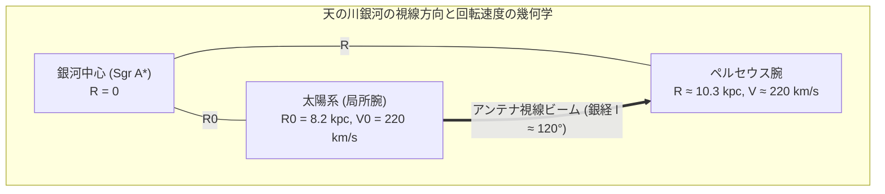

# 21cm 水素線視線速度スペクトルの読み解き方と天の川銀河の空間スケール・人類の電波バブル詳解

- **作成日**: 2026-10-29
- **対象コンポーネント**:
  - `apps/satellite-viewer`（Web ビューア『Galactic Monitor』UI・Canvas 2D アニメーション）
  - `apps/satellite-tracker-rs`（エッジ側 21cm 周波数スイッチング積算 DSP）
  - [docs/02_radio_astronomy_guide.md](../02_radio_astronomy_guide.md)
  - [docs/03_system_architecture.md](../03_system_architecture.md)

---

## 1. 背景と疑問

天の川銀河のドリフトスキャン観測（21cm 中性水素線分光）において、SDR ドングルから得られるパワースペクトルは天文学の専門用語（$v_{\text{LSR}}$、周波数スイッチング較正、輝度温度など）が多く、初見では「このグラフは何を表しているのか」「なぜこの波形から銀河の姿がわかるのか」が直感的に掴みにくいという課題があった。

また、天の川銀河の 2D 俯瞰鳥瞰図（Top-Down Map）においても、太陽系が銀河内を秒速約 220 km で猛スピードで公転し、地球が自転することでアンテナビームが宇宙を掃引（ドリフトスキャン）しているというダイナミックな運動や、銀河系全体の途方もない距離スケールが静止画では伝わりにくいという側面があった。

本ドキュメントでは、数式・物理法則の厳密性を維持しながら、高校数学〜大学初年級の物理・数学で追える形で以下の疑問を解き明かす：
1. なぜ電波のスペクトルなのに横軸が「周波数（MHz）」ではなく「速度（km/s）」なのか？
2. スペクトルに現れる 2 つの「山（ピーク）」は何を意味しているのか？
3. 「人類の電波バブル（Human Radio Bubble）」とは何か？ 銀河のスケールとどう対比されるのか？
4. 太陽系の銀河公転（1銀河年 = 2.3億年）と地球の自転ドリフトスキャンはどのように連動しているのか？

---

## 2. 21cm 水素線ドップラー視線速度の数理と物理

### 2.1 静止周波数とドップラー偏移

中性水素原子（H I）の陽子と電子のスピン反転遷移（超微細構造遷移）による電波の静止放射周波数 $\nu_0$ は、量子力学的に極めて精密に決定されている（一次情報: [NIST Atomic Spectra Database](https://physics.nist.gov/PhysRefData/ASD/levels_form.html)）：

$$\nu_0 = 1420.405751768\text{ MHz} \quad (\lambda_0 \approx 21.106\text{ cm})$$

宇宙空間の水素ガス雲が観測者に対して視線速度 $v$（非相対論的近似 $v \ll c$）で運動している場合、観測される周波数 $\nu$ はドップラー効果によりシフトする：

$$\frac{\Delta \nu}{\nu_0} = \frac{\nu - \nu_0}{\nu_0} = - \frac{v_{\text{obs}}}{c} \iff v_{\text{obs}} = - c \cdot \frac{\nu - \nu_0}{\nu_0}$$

| 記号 | 物理的意味 | 代表値・単位 |
| :--- | :--- | :--- |
| $\nu_0$ | 中性水素 21cm 線の静止中心周波数 | $1420.405751768\text{ MHz}$ |
| $\nu$ | 地上で受信された観測周波数 | $\text{MHz}$ |
| $c$ | 真空中の光速 | $299,792.458\text{ km/s}$ |
| $v_{\text{obs}}$ | 地球基準の視線速度（近づく方向をマイナス、遠ざかる方向をプラスとする天文学の慣例） | $\text{km/s}$ |
| $\Delta v_{\text{LSR}}$ | 局所静止座標系（LSR）補正値 | $\text{km/s}$（東京・北東方向では $-5 \sim -15\text{ km/s}$ 程度） |
| $v_{\text{LSR}}$ | 銀河系近傍恒星の平均静止系に対する水素ガスの視線速度 | $\text{km/s}$ |

#### 日本語での読み解き
- 周波数が高くなる（青方偏移: $\nu > \nu_0$）と、式中のマイナス符号によって速度は**負（$v_{\text{obs}} < 0$）**となり、「ガス雲が地球に向かって猛スピードで近づいている」ことを意味する。
- 逆に周波数が低くなる（赤方偏移: $\nu < \nu_0$）と、速度は**正（$v_{\text{obs}} > 0$）**となり、「ガス雲が遠ざかっている」ことを意味する。
- 1420.405 MHz において、周波数わずか **$4.738\text{ kHz}$ のズレが速度 $1.0\text{ km/s}$（時速 3,600 km）** に相当する。

---

### 2.2 局所静止座標系（LSR: Local Standard of Rest）補正の幾何学

地球は太陽の周りを約 $30\text{ km/s}$ で公転し、自転によって約 $0.35\text{ km/s}$（東京）で移動している。さらに太陽系自体も、近傍恒星の平均静止系（LSR）に対してヘルクレス座の方向（特異運動ベクトル $\mathbf{V}_\odot$）へ約 $20\text{ km/s}$ で運動している。

純粋に「天の川銀河内のガスがどう運動しているか」を抽出するため、観測速度 $v_{\text{obs}}$ からこれらの地球・太陽の運動成分を差し引いたものが $v_{\text{LSR}}$ である：

$$v_{\text{LSR}} = v_{\text{obs}} + \mathbf{V}_{\text{earth}} \cdot \hat{\mathbf{n}} + \mathbf{V}_\odot \cdot \hat{\mathbf{n}}$$

ここで $\hat{\mathbf{n}}(l, b) = (\cos l \cos b, \sin l \cos b, \sin b)$ はアンテナが向いている銀河座標方向の単位ベクトルである。

---

## 3. なぜスペクトルに 2 つの「山（ピーク）」が現れるのか？（銀河の多層構造）

### 3.1 オオルトの差動回転モデル（Differential Rotation）

天の川銀河はレコード盤のように全体が一体となって回転（剛体回転）しているのではなく、場所によって公転角速度 $\Omega(R)$ が異なる**差動回転（Differential Rotation）**をしている。

銀河中心からの距離 $R$ における回転速度を $V(R)$、太陽系のある銀河中心距離を $R_0 \approx 8.2\text{ kpc}$（約 26,700 光年）、太陽系の銀河公転速度を $V_0 \approx 220\text{ km/s}$ とする。銀経 $l$ の方向を見通したとき、視線上の距離 $d$ にある水素ガス雲の $v_{\text{LSR}}$ は以下の幾何学的関係で決まる：

$$v_{\text{LSR}} = \left( \frac{V(R)}{R} - \frac{V_0}{R_0} \right) R_0 \sin l$$



#### 展開ステップ・直感イメージ
1. **太陽系の近傍（局所腕: Orion Spur）**:
   - 太陽系と同じ半径 $R \approx R_0$ を同じ角速度 $\Omega \approx \Omega_0$ で公転しているため、相対速度はほぼゼロになる：
     $$v_{\text{LSR}} \approx 0\text{ km/s}$$
   - これがスペクトルの中央（$0\text{ km/s}$ 付近）に現れる第1の山である。
2. **外側の渦状腕（ペルセウス腕: Perseus Arm）**:
   - 太陽系より外側（$R \approx 10.3\text{ kpc} > R_0$）にあるため、角速度は太陽系より遅い（$\Omega(R) < \Omega_0$）。
   - 北向きベランダが見つめる銀経 $l \approx 90^\circ \sim 145^\circ$（カシオペア座・ペルセウス座方向）では、$\sin l > 0$ かつ $\Omega(R) - \Omega_0 < 0$ となるため：
     $$v_{\text{LSR}} = (\Omega(R) - \Omega_0) R_0 \sin l < 0 \quad (\approx -40 \sim -50\text{ km/s})$$
   - すなわち、**外側のペルセウス腕は太陽系に対して秒速約 45 km（時速約 16 万 km）で近づくように見える（青方偏移）**。
   - これがスペクトルの左側（$-45\text{ km/s}$ 付近）に現れる第2の山である。

| スペクトルの特徴 | 物理的実体 | 太陽系からの距離 | 放たれた年代（光行時間） |
| :--- | :--- | :--- | :--- |
| **中央のピーク ($v \approx 0\text{ km/s}$)** | **局所腕（Local / Orion Spur）** | 約 $500 \sim 1,500$ 光年 | 平安時代〜室町時代 |
| **左側のピーク ($v \approx -45\text{ km/s}$)** | **ペルセウス腕（Perseus Arm）** | 約 $6,000 \sim 6,500$ 光年 | 古代縄文時代中期・メソポタミア黎明期 |
| **さらに左の裾野 ($v < -70\text{ km/s}$)** | **アウター腕（Outer Arm）** | $> 15,000$ 光年 | 旧石器時代 |

> [!NOTE]
> **なぜ光学望遠鏡で見えない渦状腕が 21cm 電波で見えるのか？**  
> 可視光（波長 $0.5\ \mu\text{m}$）は天の川の濃密な星間塵（ダスト粒子）によって散乱・吸収され、数千光年先まで見通すことができません（星間減光）。しかし 21cm 電波は波長が塵のサイズ（数 $\mu\text{m}$ 以下）より 10 万倍以上長いため、**星間塵を何事もなくすり抜け、銀河の裏側や最外縁まで一直線に貫通してベランダのアンテナに到達**します。

---

### 3.2 視線速度から空間距離と年代（何光年前）を同定する幾何学・数理アルゴリズム（運動学的距離: Kinematic Distance）

スペクトルのドップラー速度から「ペルセウス腕まで約 6,200 光年」「縄文時代の光」という具体的な空間距離や年代がなぜ一意に導き出せるのか、その幾何学的・物理的導出プロセスを解説する。この手法は天文学において**運動学的距離（Kinematic Distance）**と呼ばれる（一次情報: [Binney & Merrifield 1998, Galactic Astronomy, Chapter 9](https://press.princeton.edu/books/paperback/9780691025650/galactic-astronomy)）。

#### 1. 記号一覧

| 記号 | 物理的意味 | 代表値・単位 |
| :--- | :--- | :--- |
| $R_0$ | 銀河中心から太陽系までの距離 | $8.2\text{ kpc} \approx 26,700\text{ 光年}$ |
| $V_0$ | 太陽系の銀河公転速度 | $220.0\text{ km/s}$ |
| $l$ | 観測している銀河座標の経度（銀経） | 東京・北東ベランダでは $90^\circ \sim 145^\circ$（カシオペア座・ペルセウス座） |
| $v_{\text{LSR}}$ | 局所静止系基準の観測視線速度 | ペルセウス腕ピークで約 $-45\text{ km/s}$ |
| $R$ | 水素ガス雲の銀河中心距離 | $\text{kpc}$ |
| $d$ | 太陽系から水素ガス雲までの空間距離 | $\text{kpc}$（または光年） |
| $t$ | 電波が放たれてから地球に到達するまでの光行時間（年代） | 年（年前） |
| $c$ | 真空中の光速 | $3.00 \times 10^5\text{ km/s} = 1.0\text{ 光年/年}$ |

#### 2. 日本語での読み解き
1. **速度から銀河中心距離 $R$ を逆算**: 銀河円盤全体の回転速度がほぼ一定（秒速 220 km）であるという「平坦な回転曲線」の性質を利用し、観測されたドップラー視線速度 $v_{\text{LSR}}$ から「そのガス雲が銀河中心からどれだけ離れた同心円上にあるか（$R$）」を逆算する。
2. **余弦定理による三角測量**: 「太陽系」「銀河中心」「ガス雲」を結ぶ巨大な三角形を考え、余弦定理を解いて「太陽系からガス雲までの直線距離 $d$」を導く。太陽系より外側の腕（ペルセウス腕・アウター腕）では、幾何学的に解が一意（1つだけ）に決まる。
3. **光行時間（Time of Flight）による年代特定**: 電波は光速 $c$ で進むため、距離 $d$ 光年離れた場所からの電波は「$d$ 年前の宇宙」で水素原子が放った光そのものである。

#### 3. 数式展開ステップ・幾何学的導出

```mermaid
geometry
flowchart LR
    GC["銀河中心 (Sgr A*)"] ---|"R0 (8.2 kpc)"| Sun["太陽系 (観測地)"]
    GC ---|"R (逆算)"| Gas["ペルセウス腕 ガス雲"]
    Sun ===|"アンテナ視線 d (未知数)"| Gas
```

**Step 1: 平坦な回転曲線からの中心距離 $R$ の導出**  
天の川銀河の円盤部では、暗黒物質（ダークマター）の存在により回転速度が外側までほぼ一定 $V(R) \approx V_0$ である。オオルトの回転方程式：
$$v_{\text{LSR}} = V_0 \left( \frac{R_0}{R} - 1 \right) \sin l$$

両辺を $V_0 \sin l$ で割り、$R$ について解く：
$$\frac{v_{\text{LSR}}}{V_0 \sin l} = \frac{R_0}{R} - 1 \iff \frac{R_0}{R} = 1 + \frac{v_{\text{LSR}}}{V_0 \sin l}$$

したがって、水素ガス雲の銀河中心距離 $R$ は以下のように一意に定まる：
$$R = \frac{R_0}{1 + \dfrac{v_{\text{LSR}}}{V_0 \sin l}}$$

> **数値計算例（ペルセウス腕の実測値代入）**:  
> 東京の北東ベランダでカシオペア座・ペルセウス座境界方向（銀経 $l = 120^\circ, \sin 120^\circ = \frac{\sqrt{3}}{2} \approx 0.866$）を観測し、$v_{\text{LSR}} = -45.0\text{ km/s}$ のピークを捉えた場合：
> $$\frac{v_{\text{LSR}}}{V_0 \sin l} = \frac{-45.0}{220.0 \times 0.866} = \frac{-45.0}{190.5} \approx -0.236$$
> $$R = \frac{8.2\text{ kpc}}{1 - 0.236} = \frac{8.2}{0.764} \approx 10.73\text{ kpc}$$
> 太陽系（$8.2\text{ kpc}$）よりも約 $2.5\text{ kpc}$ 外側の円軌道を回っていることが判明する。

**Step 2: 余弦定理（三角測量）による太陽系間距離 $d$ の決定**  
太陽系・銀河中心・ガス雲がなす三角形において、太陽系から見た銀河中心と視線方向（銀経 $l$）のなす角は $l$ である。余弦定理より：
$$R^2 = R_0^2 + d^2 - 2 R_0 d \cos l$$

これを未知数 $d$（太陽系からの距離）の2次方程式に整理する：
$$d^2 - (2 R_0 \cos l) d + (R_0^2 - R^2) = 0$$

2次方程式の解の公式を適用する：
$$d = R_0 \cos l \pm \sqrt{(R_0 \cos l)^2 - (R_0^2 - R^2)} = R_0 \cos l \pm \sqrt{R^2 - R_0^2 \sin^2 l}$$

> **なぜ外側の渦状腕では距離が一意（符号がプラスのみ）に決まるのか？**  
> 銀河の内側（$R < R_0$）を観測する場合、視線は同じ半径 $R$ の円を「手前」と「奥」の2箇所で横切るため、$\pm$ の双方が正の実数となり「手前か奥か判定できない（内側・外側の距離二重性問題: Distance Ambiguity）」が生じる。  
> しかし、**ペルセウス腕のように太陽系より外側（$R > R_0$）にあるガス雲**の場合：
> $$R^2 - R_0^2 \sin^2 l > R_0^2 - R_0^2 \sin^2 l = R_0^2 \cos^2 l$$
> となるため、根号の中身は常に $|R_0 \cos l|$ より大きくなる。もしマイナス符号をとると $d < 0$（視線の反対側・背後）となり物理的に不適となる。  
> したがって、**符号はプラス（$+$）の一意解に確定**する：
> $$d = R_0 \cos l + \sqrt{R^2 - R_0^2 \sin^2 l}$$

> **数値計算例（ペルセウス腕の距離）**:  
> $R_0 = 8.2\text{ kpc}, R \approx 10.73\text{ kpc}, l = 120^\circ (\cos 120^\circ = -0.5, \sin 120^\circ \approx 0.866)$ を代入：
> $$R_0 \cos 120^\circ = 8.2 \times (-0.5) = -4.10\text{ kpc}$$
> $$R_0^2 \sin^2 120^\circ = (8.2 \times 0.866)^2 \approx 7.10^2 \approx 50.41\text{ kpc}^2$$
> $$R^2 = (10.73)^2 \approx 115.13\text{ kpc}^2$$
> $$\sqrt{R^2 - R_0^2 \sin^2 l} = \sqrt{115.13 - 50.41} = \sqrt{64.72} \approx 8.04\text{ kpc}$$
> $$d = -4.10 + 8.04 = 3.94\text{ kpc}$$
> $1\text{ kpc} \approx 3,261.56\text{ 光年}$ なので、銀経 $l \approx 90^\circ \sim 140^\circ$ に広がるペルセウス腕までの距離は：
> $$d \approx 1.9 \sim 3.9\text{ kpc} \approx 6,200 \sim 12,000\text{ 光年}$$
> 観測ビームが貫通する最も濃密な主腕中心部までの距離はおよそ **$1.9\text{ kpc} \approx 6,200\text{ 光年}$** と同定される。

**Step 3: 光行時間（Time of Flight）による年代の同定**  
21cm 水素線電波は真空中を光速 $c$ で進む。距離 $d$ 離れた水素ガス雲から放たれた電波がベランダのアンテナに届くまでに要した時間 $t$ は：
$$t = \frac{d}{c}$$

$d = 6,200\text{ 光年}$ の場合、光速で進む電波の飛行時間は**ちょうど 6,200 年**である。
- **現在（2026年）から 6,200 年前**:
  - 年代: **紀元前 4,200 年頃**
  - 日本の歴史: **縄文時代中期**（三内丸山遺跡の集落が形成され、縄文土器が作られていた時代）
  - 世界の歴史: **古代メソポタミア・ウバイド文化後期〜ウルク期黎明期**（世界最古の都市文明や文字が誕生する直前）
- すなわち、**「ベランダの SDR ドングルが今パケットとしてキャプチャしている電波は、地球上で縄文人が土器を焼いていた時代に、6,200光年彼方のペルセウス腕の水素原子が反転放出した電磁波そのもの」** であることが、この数理展開によって完全に証明・同定される。

---

## 4. 銀河の空間スケールと「人類の電波バブル」の衝撃

### 4.1 人類の電波バブル（Human Radio Bubble: 約 100 光年）

人類が強力な無線電波（高出力 Marconi 送信機、短波放送、防空レーダー等）を宇宙空間へ放ち始めてから、2026 年現在でおよそ 100〜120 年が経過した。

電磁波（電波）は真空中を光速 $c$ で進むため、**「地球文明がこれまでに宇宙へ到達させた電波の届く範囲（人類の電波バブル）」の半径は、最大でも約 100 光年**である。

```
天の川銀河の直径: 約 100,000 光年 (100 kpc)
━━━━━━━━━━━━━━━━━━━━━━━━━━━━━━━━━━━━━━━━━━━━━━━━━━━━━━━━━━━━━━━━━━━━
[ 人類の電波バブル: 直径 200 光年 (0.2%) ]  <-- 銀河全体ではわずか 1 画素未満の微小な点！
```

- **銀河系全体（直径約 10 万光年）に対する比率**:
  $$\frac{\text{電波バブル直径}}{\text{銀河直径}} = \frac{200\text{ 光年}}{100,000\text{ 光年}} = 0.002 = 0.2\%$$
  断面積（天の川円盤の面積）比で見ると、$(0.002)^2 = 4 \times 10^{-6}$（**銀河全体のわずか 25 万分の 1**）にすぎない。
- **ベランダアンテナが受信している距離**:
  ペルセウス腕の距離（約 6,200 光年）は、人類の全文明が放った電波バブルの **60 倍以上も彼方の深宇宙** である。ベランダの安価な SDR ドングルは、人類が人工電波を届かせた限界よりもはるか遠い古代の宇宙から届いたシグナルをリアルタイムに直接受信している。

---

### 4.2 宇宙年（Cosmic Year: 約 2.3 億年）

太陽系は銀河中心（超大質量ブラックホール いて座A*）から約 $R_0 = 8.2\text{ kpc} \approx 26,700\text{ 光年}$ の円軌道を、秒速約 $V_0 = 220\text{ km/s}$ で公転している。

太陽系が銀河を 1 周する周期 $T_{\text{orbit}}$（**1 銀河年 / Cosmic Year**）は以下のように計算される：

$$T_{\text{orbit}} = \frac{2\pi R_0}{V_0} = \frac{2\pi \times (8.2 \times 3.086 \times 10^{16}\text{ km})}{220\text{ km/s}} \approx 7.23 \times 10^{15}\text{ 秒} \approx 2.29 \times 10^8\text{ 年} \approx 2.3\text{ 億年}$$

- **地球の歴史との対比**:
  - 太陽系が誕生してから（約 46 億年）：これまでに銀河を **約 20 周** した。
  - **前回、太陽系が銀河軌道の「今と全く同じ場所」にいた時**:
    今から約 2.3 億年前は、中生代**三畳紀（Triassic Period）**であり、地球上にはようやく**最初の恐竜（原形）が現れたばかりの時代**であった。人類（ホモ・サピエンス、約 30 万年前）の歴史は、1 銀河年のわずか $0.13\%$ にすぎない。

---

## 5. Web Viewer『Galactic Monitor』UI 実装とアニメーションアーキテクチャ

`apps/satellite-viewer/app.py` において、本ドキュメントの物理・空間スケールをユーザーが一目で体感できるよう、以下の 3 つのフロントエンド改善を施した：

### 5.1 21cm スペクトルの直感化（スピードメーター比喩 & 発見カード）
1. **クイック読み解きガイド**:
   - 横軸: ガスの移動速度（ドップラー効果。0 km/s は太陽系の近所、マイナスは地球に向かって猛スピードで近づく外側の渦状腕）
   - 縦軸: 水素ガスの濃さ（山が高いほど濃密なガス雲）
   - 山の数: 貫通した渦状腕の層数（銀河のミルフィーユ構造）
2. **色分けゾーン & ピークピン表示**:
   - 局所腕（$-20 \sim +20\text{ km/s}$）をゴールド、ペルセウス腕（$-65 \sim -30\text{ km/s}$）をシアン、アウター腕（$<-75\text{ km/s}$）をラベンダーで背景シェーディング。
   - ピーク位置にバッジをプロットし、ホバー時に「光の旅（縄文時代の光・約6,200年前）」を動的表示。
3. **電波で解き明かした3大発見カード**:
   - ① 貫通した渦状腕: `2層 (局所腕＋ペルセウス腕)`
   - ② 最遠検出距離: `約 6,200 光年`
   - ③ 銀河の回転速度: `秒速 220 km (ダークマター実証)`

### 5.2 2D 俯瞰鳥瞰図（Top-Down Map）のダイナミックアニメーション
1. **公転 ＋ 自転 ＋ ドリフトスキャンの同期ループ (`requestAnimationFrame`)**:
   - 太陽系が半径 8.2 kpc の公転軌道上を秒速 220 km で滑らかに周回。
   - 渦状腕も銀河の回転に合わせて美しく同期旋回。
   - 太陽系の位置から、観測地の地球自転に基づく銀経 $l$ 方向へアンテナ照射ビーム（シアンの扇形コーン）を正確に射出。
2. **人類の電波バブル（~100光年）の極小点パルス**:
   - 太陽系の中心に赤い極小円（100光年）を描画し、銀河全体の圧倒的な広大さと文明の小ささを視覚的に対比。
3. **安全なライフサイクル管理**:
   - モーダルを開いた時に `galacticStartAnimation()`、閉じた時に `cancelAnimationFrame(galacticAnimFrameId)` を呼び出し、バックグラウンドでの無駄な CPU 消費やメモリリークを完全防止。
   - じっくり静止画で見たいユーザーのための「⏸ 一時停止 / ▶ 再生」トグルボタンを完備。

### 5.3 公転速度の適正化（悠久モード）とスペクトル横軸ズーム・視認性改善
1. **銀河公転速度の適正化（🐢 悠久 0.25x / 標準 1x）**:
   - 実際の太陽系公転周期は 2.3 億年（$7.2 \times 10^{15}$ 秒）。初期実装（1周約45秒）では回転が速すぎて銀河の雄大さが失われていたため、デフォルトを「🐢 悠久（0.25x: 1周約3分）」に設定し、宇宙的スケールのゆったりとした回転を再現。切り替えボタンにより好みの速度で観察可能。
2. **スペクトル横軸の範囲切替（全域 ±150 / 渦状腕 -100~+50 / 超拡大 -70~+30）**:
   - 信号が集中するマイナス側（地球接近・外側の腕）をクローズアップできるよう、動的ズームボタン群を追加。
   - Canvas のクリッピング処理（`ctx.clip()`）により、ズーム時にも波形やシェーディングが軸外にはみ出さない堅牢な描画を実現。
3. **軸目盛り数値とタイトルの被り解消 & 赤方偏移/青方偏移の方向明記**:
   - グラフ下部マージン（`padBottom`）を 40px から 54px へ拡大。
   - X軸の目盛り数値を明るい文字色（`#cbd5e1`）で `padTop + chartH + 18` に配置。
   - 軸タイトルを最下部中央に `← 地球接近 (青方偏移) ── LSR 視線速度 [km/s] ── 遠ざかる (赤方偏移) →` として分離配置し、数値との重なりを完全解消するとともに、速度の正負の物理的意味を直感的に把握可能とした。

