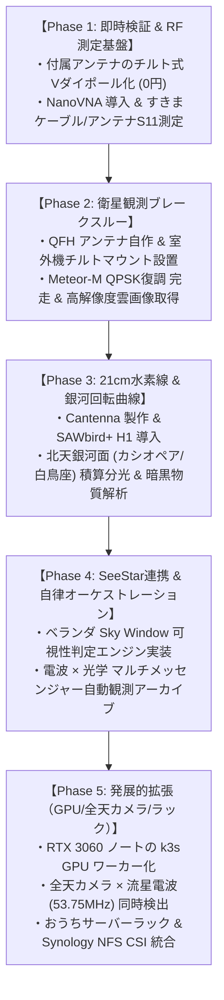

# ベランダ電波天文学 & 衛星地上局 全方位アップデート設計仕様書

- **作成日**: 2026-10-12
- **ステータス**: 承認済み（仕様策定フェーズ）
- **対象環境**: 北向き・東向きベランダ（GPD Pocket3 / Ubuntu 26.04 LTS / RTL-SDR Blog V4）

---

## 1. 概要と目的

### 1.1 背景と課題
本プロジェクトではこれまで、RTL-SDR Blog V4 を用いた極軌道気象衛星（Meteor-M、NOAA）やアマチュア衛星（XW-2A、UmKA-1 等）の自動追尾・録音・解析パイプラインを構築してきた。
しかし、直近の観測データ解析において以下の課題が顕在化している：
1. **仰角の高い好条件下でもデジタル信号が復調できない**: 生信号（`raw.u8`）は数百MB記録されているにもかかわらず、Meteor-M の QPSK デジタル復調（`cadu`）が 0 バイトで画像復元に失敗している。
2. **ベランダ環境特有の物理的障壁**:
   - 上階ベランダのひさし（鉄筋コンクリート）による真上（仰角 $70^\circ \sim 90^\circ$）の電波遮蔽。
   - 金属手すりによる電波反射・マルチパス干渉、および浮遊容量によるアンテナインピーダンス（$50\,\Omega$）の破壊。
   - エアコン室外機直置きによるインバーター・ファンモーターからの高周波ノイズ混入。
3. **電波天文学（21cm水素線）への未到達**: 付属アンテナ単体では利得・雑音指数の制約から、銀河系の中性水素線（HI Line: 1420.405 MHz）が検出できない。

### 1.2 目的
予算 1.5万〜2万円 程度の最適設備投資を行い、**「理論と測定の裏付け（NanoVNA）」** と **「低ノイズ・高性能ハードウェア（QFH / Cantenna / LNA）」**、そして **「ベランダ幾何学に最適化した自律オーケストレーション（SeeStar S50 遠隔連携含む）」** を統合した、本格的なベランダ分散天文台・地上局システムを確立する。

---

## 2. システム全体アーキテクチャ

```text
【屋外：ベランダ室外機上】（電源なし・手すり内完結・チルト角度調整）
  ┌─────────────────────────────────────────────────────────────┐
  │  ① 衛星用：137MHz 4条螺旋アンテナ (QFH)                      │
  │     （右旋円偏波 RHCP / 天頂ヌルなし / 底面ノイズ -20dB遮蔽） │
  │  ② 天体用：1420MHz 導波管ホーン (Cantenna)                   │
  │     ＋ アンテナ直下 LNA (SAWbird+ H1, 利得40dB/NF 0.8dB)     │
  └──────────────────────────────┬──────────────────────────────┘
                                 │
                 [カメラ用ボール自由雲台 + 支柱 + 磁石]
                 （北東向き・仰角40°〜45°へチルト固定）
                                 │
                     [コモンモードチョーク (バラン)]
                                 │
  ───────────────────────────────┼─────────────────────────────── 【窓サッシ境界】
                                 │ SMA 50Ω すきまフラット同軸
  ───────────────────────────────┼───────────────────────────────
                                 │
【屋内：北側居室】               ▼
  ┌─────────────────────────────────────────────────────────────┐
  │  [FMトラップフィルタ (88-108MHzカット)]                     │
  │                     │                                       │
  │  [RTL-SDR Blog V4] (Bias-T 4.5V 給電ON / TCXO 1PPM)         │
  │                     │ USB                                   │
  │  [GPD Pocket3 (Ubuntu 26.04 LTS)]                           │
  │   - KubeEdge (EdgeCore + CloudCore)                         │
  │   - satellite-tracker-rs (Rust SGP4/ドップラー補正)          │
  │   - 21cm分光積算DSP (放射計方程式 / LSR速度変換)            │
  │   - Temporal ワークフロー (Sky Window 可視判定 & 追尾制御)  │
  │   - SeeStar S50 遠隔制御 (Wi-Fi JSON-RPC / 自動撮影)         │
  └─────────────────────────────────────────────────────────────┘
```

---

## 3. ハードウェア & RFフロントエンド設計

### 3.1 衛星用 4条螺旋アンテナ（QFH: Quadrifilar Helix Antenna）
* **選定根拠**:
  * **完全な右旋円偏波（RHCP）**: 衛星の姿勢変化や電離層ファラデー回転による偏波消失フェージングを完全解消（軸比 $\le 2\text{ dB}$）。
  * **天頂ヌルなし**: 低仰角（$15^\circ$）から天頂（$90^\circ$）まで均一なカーディオイド放射パターン。
  * **底面ノイズ遮蔽**: アンテナ底面方向の感度が $-15 \sim -20\text{ dB}$ 低いため、真下の室外機インバーターノイズやベランダ床面反射を物理的に遮断。
* **物理仕様**:
  * 芯材: 塩ビパイプ VP40 または VP50（高さ約 $65\text{ cm}$、外径約 $20\text{ cm}$）。手すり内側に完全に収まり外観を損ねない。
  * エレメント: 50Ω同軸ケーブル（RG-58A/U）を用いた同軸QFH方式。
  * 中心周波数: 137.1 MHz（Meteor / NOAA共用）。

### 3.2 21cm中性水素線用 Cantenna（円形導波管ホーンアンテナ）
* **物理仕様**: 直径約 $15 \sim 18\text{ cm}$、奥行き約 $25 \sim 30\text{ cm}$ の金属円筒（粉ミルク缶またはペール缶）。
* **カットオフ周波数 $f_c$**: $\text{TE}_{11}$ モードにおいて $f_c = \frac{1.8412 c}{2 \pi a} \approx 1.1 \sim 1.2\text{ GHz}$。1420MHz を低損失で通し、低周波ノイズを物理的に遮断するハイパス特性。
* **RFフロントエンド**:
  * **SAWbird+ H1**: アンテナ給電プローブ直後に直結。中心周波数 1420.4 MHz、利得約 $40\text{ dB}$、雑音指数 $\text{NF} < 0.8\text{ dB}$。
  * **Bias-T受電**: RTL-SDR Blog V4 から同軸経由で 4.5V DC を給電（ベランダ電源不要）。

### 3.3 マウント機構（マンション管理規約完全適合）
* **手すり内完結**: 手すりからの突出や外観への露出をゼロにし、専有使用権の範囲内に収める。
* **カメラ用自由雲台（ボールヘッド）＋ 支柱 ＋ マグネットベース**:
  * 強力ネオジム磁石で室外機天板に固定。
  * 支柱（約 $25\text{ cm}$）で天板から浮かせることで、金属板との浮遊容量結合を防止。
  * アンテナを **「北東方向・仰角 $40^\circ \sim 45^\circ$」** にチルト固定し、上階のひさしによる死角を避けてベランダの開口窓にビームを集中。

### 3.4 NanoVNA による RF 定量測定・最適化フロー
1. **SOLT 基準較正**: Short, Open, Load ($50\,\Omega$), Through 治具を用いて、測定ケーブルの位相・損失を校正。
2. **反射特性 ($S_{11}$) 測定**:
   * 目標値: 目的周波数（137.1 MHz / 1420.4 MHz）において **$S_{11} \le -15\text{ dB}$（VSWR $\le 1.43$）**。
   * チルト角度調整時のスミスチャートを観測し、手すりや外壁との干渉が最小となる幾何学的角度を確定。
3. **通過特性 ($S_{21}$) 測定**:
   * すきまフラット同軸ケーブルの通過損失測定（目標: 137MHz で $< 1.0\text{ dB}$）。
   * FMノッチフィルタの減衰特性確認（88〜108MHz で $> -30\text{ dB}$、137MHz で $< -1.0\text{ dB}$）。

---

## 4. デジタル信号処理 (DSP) パイプライン

### 4.1 21cm線分光・積算パイプライン

#### ① パワースペクトル密度 (PSD)
入力複素IQ信号 $x[n] = I[n] + jQ[n]$（サンプリングレート $f_s = 2.4\text{ MSPS}$）に対し、Blackman 窓 $w[n]$ を適用して 2048点 FFT を実行：

$$X[k] = \sum_{n=0}^{N-1} x[n] w[n] e^{-j \frac{2\pi}{N} k n}, \quad P[k] = \frac{1}{N \cdot f_s} |X[k]|^2$$

#### ② 放射計方程式に基づく長時間積算
熱雑音の標準偏差 $\Delta T$ は、積算時間 $\tau$ により圧縮される：

$$\Delta T = \frac{T_{\text{sys}}}{\sqrt{B \cdot \tau}}$$

* 帯域幅 $B = 2.4\text{ MHz}$、積算時間 $\tau = 300\text{ s}$（5分）の積算により、雑音フロアの揺らぎを約 $1/27,000$ に低減。

#### ③ 局所静止座標系 (LSR) ドップラー速度変換
観測周波数 $\nu_{\text{obs}}$ から天体の視線速度 $v_{\text{obs}}$ を算出し、地球の自転・公転運動成分 $v_{\text{bary}}$ を補正：

$$v_{\text{LSR}} = -c \frac{\nu_{\text{obs}} - \nu_0}{\nu_0} - v_{\text{bary}}$$

* $\nu_0 = 1420.405751\text{ MHz}$（中性水素の静止周波数）。
* 得られたスペクトルの速度ピークから、天の川銀河の各渦状腕の回転速度を算出し、ケプラー回転からの逸脱（暗黒物質ハロー）を定量検証。

### 4.2 衛星通信復調パイプライン (Rust)
* **リアルタイム・ドップラー周波数補正**: SGP4 軌道伝播から算出した視線速度に基づき、NCO（数値制御発振器）によるベースバンド位相回転補正を実施。
* **Costas Loop & RRC フィルタ**: QPSK のキャリア位相同期およびルートレイズドコサイン波形整形。
* **ビタビ軟判定復号 ＆ リード・ソロモン復号**: 誤り訂正を行い、CADU フレーム（MSU-MR パケット）を完全復元。

---

## 5. 自律観測オーケストレーション & SeeStar 遠隔連携

### 5.1 ベランダ地平線マスク（Sky Window エンジン）
ベランダから見通せる空の幾何学的視野を方位角 $\text{Az}$ と仰角 $\text{Alt}$ の制約関数として定義：

$$\text{Alt}_{\min}(\text{Az}) \le \text{Alt}(t) \le \text{Alt}_{\max}(\text{Az})$$

* 北・東向きベランダの典型パラメータ：
  * 方位角 $\text{Az} \in [340^\circ, 110^\circ]$（北北西〜東南東）
  * 仰角 $\text{Alt} \in [20^\circ, 60^\circ]$（手すりの上〜上階ひさしの下）
* **可視パス自動抽出**:
  * 衛星パスまたは天体座標（赤経 $\alpha$, 赤緯 $\delta$）がこの Sky Window に入る開始時刻 $t_{\text{start}}$ と終了時刻 $t_{\text{end}}$ を自動算出。
  * ひさしに遮られる時間帯の無駄な録音・撮影を排除し、有効区間のみを実行。

### 5.2 SeeStar S50 遠隔自動撮影連携
* **通信仕様**: 自宅 LAN（Wi-Fi Station モード）経由、WebSocket / JSON-RPC（ポート 4700）プロトコル。
* **データ自動ダウンロード**:
  * 撮影完了イベント（WebSocket）をトリガーに、HTTP API（ポート 4380）または Samba（ポート 445）経由で FITS / JPEG を自動取得。
  * 取得したファイルをローカル Garage S3 の `optical/` バケットへ自動同期し、`satellite-viewer` や Grafana 上で電波観測データと同一タイムラインで統合表示。
* **連動シナリオ**:
  1. **北天銀河面マルチ波長アーカイブ**: Cantenna でカシオペア座・白鳥座方向の21cm線を積算分光中、Sky Window に合致する散開星団（M52）や星雲（NGC 7635）へ自動 GOTO ＆ ライブスタック撮影。
  2. **太陽バースト連動**: `solar-station` が電波スパイクを検知した際、SeeStar（ソーラーフィルター装着時）を太陽追尾モードで起動し光学黒点写真を同時記録。
  3. **ISS 可視パス追尾**: 光学可視パスにおいて、電波受信と同時に SeeStar による光学トラッキングを実施。

### 5.3 SeeStar 運用・電源サイクル ＆ お天気安全フェイルセーフ
* **モバイルバッテリー給電サイクル（配線不要・完全自立）**:
  * **日中**: 20,000mAh モバイルバッテリーを室内で充電。
  * **夜間（晴天時）**: ベランダ定位置（室外機横三脚）に SeeStar をポンと配置し、モバイルバッテリーを USB Type-C 接続（内蔵6,000mAh ＋ 20,000mAh で一晩中完全連続駆動）。
  * **朝**: SeeStar とモバイルバッテリーを室内へ回収（所要時間30秒）。精密光学部品の夜露・雨天・紫外線劣化を完全防止。
* **SRE的お天気安全フェイルセーフ（Temporal ワークフロー連携）**:
  * 天候 API（OpenWeatherMap / 気象庁雨雲レーダー等）を定期ポーリング監視。
  * 降水確率急上昇（$> 20\%$）または降雨を検知した場合：
    1. 撮影を即座に中断。
    2. 鏡筒を真下に畳む安全退避位置（Park Position）へ自動格納。
    3. Discord へ緊急メンション通知（「降雨の危険を検知しました。SeeStar を室内へ回収してください」）。

---

## 6. 調達・投資計画

| 品名・パーツ | 用途 | 想定価格 | 優先度 |
| :--- | :--- | :---: | :---: |
| **NanoVNA-H (または H4)** | アンテナ・ケーブル・共振・減衰測定 | 約 7,500 円 | 必須 |
| **137MHz QFH アンテナ自作部材**<br>(塩ビ管 VP40 + RG-58同軸 + SMAコネクタ) | 極軌道衛星用（RHCP・底面ノイズ遮断） | 約 2,500 円 | 必須 |
| **カメラ用マグネットベース ＋ 自由雲台** | 室外機天板マウント（チルト調整・耐風） | 約 2,000 円 | 必須 |
| **50Ω SMA すきま同軸フラットケーブル** | サッシ窓通過用（窓密閉保護） | 約 1,500 円 | 必須 |
| **Nooelec SAWbird+ H1** | 21cm中性水素線専用 LNA+BPF | 約 7,500 円 | 必須 |
| **Cantenna 自作部材**（粉ミルク缶等） | 21cm線用円形導波管ホーン | 約 500 円 | 必須 |
| **FMトラップフィルタ** (必要に応じて) | 137MHz受信時のFM放送波抑圧 | 約 2,000 円 | 推奨 |
| **合計** | — | **約 21,000〜23,000 円** | **予算合致** |

### 6.2 将来インフラ拡張（超低消費電力ストレージ基盤）
観測データの長期蓄積（大容量 FITS / SDR 生録音データ）および k3s とのシームレスな連携のため、以下の専用ストレージを継続観測（セール・価格ウォッチ）して段階導入する：
* **選定機種**: **Synology DS223j**（または DS124）
  * 稼働時消費電力: 約 $16\text{ W}$、スリープ時 **約 $4.0\text{ W}$**（電気代 月150円以下）。
  * 2ベイ RAID 1 ミラーリングによるデータ二重化。
* **Kubernetes 連携仕様**:
  * **CSI Driver**: 公式 `csi-driver-nfs`（`kubernetes-csi/csi-driver-nfs`）による動的プロビジョニング。
  * **アクセスモード**: `ReadWriteMany (RWX)`。複数 Pod（衛星解析ワーカー、SeeStar ダウンローダー、Web ビューア）からの同時アクセス。
  * **DSM 設定**: `no_root_squash`（マッピングなし）、非特権ポート接続許可、NFSv4.1 有効化。

---

## 7. 段階的実装ロードマップ



---

## 8. 将来の発展的展望 (Future Vision)

### 8.1 RTX 3060 Mobile GPU ワーカーノード（ヘテロジニアス・クラスタ）
手持ちの遊休ノートPC（RTX 3060 Laptop GPU: 3,840 CUDAコア / 6GB GDDR6）を Ubuntu サーバー化し、k3s GPU ワーカーとしてクラスタに参加させる：
* **CUDA 高速化用途**:
  * SatDump の QPSK 搬送波同期・ビタビ復号・MSU-MR 幾何補正パイプラインの超高速化（数秒完了）。
  * SeeStar 撮影 FITS 画像の自動アライメント・スタッキング・背景カブリ除去（Siril CLI 連携）。
  * CuPy による 21cm 線・パルサー解析の超並列 FFT / PFB（ポリフェーズ・フィルタバンク）積算。
* **常時稼働適性**: TGP（最大消費電力）がノートPC仕様で制限されており、待機時電力はわずか数W〜10W台。内蔵バッテリーがそのまま「無停電電源装置 (UPS)」として機能する高信頼性。

### 8.2 全天カメラ（All-Sky Camera）× 流星電波散乱（Meteor Scatter）の同時観測
ベランダに超高感度CMOS（Sony STARVIS センサー等）と魚眼レンズを備えた全天カメラ（Allsky / Global Meteor Network 規格）を増設：
* **電波 × 光学の流星同時検出**:
  * **電波**: 53.750MHz ビーコン波等の流星痕（電離プラズマ柱）反射エコー（Meteor Scatter）を 24 時間常時検知。
  * **光学**: 夜間晴天時に全天カメラで火球・流れ星の軌跡を自動撮影。
  * **AI 動体検出**: RTX 3060 GPU ワーカー上で YOLO 等の軽量モデルを回し、流星の出現をミリ秒単位で検知・切り出し、電波スペクトログラムと自動結合アーカイブ。

### 8.3 おうちサーバーラック（10インチ / 19インチ 卓上ミニデータセンター）
GPD Pocket3、Synology NAS、スイッチ、電源タップ、窓からの同軸配線を美しく整頓する小型ラックの導入：
* 10インチミニラック（6U〜9U）または卓上19インチオープンフレームによる、省スペースかつメンテナンス性に優れた管制コンソール化。

