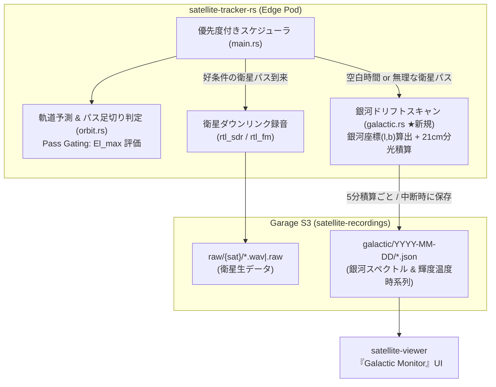
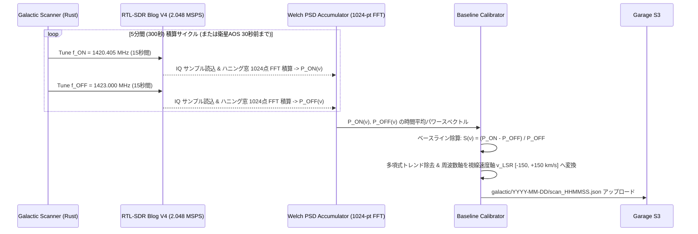
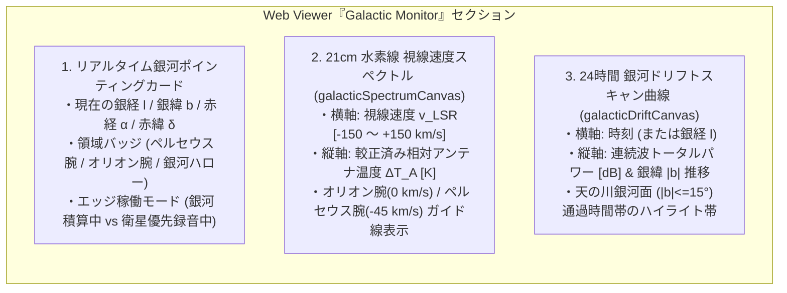

# 24時間ハイブリッド宇宙観測所：衛星スマート足切り（Pass Gating）× 天の川銀河ドリフトスキャン（21cm HI & 連続波）設計書

- **作成日**: 2026-10-28
- **ステータス**: 承認済（Approved）
- **対象コンポーネント**:
  - `apps/satellite-tracker-rs`（エッジ側：パス足切り判定・銀河ドリフトスキャン DSP・S3 アップロード）
  - `apps/satellite-viewer`（クラウド側：銀河座標計算・スペクトル & ドリフトカーブ可視化 UI）

---

## 1. 背景と目的

北向きベランダ（東京都、北緯 $35.6895^\circ$、東経 $139.6917^\circ$、標高 $30\text{ m}$）におけるこれまでの衛星ダウンリンク観測実績（[docs/qa/28_demodulation_track_record_and_pass_prediction_accuracy.md](../../qa/28_demodulation_track_record_and_pass_prediction_accuracy.md) および [docs/qa/31_balcony_aperture_window_and_antenna_geometry.md](../../qa/31_balcony_aperture_window_and_antenna_geometry.md)）により、以下の事実が定量的に明らかになった：

1. **好条件パスの希少性**:
   北向きスカイウィンドウ（方位角 $\text{Az } 250^\circ \sim 110^\circ$、仰角 $\text{El } 25^\circ \sim 60^\circ$）を通過し、実際に画像（METEOR LRPT）やテレメトリパケット（ISS APRS, FUNCUBE-1 BPSK）を復号できる好条件の衛星パスは、1日のうち合計 1〜2 時間程度である。
2. **低仰角・遮蔽パス（MARGINAL）の無駄**:
   最大仰角 $\text{El}_{\max} < 20^\circ$ の低仰角パスは建物や手すりによる遮蔽・回折損失が大きく、SDR を起動してもノイズ WAV しか生成されない。
3. **北天を通過する天の川銀河（Galactic Plane）との幾何学的一致**:
   天の川銀河の円盤面（銀緯 $b = 0^\circ$）は地球の自転軸に対して約 $62.87^\circ$ 傾いており、カシオペア座・ケフェウス座・はくちょう座・ペルセウス座を含む銀河面（銀経 $l \approx 75^\circ \sim 160^\circ$、ペルセウス腕およびオリオン腕）が、地球の自転（日周運動）に伴って毎日必ず北向きベランダの開口ウィンドウ正面を横切っていく。

本設計では、既存のハードウェア（137 MHz Vダイポールアンテナ + RTL-SDR Blog V4 1台 + GPD Pocket3）に物理的な変更を加えることなく、ソフトウェア制御のみによって**「復調見込みのない低仰角衛星パスをスキップし、1日約22時間の空白時間をすべて天の川銀河のドリフトスキャン観測（21cm 中性水素線分光および銀河背景放射測定）へ自動配分する 24時間ハイブリッド宇宙観測所」**を構築する。

---

## 2. セクション 1：全体アーキテクチャと「衛星 vs 銀河」スマート・プリエンプション制御（承認済）

### 2.1 コンポーネント構成と排他制御
USB バス上の RTL-SDR Blog V4 は単一デバイスであるため、複数プロセス・コンテナからの競合アクセス（`usb_claim_interface error`）を防ぐため、エッジ側の `satellite-tracker-rs` 単一プロセス内のメインループで「衛星ダウンリンク録音モード」と「銀河ドリフトスキャンモード」を排他制御する。



### 2.2 「無理な衛星パス」のスマート足切り基準（Pass Gating）
`orbit.rs` において、衛星が視界（$\text{El} \ge 10^\circ$）に進入した際、または次回パス探索時に、そのパスの最大仰角 $\text{El}_{\max}$ が以下の閾値（Qualifying Threshold）を満たすかを判定する：

| 対象衛星カテゴリ | 衛星録音へ切り替える条件（Qualifying Pass） | 環境変数（デフォルト値） | 足切り（スキップ）時の動作 |
| :--- | :--- | :--- | :--- |
| **気象画像衛星**<br/>(`METEOR-M2 3`, `METEOR-M2 4`) | パス最大仰角 $\text{El}_{\max} \ge 25.0^\circ$<br/>（スカイウィンドウに入る `GOOD` / `EXCELLENT`） | `MIN_MAX_EL_METEOR_DEG` (`25.0`) | $\text{El}_{\max} < 25.0^\circ$ のパスはスキップし、**銀河観測を継続** |
| **狭帯域パケット・CW 衛星**<br/>(`ISS`, `FUNCUBE-1` 等) | パス最大仰角 $\text{El}_{\max} \ge 20.0^\circ$<br/>（ベランダ視野内の `FAIR` 以上） | `MIN_MAX_EL_DEFAULT_DEG` (`20.0`) | $\text{El}_{\max} < 20.0^\circ$（`MARGINAL`）はスキップし、**銀河観測を継続** |

### 2.3 プリエンプション（優先割り込み）のステートマシン
地球の自転角速度は $\omega_\oplus \approx 15^\circ/\text{h} = 0.25^\circ/\text{min}$ であり、5 分間（300 秒）での天球の移動角は $1.25^\circ$ に過ぎず、アンテナビーム幅に対して十分に小さい。したがって、銀河ドリフトスキャンは **1 サイクル＝300 秒（5 分）** を基本積分ウィンドウとする。

1. **通常時（アイドル時）**:
   - 次回の「好条件な衛星パス（Qualifying Pass）」の AOS まで **60 秒以上** 空いている場合、`Galactic Scan` サイクルを実行する。
   - 300 秒の積算が完了するごとに、観測時刻・天球座標 $(\text{Az}, \text{El}, \alpha, \delta, l, b)$・LSR 視線速度補正値・周波数スイッチング較正済みパワースペクトルを JSON として S3（`galactic/YYYY-MM-DD/scan_HHMMSS.json`）へアップロードする。
2. **好条件な衛星パスの接近時（AOS 30 秒前）**:
   - 進行中の銀河スキャンを即座に中断（Early Flush）する。その時点で 60 秒以上の有効積算データがあれば S3 へ保存し、SDR を解放してスタンバイ状態に移行する。
   - AOS 到来と同時に衛星ダウンリンク録音を開始する。
3. **衛星通過終了時（LOS 後）**:
   - 衛星録音ファイルの S3 アップロードが完了し次第、再び自動で `Galactic Scan` モードへ復帰する。

---

## 3. セクション 2：天球・銀河座標変換と 21cm 周波数スイッチング DSP パイプライン

### 3.1 地平座標 $(\text{Az}, \text{El})$ から赤道座標 $(\alpha, \delta)$・銀河座標 $(l, b)$ への変換

北向きベランダに固定設置されたアンテナの主ビーム中心方向を、代表値として **方位角 $\text{Az} = 0.0^\circ$（真北）、仰角 $\text{El} = 40.0^\circ$**（環境変数 `BEAM_AZ_DEG`, `BEAM_EL_DEG` で設定可能）と定義する。

#### (1) 地平座標 $(\text{Az}, \text{El})$ から赤道座標 $(\alpha, \delta)$ への球面三角法変換
観測地の緯度を $\phi$、経度を $\lambda_{\text{lon}}$、現在時刻のグリニッジ恒星時を $\text{GMST}$ とすると、地方恒星時 $\text{LST}$（ラジアン）は $\text{LST} = \text{GMST} + \lambda_{\text{lon}}$ で与えられる。このとき、赤緯 $\delta$ と時角 $H$、赤経 $\alpha$ は以下の球面三角法の公式で求まる：

$$\sin \delta = \sin \text{El} \sin \phi + \cos \text{El} \cos \phi \cos \text{Az}$$

$$\tan H = \frac{-\sin \text{Az} \cos \text{El}}{\cos \phi \sin \text{El} - \sin \phi \cos \text{El} \cos \text{Az}}, \quad \alpha = \text{LST} - H$$

| 記号 | 物理的・幾何学的意味 | 単位 / 代表値 |
| :--- | :--- | :--- |
| $\text{Az}, \text{El}$ | アンテナビーム中心の方位角（北 $=0^\circ$、東 $=90^\circ$）および仰角 | $\text{rad}$（代表値: $\text{Az}=0^\circ, \text{El}=40^\circ$） |
| $\phi, \lambda_{\text{lon}}$ | 観測地の測地緯度・経度 | $\text{rad}$（東京: $\phi=35.6895^\circ, \lambda_{\text{lon}}=139.6917^\circ$） |
| $\text{LST}$ | 地方恒星時（Local Sidereal Time：天球の春分点が南中してからの角度） | $\text{rad}$（$0 \sim 2\pi$） |
| $H$ | 時角（Hour Angle：対象天体が子午線からどれだけ西へ回ったか） | $\text{rad}$ |
| $\alpha, \delta$ | 赤道座標系の赤経（Right Ascension）および赤緯（Declination） | $\text{rad}$ または度（$\text{deg}$） |

##### 日本語での読み解き
- アンテナを真北（$\text{Az} = 0^\circ \implies \cos\text{Az} = 1, \sin\text{Az} = 0$）かつ仰角 $\text{El} = 40^\circ$ に固定している場合、第1式は加法定理 $\sin(\text{El} + \phi)$ の形（または天の北極を介した和）となり、常時 **赤緯 $\delta \approx 90^\circ - (\text{El} - \phi)$ または $\delta \approx \phi + \text{El} = 35.7^\circ + 40.0^\circ = 75.7^\circ$（北極星の上側）〜 $\text{El}$ に応じた北天の帯（$\delta \approx +50^\circ \sim +75^\circ$）** を見つめることになる。
- 一方、赤経 $\alpha$ は地方恒星時 $\text{LST}$ の進行に伴って 24 時間で $0^\circ \to 360^\circ$ まで一様に回転する。これがドリフトスキャンの原理である。

#### (2) 赤道座標 $(\alpha, \delta)$ から銀河座標 $(l, b)$ への変換（IAU J2000.0 定義）
国際天文学連合（IAU）の J2000.0 元期における銀河北極（NGP）の赤道座標 $(\alpha_{\text{NGP}}, \delta_{\text{NGP}})$ と銀河中心方向の昇交点位置角 $l_{\text{NCP}}$ を用いて、銀緯 $b$ と銀経 $l$ を算出する（一次情報: [ESA Hipparcos Documentation Vol.1 Section 1.5](https://www.cosmos.esa.int/documents/532822/552851/vol1_all.pdf)）：

$$\sin b = \sin \delta \sin \delta_{\text{NGP}} + \cos \delta \cos \delta_{\text{NGP}} \cos(\alpha - \alpha_{\text{NGP}})$$

$$\tan(l_{\text{NCP}} - l) = \frac{\cos \delta \sin(\alpha - \alpha_{\text{NGP}})}{\sin \delta \cos \delta_{\text{NGP}} - \cos \delta \sin \delta_{\text{NGP}} \cos(\alpha - \alpha_{\text{NGP}})}$$

| 定数・記号 | 物理的意味 | 数値・単位（J2000.0） |
| :--- | :--- | :--- |
| $\alpha_{\text{NGP}}$ | 銀河北極（かみのけ座方向）の赤経 | $192.85948^\circ$（$12^{\text{h}} 51^{\text{m}} 26.28^{\text{s}}$） |
| $\delta_{\text{NGP}}$ | 銀河北極の赤緯 | $+27.12825^\circ$ |
| $l_{\text{NCP}}$ | 天の北極（NCP）における銀経 | $122.93192^\circ$ |
| $l$ | 銀経（Galactic Longitude：いて座銀河中心を $0^\circ$ とする角度） | $0^\circ \sim 360^\circ$ |
| $b$ | 銀緯（Galactic Latitude：天の川銀河円盤面を $0^\circ$ とする角度） | $-90^\circ \sim +90^\circ$ |

##### 展開ステップ・直感イメージ
- 銀緯 $|b| \le 15^\circ$ のとき、アンテナビームは**天の川銀河の円盤（水素ガスが濃密に詰まった渦状腕：カシオペア座・ケフェウス座・ペルセウス座・はくちょう座）**を直撃している（**Warm Sky / Galactic Plane**）。
- 銀緯 $|b| > 30^\circ$ のとき、アンテナビームは銀河円盤から外れ、水素ガスが希薄な**銀河ハロー（おおぐま座・りゅう座等の深宇宙：Cold Sky）**を向いている。

---

### 3.2 局所静止座標系（LSR）への視線速度ドップラー補正

観測された周波数 $\nu$ から水素ガスの視線速度 $v_{\text{obs}}$ を求め、さらに太陽系および地球の運動によるドップラーシフト $\Delta v_{\text{LSR}}$ を補正して、銀河系内の純粋なガス運動速度 $v_{\text{LSR}}$ を算出する：

$$v_{\text{obs}} = - c \cdot \frac{\nu - \nu_0}{\nu_0}, \quad v_{\text{LSR}} = v_{\text{obs}} + \Delta v_{\text{helio}} + \Delta v_{\text{solar}}$$

$$\Delta v_{\text{solar}} = \mathbf{V}_{\odot} \cdot \hat{\mathbf{u}}(l, b) = U_\odot \cos l \cos b + V_\odot \sin l \cos b + W_\odot \sin b$$

| 記号 | 物理的意味 | 代表値・単位 |
| :--- | :--- | :--- |
| $\nu_0$ | 中性水素超微細構造遷移の静止周波数 | $1420.405751768\text{ MHz}$ |
| $c$ | 真空中の光速 | $299,792.458\text{ km/s}$ |
| $\Delta v_{\text{helio}}$ | 地球の公転（約 $30\text{ km/s}$）および自転（約 $0.4\text{ km/s}$）の視線方向成分 | $\text{km/s}$ |
| $\Delta v_{\text{solar}}$ | 太陽系の特異運動（ヘルクレス座方向へ約 $20\text{ km/s}$）の視線方向成分 | $\text{km/s}$ |
| $(U_\odot, V_\odot, W_\odot)$ | 銀河座標系における太陽運動ベクトル（標準太陽運動または Schönrich+ 2010） | $(10.0, 15.4, 7.8)\text{ km/s}$ 等 |

##### 日本語での読み解き
- $1420.405\text{ MHz}$ において、周波数 $4.738\text{ kHz}$ のズレが視線速度 $1.0\text{ km/s}$ に相当する。
- 北の空のカシオペア座方向（銀経 $l \approx 120^\circ, b \approx 0^\circ$）では、銀河の差動回転によって遠方のペルセウス腕のガスが太陽系に対して近づく方向（視線速度 $v_{\text{LSR}} \approx -40 \sim -60\text{ km/s}$、周波数で約 $+200 \sim +280\text{ kHz}$ の青方偏移）にシフトして観測される。

---

### 3.3 21cm 周波数スイッチング（Frequency Switching）DSP パイプライン

RTL-SDR Blog V4 の内部フィルタ特性（ベースバンドの山型うねり）およびゲイン変動を打ち消すため、1 サイクル（300 秒）の中で中心周波数を高速に切り替える **周波数スイッチング分光法** を実装する。



#### DSP パラメータ設計
- **サンプリングレート**: $f_s = 2.048\text{ MSPS}$（$1\text{ ビンあたりの分解能 } \Delta f = 2048\text{ kHz} / 1024 = 2.0\text{ kHz} \approx 0.42\text{ km/s}$ の高速度分解能）
- **スイッチング周期**: $T_{\text{sw}} = 15\text{ 秒}$（ON 15秒 $\leftrightarrow$ OFF 15秒 を 10 セット＝計 300 秒）
- **相対アンテナ温度（Line-to-Continuum Ratio）と全電力（Total Power）の同時記録**:
  1. **分光プロファイル**: $S_{\text{line}}(v_{\text{LSR}}) = \frac{P_{\text{ON}}(v_{\text{LSR}}) - P_{\text{OFF}}}{P_{\text{OFF}}}$ により、SDR の通過帯域特性（IF フィルタ形状）を完全に除去した水素輝線スペクトルを得る。
  2. **広帯域連続波（Continuum Power）**: 同時に帯域全体の平均受信電力 $P_{\text{total}}$（dB）を記録し、24 時間の日周運動に伴う天の川通過時の総電力ドリフトカーブ（ドリフトスキャン曲線）を生成する。


---

## 4. セクション 3：Garage S3 データ構造と Web Viewer『Galactic Monitor』UI・テスト設計

### 4.1 Garage S3 ストレージ構造と JSON スキーマ
既存の `satellite-recordings` バケット内に、衛星録音用の `raw/`・`results/` とは完全に独立した **`galactic/` プレフィックス** を新設する。
※ `satellite-viewer` の未解析 WAV ポーリング（Temporal ワークフロー起動トリガー）は `raw/` 配下のみを走査するため、`galactic/` への保存が衛星解析 KEDA ワーカーを誤起動させることはない。

#### オブジェクトキー命名規則
`galactic/YYYY-MM-DD/scan_HHMMSS.json`（UTC 日時基準、1ファイルあたり約 3〜5 KB）

#### JSON ペイロード仕様
```json
{
  "timestamp_utc": "2026-10-28T09:05:00Z",
  "integration_sec": 300.0,
  "preempted": false,
  "pointing": {
    "az_deg": 0.0,
    "el_deg": 40.0,
    "lst_deg": 18.42,
    "ra_deg": 18.42,
    "dec_deg": 75.69,
    "gal_l_deg": 123.51,
    "gal_b_deg": 12.84,
    "region_label": "カシオペア座・ケフェウス座領域（ペルセウス腕）",
    "sky_type": "WARM_GALACTIC_PLANE"
  },
  "lsr_correction_km_s": -8.35,
  "rf_metrics": {
    "center_freq_on_hz": 1420405752.0,
    "center_freq_off_hz": 1423000000.0,
    "continuum_power_db": -38.42,
    "peak_line_snr_db": 2.15,
    "peak_v_lsr_km_s": -46.8
  },
  "spectrum": {
    "v_lsr_km_s": [-150.0, -148.0, "...", 0.0, "...", 150.0],
    "relative_temp_k": [0.02, -0.05, "...", 1.85, "...", 0.01]
  }
}
```

---

### 4.2 Web Viewer『Galactic Monitor（天の川銀河観測モニター）』UI 設計

`apps/satellite-viewer` に、天の川銀河のドリフトスキャン状況と 21cm 分光スペクトルをリアルタイム可視化する **『Galactic Monitor』セクション** および API エンドポイント（`GET /api/galactic-observations`）を追加する。



#### フロントエンド & パフォーマンス規約の遵守（`GEMINI.md` 準拠）
1. **S3 並列取得 & バックグラウンドプリウォーム**:
   - `server.py` にて直近 24 時間分の `galactic/YYYY-MM-DD/scan_*.json` を取得する際、直列ループを避け `ThreadPoolExecutor(max_workers=16)` で並列フェッチし、メモリキャッシュおよび起動時プリウォームスレッドに組み込む。
2. **HTTP Gzip 圧縮**:
   - `/api/galactic-observations` のレスポンス（1KB 超）は既存の Gzip 圧縮機構（level=6）により自動圧縮配信する。
3. **JavaScript グローバル名前空間の衝突防止**:
   - 単一 HTML テンプレート（`templates/index.html`）内で既存の `orbit*`, `replay*`, `cal*` 等と変数・関数・DOM ID が一切衝突しないよう、すべてに **`galactic*` プレフィックス**（`galacticState`, `galacticFetchData()`, `galacticRenderSpectrum()`, `galacticSpectrumCanvas`, `galacticDriftCanvas` 等）を付与する。

---

### 4.3 エラーハンドリングとフォールバック設計

1. **SDR デバイス競合の完全防止**:
   - 衛星 AOS によるプリエンプション発生時、銀河スキャンが外部プロセスまたは内部 SDR ハンドルを使用している場合は確実に停止・ドロップ完了（`wait().await`）を待ってから衛星録音を開始する。
2. **S3 通信障害時の耐障害性**:
   - 銀河スキャン JSON のアップロード失敗時は警告ログを出力してローカル一時ファイルをクリーンアップし、エッジのメインループ（特に次回の衛星パス監視）を決してブロックしない。
3. **スキャンデータ未蓄積時の Viewer 表示**:
   - デプロイ直後などで S3 の `galactic/` にまだスキャン JSON が 0 件の場合でも、Viewer 側の Python 天球計算エンジンが現在時刻のリアルタイム銀河座標 $(l, b)$・領域名・理論上の 24 時間銀河通過予測曲線（銀緯 $|b|$ の日周推移カーブ）を即座に計算して描画する（「データ待ち」で画面が真っ白にならない設計）。

---

### 4.4 テスト・検証計画

1. **Rust エッジ単体・統合テスト（`apps/satellite-tracker-rs/tests/`）**:
   - `galactic_test.rs`:
     - 地平座標 $(\text{Az}, \text{El}) \to$ 赤道座標 $(\alpha, \delta) \to$ 銀河座標 $(l, b)$ の変換精度テスト（J2000.0 基準の既知座標との誤差 $< 0.1^\circ$ を検証）。
     - LSR 視線速度補正値 $\Delta v_{\text{LSR}}$ の計算検証。
     - 周波数スイッチング $(P_{\text{ON}} - P_{\text{OFF}}) / P_{\text{OFF}}$ による模擬バンドパス歪みキャンセルと、合成ガウシアン輝線のピーク速度検出テスト。
   - `orbit_test.rs`:
     - Pass Gating 判定（METEOR $\ge 25.0^\circ$, ISS/FUNCUBE $\ge 20.0^\circ$）により、低仰角パスが正しくスキップ（`is_qualifying_pass == false`）されることの検証。
2. **Python Viewer 単体・回帰テスト（`apps/satellite-viewer/tests/`）**:
   - `/api/galactic-observations` のレスポンス構造、リアルタイム銀河座標算出、S3 並列フェッチのテスト。
   - `node -c` による HTML テンプレート内 JavaScript の構文解析テスト（`galactic*` 関数群の重複・構文エラーゼロ検証）。
