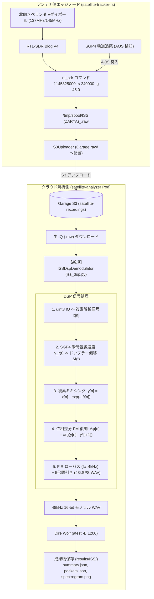

# ISS 生 IQ 録音とクラウド側 DSP ドップラー相殺復調パイプライン設計

## 1. 概要と背景

### 1.1 背景
北向きベランダ電波観測所において、国際宇宙ステーション（ISS: $145.825\ \text{MHz}$）の観測実績において過去の結合テスト用モックデータ（40件）が残存していたため、見かけ上の復調率（78%〜87%）が過大評価されていました。このモックデータを退避・パージした結果、現在の純粋な実機観測実績は 0%（直近 25 パスすべてパケット未検出）であることが判明しました。

ISS の APRS（1200bps AFSK / AX.25）が未検出となっている電波工学的要因として、以下の 3 点があります：
1. **軌道通過に伴うドップラー周波数偏移（Doppler Shift）**: 低軌道（高度約 400km、速度約 $7.66\ \text{km/s}$）を周回する ISS からの電波は、通過中に最大 $\pm 3.5\ \text{kHz}$（合計約 $7\ \text{kHz}$）の周波数ドリフトを起こします。
2. **固定周波数 FM 復調の限界**: 従来はエッジノードで `rtl_fm -f 145825000` を固定周波数で実行していたため、AOS 直後や LOS 直前の周波数ズレが IF 帯域端に押し出され、復調後の音声に大きな DC オフセットや波形歪みが生じていました。
3. **エッジとクラウドの責務の不統一**: 気象衛星（Meteor-M2）や CubeSat（FUNcube-1）はエッジ側で生 IQ（`rtl_sdr -s 240000`）を記録し、クラウド側で SatDump や gr-satellites により高精度にソフトウェア復調しているのに対し、ISS のみエッジ完結で `rtl_fm` を回す非対称な構成になっていました。

### 1.2 目的
ISS の受信パイプラインを Meteor や FUNcube と同様の **「案 B（生 IQ 録音 ＋ クラウド側 DSP 完全ドップラー相殺）」** に統一します。
エッジ側は `rtl_sdr` による 240kSPS 生 IQ（`.raw`）の記録に単純化し、クラウド側（`satellite-analyzer`）で SGP4 軌道計算に基づく瞬時ドップラー周波数偏移の複素ミキシング相殺と位相差分 FM 復調を行い、Dire Wolf（`atest -B 1200`）による高精度なパケット復号を実現します。

---

## 2. システムアーキテクチャ



---

## 3. DSP 復調アルゴリズムの数理と設計

### 3.1 複素解析信号化（IQ 復元）
RTL-SDR の出力形式は、同相成分（$I$）と直交位相成分（$Q$）が 8 ビット符号なし整数（`uint8`: $0 \sim 255$、中心 $127.5$）として交互に並ぶバイト列です。

$$x[n] = \frac{I[n] - 127.5}{128.0} + j \frac{Q[n] - 127.5}{128.0}$$

サンプリング周波数 $f_s = 240\ \text{kSPS}$ において、帯域幅 $240\ \text{kHz}$ の複素ベースバンド信号 $x[n]$ を復元します。

### 3.2 軌道ドップラー周波数偏移の算出

#### ① 記号一覧
| 記号 | 物理的・工学的意味 | 単位 / 代表値 |
| :--- | :--- | :--- |
| $f_0$ | ISS APRS 公称送信周波数 | $145.825\ \text{MHz}$ |
| $v_r(t)$ | 地上局から見た衛星の相対視線速度（Radial Velocity） | $\pm 7.0\ \text{km/s}$（接近: 負 / 離脱: 正） |
| $c$ | 光速 | $2.99792458 \times 10^8\ \text{m/s}$ |
| $\Delta f(t)$ | 瞬時ドップラー周波数偏移 | 最大約 $\mp 3.4\ \text{kHz}$ |
| $\theta[n]$ | 離散時間サンプル $n$ における累積回転位相 | $\text{rad}$ |

#### ② 日本語での読み解き
「衛星が地上局に接近する際は電波の波面が圧縮されて周波数が高く観測され、遠ざかる際は波面が引き伸ばされて低く観測されます。地上局座標と TLE 軌道要素から各時刻の視線速度 $v_r(t)$ を算出し、真の周波数ズレ量 $\Delta f(t)$ を決定します」

#### ③ 展開ステップと直感イメージ
ドップラー偏移の基本方程式は：
$$\Delta f(t) = -f_0 \frac{v_r(t)}{c}$$
$v_r = -7000\ \text{m/s}$（接近時）のとき：
$$\Delta f = -145.825 \times 10^6 \times \frac{-7000}{2.99792458 \times 10^8} \approx +3405\ \text{Hz}$$

離散時間サンプル $n$（サンプリング周期 $T_s = 1/f_s$）における累積回転位相 $\theta[n]$ は以下のように積分されます：
$$\theta[n] = \theta[n-1] + 2\pi \frac{\Delta f(t_n)}{f_s}$$
※ 計算量を抑えるため、SGP4 視線速度計算は $1\ \text{秒}$ ごとに行い、サンプル点間は線形補間（`numpy.interp`）します。

### 3.3 複素ミキシングによるドップラー相殺
算出された逆位相回転ベクトル $e^{-j \theta[n]}$ を各複素サンプル $x[n]$ に乗算します：

$$y[n] = x[n] \cdot e^{-j \theta[n]} = x[n] \left( \cos\theta[n] - j \sin\theta[n] \right)$$

これにより、通過中に $7\ \text{kHz}$ にわたって変化していた搬送波周波数が、ベースバンド上で常に完全に $0\ \text{Hz}$（DC 中心）に静止・ロックされます。

### 3.4 位相差分 FM 復調（Polar Discriminator）

#### ① 記号一覧
| 記号 | 物理的・工学的意味 | 単位 |
| :--- | :--- | :--- |
| $y[n]$ | ドップラー相殺済みの複素サンプル（$A[n] e^{j \phi[n]}$） | 複素数 |
| $P[n]$ | 連続する 2 サンプルの複素共役積 | 複素数 |
| $\Delta \phi[n]$ | サンプル間位相差分（瞬時角周波数に比例） | $\text{rad}$ |
| $m[n]$ | 復調された 1200bps AFSK 音声波形 | 実数 |

#### ② 日本語での読み解き
「FM（周波数変調）は信号の角周波数（位相の回転速度）に情報を乗せる方式です。1サンプル前の複素ベクトルとの複素共役積をとって偏角を計算すれば、受信電波の振幅変動（フェージング等）に左右されず、純粋な周波数変調波形（AFSK 音声）が取り出せます」

#### ③ 展開ステップと直感イメージ
隣接サンプルの複素共役積 $P[n]$ は：
$$P[n] = y[n] \cdot y^*[n-1] = \left( A[n] e^{j \phi[n]} \right) \cdot \left( A[n-1] e^{-j \phi[n-1]} \right) = A[n] A[n-1] e^{j (\phi[n] - \phi[n-1])}$$

この偏角（Argument）を $\text{atan2}$ 関数で求めます：
$$\Delta \phi[n] = \arg(P[n]) = \text{atan2}\left( \text{Im}(P[n]),\ \text{Re}(P[n]) \right)$$

瞬時角周波数偏位 $\omega[n] = \Delta \phi[n] / T_s$ であり、$\Delta \phi[n]$ は Bell 202 の AFSK トーン（Mark $1200\ \text{Hz}$ / Space $2200\ \text{Hz}$）のオーディオ波形そのものとなります。

### 3.5 フィルタリングとデシメーション（48kSPS WAV 化）
1. **FIR ローパスフィルタ**:
   音声帯域外の広帯域高周波雑音（ディスクリミネータノイズ）を除去するため、カットオフ周波数 $f_c = 4.0\ \text{kHz}$ のローパスフィルタを適用します。
2. **デシメーション（1/5 間引き）**:
   $240\ \text{kSPS} \rightarrow 48\ \text{kSPS}$ へリサンプリング（`scipy.signal.resample_poly(..., up=1, down=5)`）。
3. **16-bit PCM WAV 出力**:
   最大振幅を基準に正規化し、ヘッダ付き 16-bit リニア PCM WAV ファイルとしてディスクに書き出します。

---

## 4. コンポーネント別変更仕様

### 4.1 `satellite-tracker-rs` (Rust)
- **対象**: `apps/satellite-tracker-rs/src/receiver.rs`
- **変更内容**:
  `is_raw_iq_target` 関数において、対象衛星名に `"ISS"` を追加：
  ```rust
  pub fn is_raw_iq_target(sat_name: &str) -> bool {
      let name_upper = sat_name.to_uppercase();
      name_upper.contains("METEOR")
          || name_upper.contains("FUNCUBE")
          || name_upper.contains("AO-73")
          || name_upper.contains("ISS")
  }
  ```
- **効果**: ISS 通過時も自動的に `rtl_sdr -f 145825000 -s 240000 -g 45.0` が起動し、生 IQ（`ISS (ZARYA)_<timestamp>.raw`）が Garage S3 の `raw/` へ配置されます。

### 4.2 `satellite-analyzer` (Python)
- **新規モジュール**: `apps/satellite-analyzer/src/iss_dsp.py`
  - `ISSDspDemodulator` クラス:
    - `demodulate_raw_iq(raw_path: str, pass_start_utc: datetime, tle_lines: Optional[Tuple[str, str]] = None, sample_rate: int = 240000) -> str`
    - SGP4 視線速度計算、複素ミキシング、位相差分復調、48kHz WAV 保存。
    - TLE が指定されていない場合はドップラー補正なし（中心固定）で安全にフォールバック。
- **ワークフロー統合**: `apps/satellite-analyzer/src/activities.py`
  - `decode_packets_activity` および `analyze_satellite_pass_activity`:
    - `category == "amateur_packet"` の際、入力ファイル拡張子が `.raw` または `.u8` の場合：
      1. `ISSDspDemodulator` を呼び出して 48kHz WAV を生成。
      2. 生成された WAV を `APRSDecoder.decode_wav` に渡してパケット抽出。
      3. 生成された WAV から `SpectrogramGenerator` でスペクトログラムを生成。
    - 入力ファイルが `.wav` の場合は後方互換性のため直接 `APRSDecoder.decode_wav` を実行。

---

## 5. エラーハンドリングと境界条件

1. **データ破損・空ファイル**:
   - 入力 `.raw` ファイルが 100KB 未満の場合はデコードをスキップし、`packets_count = 0` を返却。
2. **TLE 取得失敗 / 時刻パースエラー**:
   - パス ID から時刻が特定できない場合や TLE が不在の場合は、ドップラー補正項をゼロ（$e^{-j \cdot 0} = 1$）として標準 FM 復調にフォールバック。
3. **メモリ使用量とパフォーマンス**:
   - 5 分間のパスで約 $144\ \text{MB}$ の生データ。NumPy の 64bit float 複素数化で約 $1.1\ \text{GB}$ のメモリを消費しますが、処理時間は数秒以内で完了。

---

## 6. テスト戦略（TDD）

### 6.1 `apps/satellite-tracker-rs`
- `tests/receiver_test.rs`:
  - `is_raw_iq_target("ISS (ZARYA)")` が `true` を返すことを検証。

### 6.2 `apps/satellite-analyzer`
- `tests/test_iss_dsp.py`:
  1. **ドップラー補正精度テスト**:
     - 人工的なドップラー周波数シフト（$+3000\ \text{Hz} \rightarrow -3000\ \text{Hz}$）を与えた $1200\ \text{Hz}$ / $2200\ \text{Hz}$ の合成 IQ 信号（240kSPS）を生成。
     - `ISSDspDemodulator` で処理した後の WAV を FFT 解析し、トーン周波数が正確に $1200\ \text{Hz}$ / $2200\ \text{Hz}$ に静止していることを検証。
  2. **パケット復号 E2E テスト**:
     - 既知の AX.25 パケット波形から合成したドップラー変調 IQ 信号を入力し、`APRSDecoder` 経由でパケットが正しく復号できることを検証。

---

## 7. 一次情報リンク
- [Dire Wolf - Automated Packet Reporting System (APRS)](https://github.com/wb2osz/direwolf)
- [AX.25 Link Access Protocol for Amateur Packet Radio](https://www.tapr.org/pdf/AX25_2.2.pdf)
- [SGP4 Python Library](https://pypi.org/project/sgp4/)
- [SciPy Signal Processing (scipy.signal)](https://docs.scipy.org/doc/scipy/reference/signal.html)
- [ARISS: Amateur Radio on the International Space Station](https://www.ariss.org/)
