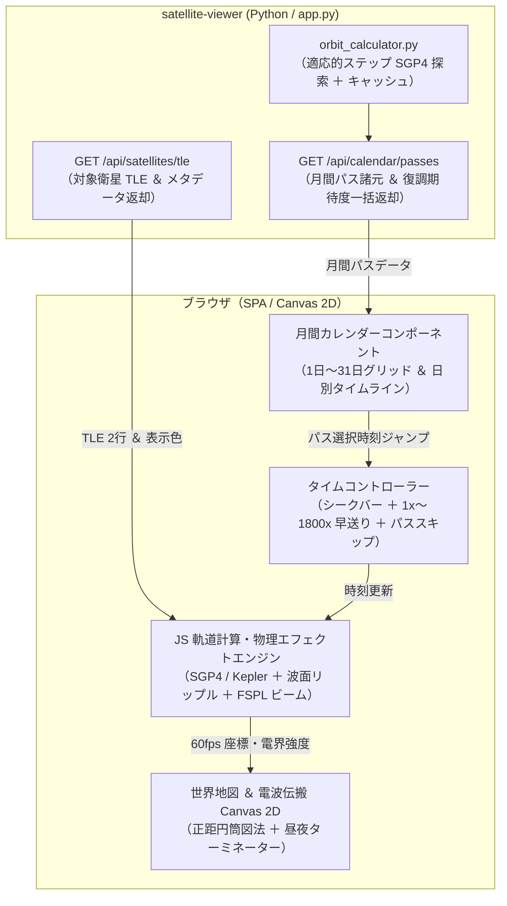

# 月間軌道予測カレンダーと複数衛星・電波伝搬アニメーション設計書

本ドキュメントは、`satellite-viewer` において向こう 1 ヶ月（当月）の衛星通過予測を俯瞰できる「月間カレンダー」と、宇宙を周回する複数衛星からアンテナへ電波が届く物理現象を体験できる「世界地図＆電波伝搬アニメーション」を統合するためのシステム設計書である。

---

## 1. 背景と解決する課題

### 1.1 背景
東京都の北向きベランダ（見通し方位 $270^\circ \sim 90^\circ$）において、低軌道衛星（Meteor-M, ISS, CubeSat 等）の受信機会は、地球の自転と太陽同期準回帰軌道のビートにより、日ごとに開口ウィンドウ（可視通過時間）や最大仰角が変動する。「今日はなぜ開口ウィンドウが小さいのか」「今月のどの日に天頂を突くゴールデンパスが巡ってくるのか」を中長期で把握したいという要望がある。

### 1.2 課題
1. **中長期（月間）の可視性欠如**: 現在の `/api/future-passes` は向こう 24 時間に限定されており、数日〜数週間先の観測計画を立てにくい。
2. **電波の不可視性**: 宇宙空間から放たれた電波が空間を伝搬し、ベランダのアンテナに捉えられる物理現象は人間の目には見えない。電磁気学的・幾何学的な受信プロセスを直感的に視覚化・体感できるインターフェースが存在しなかった。

---

## 2. システムアーキテクチャ



---

## 3. バックエンド設計

### 3.1 API 仕様

#### (1) `GET /api/calendar/passes?year=YYYY&month=MM`
* **機能**: 指定年月の全日数（1日〜31日）にわたる対象衛星のパス諸元、最大仰角、スカイウィンドウ滞在時間、および復調期待度を返却。
* **クエリパラメータ**:
  * `year`（省略時: 現在年）
  * `month`（省略時: 現在月）
* **レスポンス形式**:
  ```json
  {
    "year": 2026,
    "month": 10,
    "satellites": [
      {"name": "METEOR-M2 3", "color": "#38bdf8", "freq_mhz": 137.9},
      {"name": "METEOR-M2 4", "color": "#06b6d4", "freq_mhz": 137.1},
      {"name": "ISS (ZARYA)", "color": "#f43f5e", "freq_mhz": 145.825},
      {"name": "FUNCUBE-1 (AO-73)", "color": "#eab308", "freq_mhz": 145.935}
    ],
    "days": {
      "2026-10-28": [
        {
          "satellite": "METEOR-M2 3",
          "aos_time": "2026-10-28T09:12:15Z",
          "tca_time": "2026-10-28T09:18:40Z",
          "los_time": "2026-10-28T09:25:05Z",
          "max_elevation": 72.4,
          "max_elevation_azimuth": 355.2,
          "window_duration_seconds": 380,
          "quality_score": "EXCELLENT (スカイウィンドウ直撃)",
          "success_probability": 0.88
        }
      ]
    }
  }
  ```

#### (2) `GET /api/satellites/tle`
* **機能**: アニメーション描画用の最新 TLE 2 行と各衛星の電波仕様（周波数、変調方式、カラーコード）を返却。

### 3.2 高速化アルゴリズム（適応的ステップ SGP4 探索）
30日分のパス計算（約 $720\text{ 時間}$）を愚直に $30\text{ 秒}$ 刻みで全探索すると、約 35 万回の SGP4 座標変換が発生しサーバー CPU を圧迫する。そのため、以下の適応的ステップ探索アルゴリズムを `orbit_calculator.py` に実装する：
1. **通常巡航フェーズ**: ステップ $\Delta t_{\text{coarse}} = 90\text{ 秒}$ で粗く探索。
2. **接近検知フェーズ**: 地平線（仰角 $> 5^\circ$）への突入を検知した場合、ステップを $\Delta t_{\text{fine}} = 15\text{ 秒}$ に切り替えて詳細な TCA（最大仰角）、開口窓滞在秒数、AOS/LOS を高精度測定。
3. **インメモリキャッシュ**: 計算結果は `(year, month)` をキーとしてメモリ上に 1 時間キャッシュする。

---

## 4. フロントエンド設計

### 4.1 月間カレンダーコンポーネント
* **月間 7 列グリッド（日〜土）**:
  * 各日マスに通過する衛星のカラーピル（水色、シアン、赤、黄）をコンパクトに表示。
  * **🌟 ゴールデンパス日ハイライト**: スカイウィンドウ直撃（EXCELLENT: 最大仰角 $\ge 35^\circ$ かつ窓滞在 $\ge 60\text{ 秒}$）を含むマスはエメラルドグリーン枠で強調表示。
  * **静かな日（小開口窓）の視認性**: 掠りパスのみの日は目立たない通常色で表示。
* **日別詳細タイムライン**:
  * 日付マスをクリックすると、その日に通過するパスの詳細カードを展開。
  * 「🎬 このパスを観測」ボタンをクリックすると、通過 2 分前の時刻にタイムコントローラーを自動セットし、アニメーションビューへ切り替えて自動再生。

### 4.2 世界地図 ＆ 電波伝搬 Canvas 2D
* **オフライン完結ベクター地図**:
  * 正距円筒図法（経度 $-180^\circ \sim +180^\circ$、緯度 $-90^\circ \sim +90^\circ$）で主要な大陸・日本列島の輪郭線をベクター描画。外部タイルサーバーや CDN へのリクエストは行わない。
* **昼夜ターミネーター（夜間グラデーション）**:
  * 太陽直下点（経度・赤緯）から夜側半球を計算し、半透明の暗青色で描画。
* **東京・北向きベランダの視野扇（Fan）**:
  * 東京（北緯 $35.69^\circ$、東経 $139.69^\circ$）に観測所マーカーを配置。
  * 北向きベランダの見通し方位角（$250^\circ \sim 110^\circ$）を薄いグリーンの扇形として展開。
* **電磁気学エフェクト（電波の視覚体験）**:
  1. **同心円波面リップル**: 各衛星の現在位置から、周波数に応じた周期で同心円の波面リングが湧き出し外側へ拡散。
  2. **スラントレンジ・リンクビーム**: 衛星が東京の電波地平線（フットプリント）内に入ると、衛星と東京を結ぶビーム線を描画。
     * スラントレンジ $d$ が大きい（低仰角）: 細い赤〜橙色（自由空間損失大）。
     * スラントレンジ $d$ が小さい（天頂高仰角）: 太いシアン〜白金色（強電界）。
  3. **ベランダ開口窓突入 ＆ 受信捕捉（LOCKED）**:
     * 方位角・仰角が開口窓条件を満たした瞬間、ビームがエメラルド色にスパークし、衛星から東京アンテナへ向けて光パルスが連続して吸い込まれるエフェクトを展開。
     * ステータス表示に `STATUS: LOCKED (開口窓内 / 強電界)` と表示。南側遮蔽時は破線赤で `BLOCKED (建物遮蔽)` と表示。

### 4.3 タイムコントローラー
* **時間シークバー**: 月間または日単位のスライダー。ドラッグ時に 60fps で世界地図上の衛星位置と電波ビームが即座に同期。
* **再生速度**: `LIVE (1x)`, `10x`, `60x (1分/秒)`, `300x (5分/秒)`, `1800x (30分/秒)`.
* **スキップ機能**: `⏮️ 前のパス`, `⏭️ 次のパス` へのワンクリックジャンプ。

---

## 5. 電磁気学・幾何学の数理モデル

### 5.1 自由空間伝搬損失（FSPL）とビーム強度関数

$$L_{\text{FS}}(d) = 20 \log_{10}(d) + 20 \log_{10}(f) + 20 \log_{10}\left(\frac{4\pi}{c}\right)$$

| 記号 | 物理的意味 | 代表値・単位 |
| :--- | :--- | :--- |
| $L_{\text{FS}}$ | 自由空間伝搬損失（Free Space Path Loss） | $\text{dB}$ |
| $d$ | 衛星と観測アンテナ間のスラントレンジ | $600 \sim 2500\text{ km}$ |
| $f$ | 電波周波数 | $137 \sim 146\text{ MHz}$ |
| $c$ | 真空中の光速 | $2.9979 \times 10^8\text{ m/s}$ |

#### 日本語での読み解き
電磁波の電力束密度は距離の2乗に反比例して減衰するため、スラントレンジ $d$ が最小（約 $600\text{ km}$）となる天頂付近では損失が最も小さく、地平線すれすれ（$2000\text{ km}$ 超）では損失が約 $10\text{ dB}$（電力比10倍）悪化する。

#### Canvas 描画へのマッピング
* ビームの太さ $W = \max\left(1.0, 5.0 \times \left(1.0 - \frac{d - 600}{2000}\right)\right)\ \text{[px]}$
* ビームの色相 $H$: 遠距離（$d \ge 2200\text{ km}$）の赤（$0^\circ$）から、至近距離（$d \le 700\text{ km}$）のシアン（$190^\circ$）へ線形補間。開口窓内ではエメラルドグリーン（$150^\circ$）で脈動。

### 5.2 太陽直下点と昼夜ターミネーター

太陽の赤緯 $\delta_\odot$ とグリニッジ時角 $\text{GHA}_\odot$ から、太陽直下点 $(\phi_\odot, \lambda_\odot)$ を算出：

$$\sin \delta_\odot \approx \sin(23.44^\circ) \sin\left(\frac{2\pi}{365.25} (d_{\text{year}} - 80)\right)$$
$$\lambda_\odot = -15^\circ \times (\text{UTC時} + \text{分}/60 - 12)$$

地球上の任意の点 $(\phi, \lambda)$ における太陽高度が $0^\circ$ となる境界線（大円）を夜側領域の塗りつぶし境界とする。

---

## 6. テスト計画と検証項目

1. **バックエンド単体テスト (`test_calendar_passes.py`)**:
   * 月間パス生成関数が 30 日分の全パスを 2 秒以内に計算完了すること（パフォーマンステスト）。
   * 各パスの最大仰角、スカイウィンドウ判定、品質スコアが正しく付与されていること。
   * インメモリキャッシュが正しく動作し、同一月の2回目のリクエストが 5ms 以内に完了すること。
2. **API 結合テスト (`test_viewer_calendar_api.py`)**:
   * `/api/calendar/passes` および `/api/satellites/tle` が HTTP 200 と正常な JSON スキーマを返却すること。
3. **フロントエンド描画検証**:
   * ブラウザコンソールに JavaScript エラーが出ないこと。
   * タイムスライダーのドラッグ時にカクつきなく Canvas が再描画されること。
   * ベランダ開口窓突入時に LOCKED エフェクトが正常にトリガーされること。

---

## 7. 変更対象ファイル一覧

| ファイルパス | 変更種別 | 内容 |
| :--- | :--- | :--- |
| `apps/satellite-viewer/orbit_calculator.py` | 変更 | 適応的ステップ探索による月間パス計算関数 `find_month_passes()` およびキャッシュ機能の追加 |
| `apps/satellite-viewer/app.py` | 変更 | `/api/calendar/passes`, `/api/satellites/tle` エンドポイント追加、HTML/CSS/JS へのカレンダーモーダル ＆ Canvas 電波アニメーション組み込み |
| `apps/satellite-viewer/test_calendar_passes.py` | 新規 | 月間パス予測エンジンおよびキャッシュの単体テスト |
